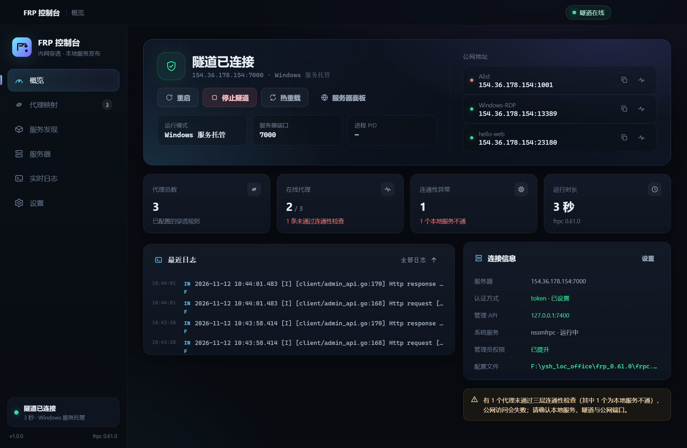
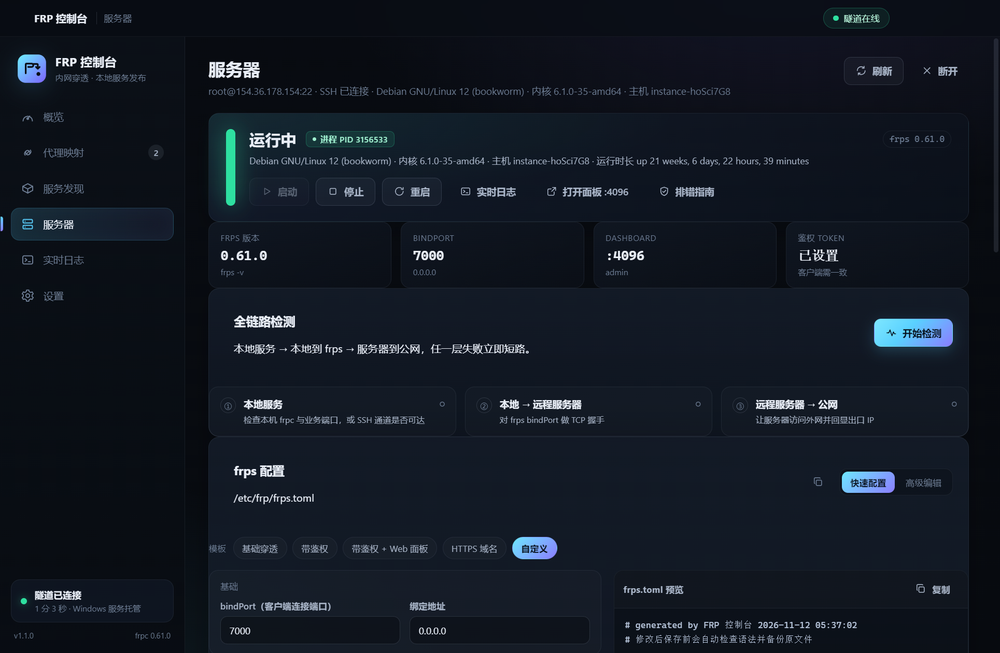

# FRP 控制台

一个用于管理 **frpc**（FRP 内网穿透客户端）的 Windows 桌面控制台。图形界面覆盖日常最常用的操作：代理管理、连接状态、Windows 服务控制、热重载、实时日志，以及把本机监听端口一键发布成公网代理。



## 功能

- **概览**：隧道连接状态、服务器信息、三条健康检查（frpc 进程 / 管理 API / 日志）、代理在线情况、最近日志。
- **代理映射**：新增、编辑、删除 TCP/UDP/HTTP/HTTPS/STCP 等代理；自动建议未被占用的公网端口；压缩、加密开关；一键测试公网端口是否可达。
- **服务发现**：扫描本机 TCP 监听端口，显示进程与监听地址；一键把某个端口发布成 frpc 代理。
- **服务器管理**：通过 SSH 连接 frps 服务器，识别 systemd / 进程 / Docker / 端口四种运行方式，展示版本、bindPort、Dashboard 与 Token 状态；支持启动、停止、重启、全链路检测、配置向导、结构化日志与排错指南。
- **实时日志**：跟随 frpc.log，按级别过滤、暂停、清空、导出。
- **设置**：修改服务器地址、端口、Token、日志级别；选择 frpc.exe / frpc.toml；Windows 服务启停与开机自启；管理 API 启用；托盘与启动行为。
- **热重载**：代理增删改直接写入 `frpc.toml` 并调用 frpc 的管理 API 重载，不中断其他代理。
- **单实例**：同一时间只允许一个控制台在跑；再开一份会自动退出，并把已有窗口提到前台。
- **外部修改保护**：检测到 `frpc.toml` 被其他程序修改时提示并自动重载；每次写入前自动备份，保留最近 30 份。

## 连通性判定

每个代理必须下面三层全部通过，才会显示为“在线”：

1. **本地服务**：`localIP:localPort` 端口可达；不通时直接报“本地服务不通”。
2. **隧道**：frpc 已连上 frps，且该代理已在服务端注册（状态 `running`），同时本机能连到 `serverAddr:serverPort`。
3. **公网**：从本机访问 `serverAddr:remotePort`（HTTP/HTTPS 代理则实际请求公网域名），确认服务端已对公网开放。

任一层失败即短路，后面的层不会再探测，悬停状态徽章可看到各层结果。检查每 14 秒刷新一次；保存配置、启动隧道或热重载后会立即重新检查。

概览页会按**失败的层级**提示（本地服务不通 / 隧道未建立 / 公网不可达分别计数）。如果 frpc 根本没连上 frps，则直接说清是哪个地址、什么原因（端口未监听 / 网络不可达 / Token 不对），并附上 frpc 的原始报错——此时本地服务通不通都不影响结论，先把隧道连上再说。

## frps 服务端控制台

「服务器」页通过 SSH（默认 22 端口）连接 frps 所在主机，把服务端从“看板”升级成可操作的闭环：连接 → 状态识别 → 配置向导 → 保存并重启 → 全链路检测 → 查看映射与日志。



1. **连接**：填写 IP、SSH 端口、用户名、密码。勾选「记住密码」后密码用 Windows DPAPI 加密保存在本机用户数据目录（便携版为 exe 同级的 `frp-console-data`），下次可留空直接连接。
2. **状态识别**：程序会同时检查 systemd 服务、`frps` 进程、Docker 容器和监听端口，避免“实际在跑却显示已停止”。状态灯分为运行中 / 已停止 / 异常，并显示来源（进程 PID、Docker 容器、systemd 或端口），版本优先从 PATH、进程可执行文件或 Docker 镜像识别。
3. **关键指标**：frps 版本、bindPort、Dashboard 端口/账号、Token 是否已设置；有 Dashboard 时提供「打开面板」。
4. **全链路检测**：按三层顺序执行，任一层失败立即短路并标红：
   - ① 本地服务：本机 frpc 已连接时逐个检查已配置代理的本地端口；未连接 frpc 时退化为 SSH 通道检查。
   - ② 本地 → 远程：从本机对 frps 的 `serverAddr:bindPort` 做 TCP 握手。
   - ③ 远程 → 公网：在服务器上执行 `curl ifconfig.me`（失败回退 `wget`），确认服务器能出网。
   - 三层全通显示「全链路通」，第一层失败直接显示「本地服务不通」。
5. **快速配置向导**（默认展开）：模板有 基础穿透 / 带鉴权 / 带鉴权 + Web 面板 / HTTPS 域名 / 自定义。表单覆盖 `bindPort`、`bindAddr`、`auth.token`、Dashboard（默认 4096）、`vhostHTTPPort` / `vhostHTTPSPort`、`allowPorts`，右侧实时生成 `frps.toml` 预览并可复制。
6. **保存与校验**：写入前在本机校验 TOML，再通过 SSH 写入临时文件；服务器存在 `frps` 时先执行 `frps verify`，通过后备份为 `frps.toml.bak-时间戳` 再覆盖。可选择「仅保存」或「保存并重启」。
7. **高级编辑**（折叠）：直接编辑完整 TOML，保留向导之外的字段（`log`、`transport` 等），同样执行语法校验、备份和重启。
8. **当前映射**：展示本机 frpc 已配置的代理、本地端口、公网地址和三层链路状态，并可跳转「代理映射」继续增删。
9. **结构化日志**：把 `journalctl -u frps`、`docker logs` 或 `frps.log` 解析成时间 / 级别 / 内容三列，汇总启动时间、客户端连接数和错误数；默认显示最近 10 行，可只看错误或展开全部。
10. **排错指南**：覆盖“显示已停止但端口在监听”“版本 unknown”“7000 不通 / connect-timeout”“token 不匹配”“改配置后起不来”等常见问题。

> 需要服务器已开启 SSH；使用 root 或具备 `systemctl` / `docker` 权限的账户。非 root 且配置了免密 `sudo` 时，控制命令会自动改用 `sudo -n`。若 frps 由 Docker 启动，控制台会用 `docker start/stop/restart` 操作容器。

## 从仅 IP + 密码开始

如果服务器上还没有 frps、`/etc/frp/frps.toml` 不存在，或者进程在跑但配置文件已丢失，不需要登录服务器手动安装：

1. 在「服务器」页填写服务器 IP、SSH 端口（默认 22）、用户名（默认 root）和密码，点「连接并读取状态」。
2. 控制台会检测到「未安装 frps / 配置文件不存在」，并显示「从零初始化 frps」卡片。
3. 按需调整快速配置（默认已自动生成随机 Token 和面板密码），点「一键初始化并启动」。
4. 控制台会依次：
   - 按服务器架构（amd64 / arm64）上传内置的 frps 0.61.0；
   - 写入 `/etc/frp/frps.toml`，先执行 `frps verify` 校验；
   - 如已有同名配置则备份为 `.bak-时间戳`；
   - 注册并启动 `frps.service`（无 systemd 的环境回退到后台进程）；
   - 停止旧的、没有 systemd 管理的 frps 进程，避免 7000 端口冲突；
   - 默认勾选「同时把本机 frpc 的服务器地址与 Token 改为本次配置」，写入本机 `frpc.toml` 并重启隧道。
5. 完成后状态灯变绿，可回到「概览」确认三层连通，再添加需要的代理映射。

> 初始化需要 root 或配置了免密 `sudo` 的账户；上传约 18 MB。服务器上已有 Docker 版 frps 时不会执行原生安装，避免与容器冲突。若服务器上原有的 frps 正在提供其他隧道，初始化会短暂中断并替换其配置，请先确认影响。

## 快速开始

1. 运行 **`FRP-Console-Setup-<版本>-x64.exe`**（一键安装，没有向导页面，装到 `%LOCALAPPDATA%\Programs\frp-console`）。安装器会自动结束正在运行的旧实例，并生成桌面与开始菜单快捷方式，**快捷方式已内置 `--no-sandbox`，双击即可启动，不需要再经过任何 .cmd**。
2. 首次启动会自动查找同目录 / 常见路径下的 `frpc.exe` 与 `frpc.toml`；找不到时在「设置 → 可执行文件与路径」中手动选择。
3. 在「设置 → 服务器连接」中填写 frps 地址、端口和 Token，点「测试连通性」确认能连上，再点「保存连接配置」。
4. 回到「概览」点「启动隧道」，或在「设置 → 运行模式」中选择使用 Windows 服务。

> 建议把 `frpc.exe`、`frpc.toml` 放在控制台 exe 同目录，便携版会把用户数据写在 exe 同级的 `frp-console-data`，便于整体拷贝。

## 更换 frps 服务器 IP

客户端侧：

1. 打开「设置 → 服务器连接」。
2. 填写新的 **服务器地址**（IP 或域名）、**服务器端口**（默认 7000）和 **Token**。
3. 点「测试连通性」，确认显示“服务器可达”。
4. 点「保存并重启」——会保存配置并重启隧道，让新地址立即生效（只点「保存连接配置」不会断开旧连接，需要再手动重启隧道）。

服务端侧（frps 所在机器）：

1. `frps.toml` 基本配置示例：

   ```toml
   bindAddr = "0.0.0.0"
   bindPort = 7000

   auth.method = "token"
   auth.token = "60d8a83c544e6168db"   # 必须与客户端一致

   # 可选：管理面板
   webServer.addr = "0.0.0.0"
   webServer.port = 7500
   webServer.user = "admin"
   webServer.password = "改成你自己的强密码"
   ```

2. 启动 / 重启 frps：

   ```bash
   ./frps -c frps.toml
   # 或者如果装成了系统服务：
   sudo systemctl restart frps
   ```

3. 放行防火墙与云服务器安全组：`7000`（frp 连接端口）、每个代理用到的远程端口（例如 `1001`、`13389`、`23180`），以及 HTTP/HTTPS 代理用到的 `80`/`443`。
4. 如果客户端填的是**域名**，把域名的 A 记录指向新服务器 IP；如果直接填 IP，则服务端不需要为“换 IP”改任何配置——frps 监听 `0.0.0.0` 即可，换 IP 后重启 frps 并确认安全组放行。
5. 确认客户端与服务端的 `auth.token` 完全一致；不一致会登录失败。

> 换了 IP 又不想漏改 Token，推荐在「服务器 → 服务器档案」里直接改档案地址（见下一节）：地址、密码、隧道三者会保持一致。

## 多服务器与服务器档案

控制台把「一台服务器」抽象成**档案**：一个本机客户端（`frpc.toml`）同一时间只连一台 frps，但可以保存任意多个服务器档案，随时切换查看、按需切换隧道。

- 档案字段：名称、IP/域名、SSH 端口与用户名、frps 端口、Token、远程配置路径、面板地址。
- 密码按档案独立保存（Windows DPAPI 加密；`server-secret.json` 里每个档案一个槽位），档案之间不共享、不回退——不会出现“拿 A 的密码去连 B”。
- 「服务器」页顶部就是档案栏：下拉框切换的是**查看目标**，不会动隧道；只有点「切换隧道并重启」才会改写 `frpc.toml` 并重启 frpc。

档案栏会逐项对照「当前档案」与「本机 frpc」，不一致时写明差在哪（地址 / 端口 / Token），并给出两个动作：

| 动作 | 作用 |
| --- | --- |
| 仅查看 | 什么都不改，只查看这台服务器的状态与配置 |
| 切换隧道并重启 | 把 frpc.toml 指向该档案的地址、端口、Token，然后重启 frpc（二次确认，所有代理短暂重连） |

新建档案时，「frps Token」会**自动填入本机 `frpc.toml` 里现有的 Token**（同一台 frps 用的本来就是同一个 Token），可直接改写；本机还没配 Token 时才需要手填。主进程写入档案时也做了同样的兜底。

切换前会先探一次目标服务器的 frps 端口：连不上就不动配置，弹窗说明原因（连接被拒绝 / 超时 / 解析失败）并提醒“切换后现有隧道会一起中断”，是否继续由你决定——避免把正在工作的隧道静默指向一个连不上的地址。

SSH 这边同理：档案里**记住密码**后，选中档案（或首次打开「服务器」页）会自动用保存的密码连接并读取状态，不用每次再点「连接并读取状态」；只有当保存的密码失效时才退回到表单让你补一次。

「切换隧道并重启」会弹出**进度浮层**，按 `写入 frpc.toml → 重启 frpc → 等待新隧道上线` 三步推进，超过 8 秒会提示“仍在等待”（服务方式重启较慢）；失败时浮层转红并指路日志。进度由主进程的 `server:switch-progress` 事件推送，不靠估算。

在「服务器」页输入与所选档案不同的 IP 时，会先问你：**更新该档案**（会清掉旧主机保存的密码）还是**另存为新档案**，不会静默改写档案。

删除档案只清除本机保存的 SSH / Token，不会动服务器上的 frps。若它是本机隧道的当前目标，需勾选「同时解除绑定」才能删——隧道仍连原地址，只是不再归属任何档案（下次启动会按 `frpc.toml` 重新归档）。

升级兼容：旧的 `settings.server` 自动升级成第一个档案；旧的单密码 `server-secret.json`（v1）迁移到对应档案的槽位，迁移成功后单密码即被删除。

数据结构（`%LOCALAPPDATA%\frp-console\settings.json`，便携版为 `frp-console-data\`）：

```jsonc
{
  "servers": [ { "id": "srv-…", "name": "…", "host": "1.2.3.4", "port": 22, "username": "root",
                 "clientPort": 7000, "clientToken": "…", "configPath": "/etc/frp/frps.toml",
                 "serviceName": "frps", "dashboardUrl": "", "lastConnectedAt": 0 } ],
  "activeServerId": "srv-…",   // 当前查看的档案
  "clientServerId": "srv-…"    // frpc.toml 当前实际指向的档案
}
```

## 运行模式说明

- **Windows 服务（推荐）**：控制台通过 `sc` / UAC 启停服务，适合开机自启。服务名默认自动检测（本机为 `nssmfrpc`）。
- **应用托管进程**：由控制台直接拉起 `frpc.exe -c frpc.toml`，关闭控制台会同时结束 frpc；适合临时使用。
- **自动**：优先使用已安装的 Windows 服务。

## 管理 API

控制台通过 frpc 自带的 Admin API（默认 `127.0.0.1:7400`，账号 `admin/admin`）读取代理状态并触发热重载。该监听只在 `webServer.addr = "127.0.0.1"` 时对本机开放；「设置 → 管理 API」可以一键补全。若修改了端口或账号，请在设置中同步。

## 服务发现说明

「服务发现」通过 `netstat -ano -p tcp` 列出本机 TCP 监听端口，再用 PowerShell `Get-Process` 按 PID 映射进程名；点击“添加代理”即可把该端口发布成公网代理。容器映射到主机的端口同样会出现在列表中，无需额外权限。个别受限运行环境拿不到进程名时会显示“未知”，可按 PID 在任务管理器对照。

## 开发与打包

```bash
npm install
npm run dev            # 开发运行（已带 --no-sandbox）
npm run dist           # 打包 NSIS 安装包（输出 dist/FRP-Console-Setup-<版本>-x64.exe）
npm run dist:portable  # 打包单文件便携版（输出 dist/FRP-Console-<版本>.exe）
npm run dist:dir       # 只生成免打包目录（dist/win-unpacked），便于调试
```

> **关于 `--no-sandbox`**：本机（管理员账户 + 受限桌面）里 Chromium 沙箱初始化会失败，进程在进入主进程代码之前就以退出码 `3` 结束，界面没有任何提示。命令行参数是唯一生效的途径（`app.commandLine.appendSwitch` 来不及执行）。
> 安装包通过 `build/installer.nsh` 里的 `customInstall` 宏，把桌面与开始菜单快捷方式**覆盖成带 `--no-sandbox` 的版本**，所以装完直接双击快捷方式就行；同一个文件里的 `customCheckAppRunning` 负责在安装/卸载前强制结束运行中的实例。
> 可执行文件名固定为 `FRP-Console.exe`（`build.executableName`），保持 ASCII：`.cmd` 由 cmd.exe 按 OEM 代码页解析，中文 exe 名会被读成乱码而报“找不到文件”。
> `npm run dist:dir` 产出的免安装目录里仍会生成 `启动 FRP 控制台.cmd`（由 `tools/after-build.cjs` 生成），供免安装方式使用。

如果安装器所在的机器上无法创建快捷方式（例如受限会话），可以改用部署脚本自行铺开：

```bash
npx electron tools/deploy.cjs              # 复制到 %LOCALAPPDATA%\Programs\frp-console 并建快捷方式
npx electron tools/deploy.cjs --shortcuts-only   # 只重建快捷方式
```

国内网络可设置：

```powershell
$env:ELECTRON_MIRROR = "https://npmmirror.com/mirrors/electron/"
$env:ELECTRON_BUILDER_BINARIES_MIRROR = "https://npmmirror.com/mirrors/electron-builder-binaries/"
npm install --cache .\.npm-cache
```

### 结构

```
src/main/       主进程：frpc 管理、配置读写、服务控制、日志跟随、端口扫描、IPC
src/main/settings.js  设置与服务器档案（servers / activeServerId / clientServerId）及按档案加密的密码库
src/main/netport.js  本机 TCP 监听端口扫描
src/main/ssh.js      SSH 会话、frps 状态识别与启停
src/main/frpsconfig.js  frps 配置解析、向导字段与 TOML 生成
src/main/preload.js   contextBridge 暴露 window.FRP
src/renderer/    无框架单页界面（index.html / styles.css / app.js）
assets/          图标
tools/           构建与自检脚本（after-build.cjs 生成启动器；deploy.cjs 免安装部署；test-secret-store.js 校验密码库；scan-unused.cjs 扫描未使用的图标/样式）
build/installer.nsh  NSIS 安装脚本：把快捷方式改写成带 --no-sandbox 的版本
```

### 版本管理

仓库已用 git 管理（分支 `main`），提交历史按「基线 → 修 bug → 删死代码」拆分，便于回溯和回滚：

```bash
git log --oneline        # 查看提交
git status               # 看工作区改动
git diff                 # 看未提交的修改
git checkout -- <文件>    # 丢弃某个文件的改动
git revert <commit>      # 撤销某次提交（保留历史）
```

`.gitignore` 已排除 `node_modules/`、`dist*/`、`.npm-cache/`、`frp-console-data/` 与本地日志，
因此 `git clone` 后需要先 `npm install`；`resources/frps/` 下的两个 frps 二进制（amd64 / arm64）
是「一键配置」的必需输入，已随仓库跟踪，不要删除。

### 本地测试

`tools/` 下有一套基于 CDP 的自动化脚本，用独立的 userData 目录跑，不会碰到你正在用的实例：

```bash
FRP_INSTANCE_PORT=47827 PORTABLE_EXECUTABLE_DIR=/tmp/frpsmoke2 \
  npx electron . --no-sandbox --remote-debugging-port=9333

node tools/ui-test.cjs              # 逐页自检 + 截图（溢出、越界、console.error）
node tools/ui-flow.cjs settings     # 交互流程：settings / logs / proxies / server / tunnel / misc / winctl
node tools/cdp-eval.cjs "document.title"   # 在渲染层执行任意表达式
node tools/cdp-probe.cjs            # 截右上角，核对三个窗口按钮图标
```

`FRP_INSTANCE_PORT` 让测试实例使用独立单实例锁，`PORTABLE_EXECUTABLE_DIR` 让它把设置写到
别处；两者缺一，测试实例会被正在运行的正式实例挡掉或改到你的真实配置。

## 常见问题

- **双击 exe 没有窗口 / 进程一闪就退出**：本机（以及多数以管理员身份运行的受限桌面）里 Chromium 沙箱初始化会失败，进程在进入主进程代码之前就以退出码 `3` 结束，所以界面上完全没有提示。命令行参数是唯一生效的方式：装完后请从**桌面 / 开始菜单快捷方式**启动（安装器已把 `--no-sandbox` 写进快捷方式）；如果你手动建的快捷方式或免安装目录，需要自行在「属性 → 目标」末尾补 ` --no-sandbox`，或改用同目录的 `启动 FRP 控制台.cmd`（内容为纯 ASCII，中文路径也不会乱码）。开发时 `npm run dev` 已内置该参数。
- **点窗口右上角 X，程序还在运行**：默认「关闭到托盘」（`closeToTray`）——这是设计行为，隧道不会断。要真正退出请用**托盘右键 → 退出**；关掉这个选项可在「设置 → 运行模式与行为」里改。
- **安装时提示「FRP控制台无法关闭」**：旧版安装器会向窗口发关闭消息等进程退出，而本应用关闭到托盘不会退。现在安装器改用 `taskkill /F /T` 直接结束实例及其 frpc 子进程（见 `build/installer.nsh` 的 `customCheckAppRunning`），不会再卡住。
- **安装时选「为所有人安装」直接闪退**：已改为**一键安装、仅当前用户**（`oneClick: true` / `perMachine: false` / `allowElevation: false`），不再提供该选项，也就不会走到那条路径。
- **启动即退出 / 白屏**：控制台会依次尝试 exe 同级 `frp-console-data`、`%LOCALAPPDATA%\frp-console` 和程序目录下的数据目录；若都不可写，请换到有写权限的位置。
- **服务启停弹 UAC**：Windows 服务需要管理员权限；取消 UAC 会提示“已取消管理员授权”，不影响已有隧道。
- **公网端口不通**：先在代理列表点“测试公网端口”；仍不通时检查服务端安全组 / 防火墙是否放行该端口，以及 frpc 是否为 `running`。
- **改了服务器地址但仍连旧服务器**：frpc 的 reload 不会重建服务器连接，必须重启隧道（「保存并重启」或概览页“重启”）。
- **看到两个控制台窗口**：不会了。除 `requestSingleInstanceLock` 外，还额外占用固定端口 `127.0.0.1:47823` 做第二道锁——因为锁文件放在 `userData` 下，安装版与便携版（甚至是复制出来的第二份程序）各有各的 `userData`，只靠前者拦不住。后启动的副本发现端口已被占用，会通知已有实例聚焦窗口并自行退出。
