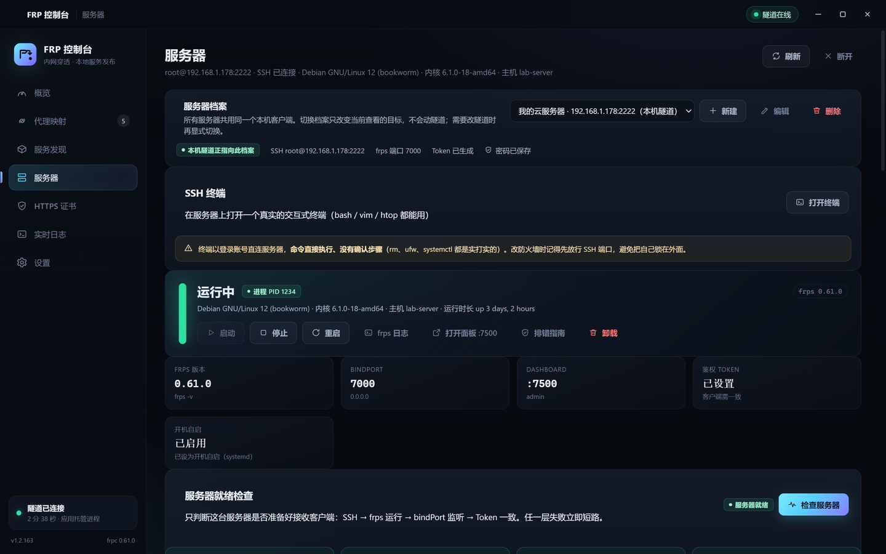

# FRP 控制台

[](LICENSE)
[](#系统要求)
[](package.json)
[](https://github.com/THEysh/FRP-Console/releases)

**把 frpc 从「改 TOML + systemctl」变成点几下鼠标。** 一个 Windows 桌面控制台，管代理、管隧道、还能反向通过 SSH 去管服务端的 frps。


## 它解决什么问题

手搓 [frp](https://github.com/fatedier/frp) 的日常是这样的：改 `frpc.toml` → 重启 frpc → 上服务器看 `journalctl` → 用 `nc` 试端口通不通 → 忘了 Token 是哪一份 → 端口撞了再改一轮。

这个控制台把这些收进一个窗口：

- **不用手写配置**：代理增删改直接写 `frpc.toml` 并热重载，其他代理不断线；写前自动备份，保留最近 10 份。
- **状态是查出来的，不是猜的**：每个代理要过「本地服务 → 隧道 → 公网」三层检查才显示"在线"，失败在哪层就报哪层。
- **服务端也能管**：填 IP + SSH 密码就能读 frps 状态、改配置、重启、管理服务器防火墙；服务器上连 frps 都没装的话，一键上传并装成服务。
- **多台服务器不再是复制粘贴**：把每台服务器存成「档案」，切换时先探端口通不通，再改写 `frpc.toml` 并重启。
- **域名 + HTTPS 一键打通**：有域名就能自动签发 Let's Encrypt 证书、自动解析 DNS、一键部署到服务器 nginx，`https://你的域名` 直接访问本机服务。

## 功能

| 模块 | 说明 |
| --- | --- |
| **概览** | 隧道状态、服务器信息、在线/异常代理计数、最近日志，一眼看清隧道到底通没通 |
| **代理映射** | TCP / UDP / HTTP / HTTPS / STCP / XTCP 代理的增删改；公网端口支持**自动建议 / 随机 / 检测**（避开已占用、浏览器禁用端口与服务器 `allowPorts` 白名单）；压缩与加密开关；单条测试公网可达 |
| **服务发现** | 扫本机 TCP 监听端口并显示进程与地址分类（回环 / 全网 / Docker / 内网），勾一个端口就变成公网代理 |
| **服务器（frps）** | SSH 连接后识别 systemd / 裸进程 / Docker 四种运行方式，展示版本与 Token 状态，支持启停、配置向导、**服务器就绪检查**、结构化日志、**服务器防火墙管理**、**SSH 交互式终端**、一键初始化 / 卸载 |
| **HTTPS 证书** | 用 Let's Encrypt 给自定义域名自动签发证书（DNS-01，支持通配符），一键填进 `https2http` / `https2https` 代理，到期前自动续期；支持 **nginx 反代（方案 Y）** 一键部署、DNS 自动解析 |
| **实时日志** | 跟随 `frpc.log`，按级别过滤、暂停、导出 |
| **设置** | frpc 路径、日志级别、运行模式、开机自启、管理 API、托盘行为、版本更新（**不含任何服务器连接配置**） |
| **自动更新** | 「设置 → 关于」里检查新版本、下载、重启安装；安装版走 NSIS 差分更新，便携版只给下载入口 |

<table>
<tr>
<td width="50%"></td>
<td width="50%"></td>
</tr>
<tr>
<td></td>
<td></td>
</tr>
</table>

## 下载安装

到 [Releases](https://github.com/THEysh/FRP-Console/releases) 下载最新安装包：

| 文件 | 说明 |
| --- | --- |
| `FRP-Console-Setup-<版本>-x64.exe` | NSIS 一键安装，装到 `%LOCALAPPDATA%\Programs\frp-console`，自动建桌面与开始菜单快捷方式 |
| `FRP-Console-<版本>.exe` | 单文件便携版，数据写在 exe 同级的 `frp-console-data\` |

安装包**内置 `frpc.exe`**（frp 0.61.0，随包升级，装完就能用，不用自己去下载和放目录）。服务端的 `frps` 仍是首次「一键初始化」时按服务器架构自动下载（约 18 MB，只下一次），详见 [frps 服务端控制台](#frps-服务端控制台)。

内置的 `frpc.exe` 位于 `<安装目录>\resources\frpc\frpc.exe`，**不要手动改它，也不要往里写配置**——安装目录在升级时会被整个替换。「设置 → 可执行文件与路径」里那张路径卡就是它，`frpc.toml` 则固定放在数据目录（`%LOCALAPPDATA%\frp-console\frpc.toml`）。想用自己的 frpc 版本，就在那里手动选一个 exe，选中后以你的为准。

### 1.2.149

- SSH 终端里**粘贴多行内容前会先确认**：这是服务器上的 root shell，粘进去的每一行都会立刻执行，粘错一次就来不及了。确认框会摊出前 5 行并告诉你总行数，单行粘贴仍然不打扰。

### 1.2.148

- 「部署到 nginx」现在**必须点名域名**：以前没传域名时会随手拿本地第一张证书顶上，传参走样就把别的域名的证书和配置写到当前服务器，界面还显示成功。
- 服务器上找不到 nginx / 证书不存在时给的是人话提示，而不是 shell 原始报错。

### 1.2.147

- 自动续期签完新证书后会**自动重新部署到那台服务器的 nginx**（原来只签不传，服务器上是旧副本，到期当天浏览器照样拿到过期证书 —— 续了等于没续）。
- 只在「这张证书当初确实部署过、且现在连的就是那台服务器」时才动手；没连服务器或连着别的机器时明确提示「续了但没部署」，并指路证书页的「部署到 nginx」。

### 1.2.146

- 证书剩余不足 30 天时，证书页顶部直接说明「自动续期会不会跑」：配了 DNS 验证渠道就是琥珀色「自动续期每 12 小时检查一次」；**没配就是红色「自动续期不会运行，到期后 https 打不开」**，并给一个「去配置 Cloudflare token」按钮（点了展开向导并聚焦 token 输入框）。
- 证书行同时加「自动续期未开启」徽标，避免只看到「剩余 11 天」却以为程序会自己搞定。
- 续期成功后仍要重新「部署到 nginx」才会换上新证书 —— 这条也写进横幅文案。

### 版本更新

安装版支持应用内更新：**设置 → 关于 → 检查更新**，发现新版本后点「下载更新」（走 NSIS 差分，只下变化的片段），下完点「重启并安装」，控制台关闭、安装、自动重开。

- **不会偷偷联网**：不检查则不请求，只在点按钮时才去 GitHub 取 Release 信息，见 [安全说明](#安全说明)。
- **升级是一次「卸载旧版 + 装新版」**（electron-builder 的 NSIS 流程），不是覆盖文件。`settings.json`、服务器档案、DPAPI 密码都在数据目录，不受影响。
- 放在安装目录里的 `frpc.exe` / `frpc.toml` / `frp-console-backups/` 会在升级前被搬到 `%LOCALAPPDATA%\frp-console\upgrade-rescue`，装完再搬回去——即便如此，**仍建议把 frpc 放在数据目录而不是安装目录**。
- 托管进程模式下升级会短暂断开隧道（安装器结束控制台时会带走 frpc 子进程）。控制台会在安装前留一张便条，新版本启动后自动把隧道接回来；系统服务模式完全不受影响。
- **便携版不支持自替换**：关于里只提供「打开发布页」，手动下载新版本替换 exe 即可（数据在 exe 同级的 `frp-console-data\`）。

### 系统要求
- Windows 10 / 11（x64）
- 会被管理的隧道需要本机有 `frpc.exe`；服务端管理需要目标机器开启 SSH
- 不做跨平台：服务控制走 `sc` / UAC，端口扫描走 `netstat` + PowerShell，都是 Windows 专有实现

## 从源码运行

```bash
git clone https://github.com/THEysh/FRP-Console.git
cd FRP-Console
npm install
npm start
```

国内网络建议先设镜像：

```powershell
$env:ELECTRON_MIRROR = "https://npmmirror.com/mirrors/electron/"
$env:ELECTRON_BUILDER_BINARIES_MIRROR = "https://npmmirror.com/mirrors/electron-builder-binaries/"
npm install --cache .\.npm-cache
```

## 快速上手

装完到打通一条隧道，正常只要四步：

1. **装完直接开**：`frpc.exe` 已经在安装包里，`frpc.toml` 由程序在数据目录自动建好（只有骨架：地址与 Token 留空，**不带任何预置代理**——预置一条连不上的代理只会让新装的人在概览看到红色"本地服务不通"）。不需要你去下载 frpc、也不需要找目录。
2. **在「服务器」页建档案**：「新建」只问服务器 IP、SSH 端口/用户名和密码。保存后如果填了密码，会直接连上去；没填就停在连接表单让你补一次。**Token 不用填**，保存档案时后端就生成好一把随机值了。
3. **在「服务器」页把 frps 弄好**：连上后会识别 systemd / 裸进程 / Docker。服务器上还没有 frps 就点「一键初始化并启动」——上传、写配置、注册服务、开机自启一次做完，并且默认勾选「同时把本机 frpc 的地址与 Token 改为本次配置」。做完点「检查服务器」，四步全绿就代表这台服务器**已经准备好接收客户端**。
4. **在「代理映射」加隧道**：新增一条代理（或用「服务发现」扫一个本机端口直接发布）。公网端口可以点「随机」自动挑一个安全的，或点「检测」连服务器查这个端口有没有被占用、是否在服务器的 `allowPorts` 白名单内。加完回到**概览**或**代理映射**看链路：三层全绿才是真的能用。

> 想开机自启就走 Windows 服务模式（见 [运行模式](#运行模式)）；只是临时用，让控制台托管进程更省事——关掉控制台 frpc 也会一起停。

## 新手教程：从零到「别人能访问你的服务」

这一节假设你**第一次接触 frp**，目标是把你电脑上跑着的一个服务（网页、游戏服务端、远程桌面……）暴露到公网，让别人从外面访问。每一步都解释「为什么」，照着走即可。

### 0. 先搞懂三个词

frp 是「内网穿透」工具。你的电脑通常没有公网 IP，外面的人直接连不到你。frp 靠一台**有公网 IP 的服务器**当中转站，把你的服务转发出去。

| 词 | 是什么 | 类比 |
| --- | --- | --- |
| **frps**（服务端） | 跑在公网服务器上的转发程序 | 中转站的「前台」 |
| **frpc**（客户端） | 跑在你电脑上的程序，主动去连 frps | 把你的服务「送」到中转站 |
| **隧道 / 代理** | 一条「公网端口 → 本机服务」的映射规则 | 中转站开一个窗口，把来访的人带到你这里 |

完整链路：**外面的人 → 服务器(frps)的某个端口 → 你电脑(frpc) → 你的本地服务**。FRP 控制台就是管理 frpc 和 frps 的图形界面，不用手写 TOML 配置。

### 1. 需要准备什么

- 一台**有公网 IP 的服务器**（VPS 即可，阿里云 / 腾讯云 / AWS / 搬瓦工都行），推荐 Linux（Debian / Ubuntu），并且**开了 SSH**（root 密码或密钥）。这是 frps 的家。
- 一个**本机正在跑的服务**，比如 `127.0.0.1:8080` 的网站、`127.0.0.1:25565` 的游戏服务端、`127.0.0.1:3389` 的远程桌面。先确认它在**本机浏览器/客户端里能打开**。
- 这台 Windows 电脑装好 FRP 控制台（下一步）。

### 2. 安装

到 [Releases](https://github.com/THEysh/FRP-Console/releases) 下载：

- 想装成正经软件 → `FRP-Console-Setup-<版本>-x64.exe`，一路下一步。
- 想放 U 盘随拿随走 → `FRP-Console-<版本>.exe` 便携版，双击即用。

装完直接打开。`frpc.exe` 已内置，`frpc.toml` 会自动生成，**不需要你手动下载或放置任何东西**。首次打开概览显示「尚未配置服务器」是正常的，继续往下。

### 3. 把服务器变成 frps（服务端）

打开左侧 **「服务器」** 页：

1. 点 **「新建档案」**，填四样：服务器 IP、SSH 端口（默认 22）、SSH 用户名（一般 root）、SSH 密码。**Token 不用填**——程序自动生成随机值。保存后会自动连上去。
2. 连上后程序会识别 frps 的运行方式（systemd / 裸进程 / Docker）。服务器上**还没有 frps** 就点 **「一键初始化并启动」**：自动下载、上传、写配置、注册系统服务、开机自启、**自动放开防火墙端口**，一次做完。默认还勾选「同时把本机 frpc 的地址与 Token 改为本次配置」，客户端一起对接好。
3. 点 **「检查服务器」**：四步全绿（SSH 通道 → frps 运行 → bindPort 监听 → Token 一致）就代表**服务器准备好接收客户端**。

> 服务器上已有 frps 但不知道 Token？在档案「高级选项」里把它的 Token 填回去，程序就能对上，不用重装。

### 4. 加第一条隧道（把服务暴露出去）

打开左侧 **「代理映射」** 页，点 **「新增代理」**。以「把本机 `127.0.0.1:8080` 的网站暴露出去」为例：

- **名称**：随便起，如 `my-web`。
- **类型**：选 `tcp`（最通用；后面想配域名 + HTTPS 再选 `http` / `https`）。
- **本地地址 / 本地端口**：`127.0.0.1` / `8080`（你服务真正监听的端口）。
- **远程端口**：点「随机」自动挑一个没被占用、也不是浏览器禁用端口的；或点「检测」连服务器查某个端口是否可用（占用 / 被服务器 `allowPorts` 白名单拒绝 / 可用，一目了然）。记下这个端口——它就是公网访问端口。

保存后回 **「概览」** 页点 **「启动隧道」**，等几秒，代理状态变成 **「三层全通」** 就成了。

### 5. 验证真的通了

在**另一台设备**（手机用流量、或另一台电脑）访问：

```
http://<你的服务器公网IP>:<远程端口>
```

比如 `http://154.36.178.154:10001`，能打开你的网站就说明穿透成功。

> **服务器本机测通了、外面连不上**：多半是云服务商（阿里云/腾讯云等）的**安全组**没放行那个端口——这是最容易被漏掉的一步。去云控制台给该端口加一条入站规则。程序能自动放开服务器系统里的 `ufw` / `firewalld` 防火墙，但云平台的安全组在程序管不到的地方。

### 6. 进阶：用自己的域名 + HTTPS（可选）

有域名（比如托管在 Cloudflare）且想用 `https://你的域名` 访问，而不是裸 IP + 端口。有两条路，选一条：

**路线 A（推荐）：nginx 反代** —— 证书放服务器、`https://域名` 不带端口、TLS 交给 nginx：

1. 打开 **「服务器」** 页连上 frps 服务器，找到「HTTPS 域名反代（nginx）」卡片：服务器没装 nginx 就点「安装 nginx 并配置」，已装就点「一键配置反代」。
2. 打开 **「HTTPS 证书」** 页，按顶部「域名就绪向导」走：先粘贴 Cloudflare API Token → 填域名（如 `app.yourname.com`）→ 签发 Let's Encrypt 正式证书（90 天有效，到期前自动续期）→ 证书签发后程序会自动部署到服务器 nginx。
3. 回 **「代理映射」** 新建一条 `http` 代理，填自定义域名 `app.yourname.com`（**不用选 TLS 插件**，TLS 由 nginx 统一终止）。
4. 在 Cloudflare 加一条 DNS 记录 `app` → 服务器 IP，**云朵点灰（DNS only，不经过 CDN）**；或在证书页向导里点「一键建解析」自动加。

**路线 B：frp 原生 https2http** —— 证书放 frpc 侧、`https://域名:端口`（带 vhost HTTPS 端口）、服务器不必装 nginx：

1. 打开 **「HTTPS 证书」** 页，同样按向导签一张 Let's Encrypt 正式证书。
2. 回 **「代理映射」** 新建 / 编辑一条 `https` 代理：插件选 `https2http`，从证书下拉选刚签的证书，填自定义域名。
3. DNS 解析同路线 A 第 4 步。

两条路都能用 `https://` 访问到本机服务。差别：路线 A 更通用（不带端口），但要求服务器能装 nginx；路线 B 不需要 nginx，但访问要带端口。

### 名词速查表

| 名词 | 一句话解释 |
| --- | --- |
| frpc / frps | 客户端（你电脑）/ 服务端（公网服务器） |
| Token | 客户端和服务端之间的「暗号」，对不上连不上 |
| bindPort | frps 接收 frpc 连接的端口（默认 7000） |
| 远程端口 / remotePort | 公网上给外部访问用的端口 |
| vhostHTTPPort / vhostHTTPSPort | http/https 代理走「域名」分发时用的端口（默认 80/443） |
| allowPorts | frps 对「客户端能申请哪些 remotePort」的白名单；不在名单里的端口会被拒绝注册 |
| STCP / XTCP | 点对点类型，不需要公网端口，双方都要装客户端 |
| 防火墙 / 安全组 | 服务器系统（ufw / firewalld / iptables）与云平台两层「放行哪些端口」的关卡；没放行就连接超时 |
| nginx 反代 | 服务器上的反向代理，统一在 443 收 HTTPS、转发给 frps，实现「不带端口访问」 |
| DNS 解析 | 把域名指到服务器 IP 的记录；用域名访问前必须先解析对 |
| 三层检查 | 本地服务 → 隧道 → 公网，三层都通才算「在线」 |

## 三层连通性检查

> 这一节说的是**概览 / 代理映射页**的检测，判的是"用户能不能访问到你的服务"。
> 「服务器」页那个按钮是另一回事，只看服务器自己准备好没有，见 [服务器就绪检查](#服务器就绪检查)。

代理"在线"不是看进程有没有起来，而是三层都过：

```
① 本地服务   127.0.0.1:8080 能连上吗          → 不通 = 本地服务不通
② 隧道       frpc 已连 frps，且该代理已注册     → 不通 = 隧道未建立
③ 公网       从本机连 serverAddr:remotePort     → 不通 = 公网不可达
```

任一层失败即短路，后面的层不再探测；悬停状态徽章能看到每层结果。检查每 14 秒刷新一次，保存配置 / 启动隧道 / 热重载后立即重查。

几条实现上的取舍：

- **所有代理都会检查**，不再有“只查前 16 条”的上限；并发 6 条、单轮预算 7 秒，超出的留到下一轮继续。
- **没测出结果 ≠ 在线**：刚启动、还没轮到的代理显示“待检测”，不会被算进“全部在线”。
- `udp` / `stcp` / `xtcp` / `sudp` / `tcpmux` 没有可直连的公网 TCP 端口，第 ③ 层标记为跳过，只要求①②通过。
- `http` / `https` 代理按 frps 的 `vhostHTTPPort` / `vhostHTTPSPort` 连 IP 并带上 `Host` 头去探测（端口按**隧道当前绑定的服务器档案**解析，连上服务器页时优先用 SSH 读到的实时值），端口不是 80/443 也不会误报“公网不可达”。

这样设计的好处是**报错直接指向原因**：本地服务没起来却去查安全组，是最常见的浪费时间。如果 frpc 根本没连上 frps，控制台会直接说清是哪个地址、什么原因（端口未监听 / 网络不可达 / Token 不对），并附上 frpc 的原始报错。


## 服务器就绪检查

「服务器」页的检查只回答一个问题：**这台服务器准备好接收客户端了吗**。四步依次判断，任一步失败立即短路：

```
① SSH 通道     还能在服务器上执行命令吗
② frps 运行    systemd / 进程 / Docker 任一种在跑，并顺带回读开机自启状态
③ bindPort     服务器本机 ss / netstat 里能看到 frps 的 bindPort
④ Token 一致   服务端 auth.token 与本机档案里的 Token 是否完全相同
```

四步全绿 = 可以去加代理了；全绿**不代表**隧道能用——那要回概览看三层。

以前这里跑的是三层检测，和概览页重复，而且"本地服务"这一层在还没建代理时必然是红的，看起来像"服务器配置失败"。现在分工清楚了：服务器页管服务端就绪，概览/代理映射管端到端连通。

## 多服务器与服务器档案

一个本机 `frpc.toml` 同一时间只能连一台 frps，但你可以保存任意多个**服务器档案**。

- 档案字段：名称、IP/域名、SSH 端口与用户名、frps 端口、Token、远程配置路径、面板地址。日常只需要填前四个。
- **Token 自动生成**：新建档案时后端生成一把随机 Token，它同时是「服务端配置向导」的默认值——写进 `frps.toml` 的 `auth.token` 和写进本机 `frpc.toml` 的是同一个字符串。想接管一台已经配好 frps 的服务器（Token 早已定死），再在「高级选项」里把它填回去即可。
- 密码**按档案独立保存**（Windows DPAPI 加密），档案之间不共享、不回退——不会出现"拿 A 的密码去连 B"。
- 「服务器」页顶部的下拉框切换的是**查看目标**，不动隧道；只有点「切换隧道并重启」才会改写 `frpc.toml` 并重启 frpc。
- **新建档案会断开上一台的 SSH 会话**：页面立刻变成这台新服务器的连接表单，不会继续显示上一台的状态，也不会在顶部弹"本机隧道指向其他服务器"这种吓人的提示。

| 动作 | 作用 |
| --- | --- |
| 仅查看 | 什么都不改，只看这台服务器的状态与配置 |
| 切换隧道并重启 | 把 `frpc.toml` 指向该档案，重启 frpc（二次确认，所有代理短暂重连） |

切换前会先探一次目标服务器的 frps 端口：连不上就不动配置，弹窗说明原因（拒绝 / 超时 / 解析失败），是否继续由你决定。切换过程有进度浮层，按「写入 frpc.toml → 重启 frpc → 等待新隧道上线」三步推进，不靠估算。

记住密码后，选中档案就会自动连接并读取状态，不用每次点「连接并读取状态」。

## frps 服务端控制台

「服务器」页通过 SSH 连上 frps 所在主机，把服务端从"看板"升级成可操作的闭环：**连接 → 状态识别 → 配置向导 → 保存并重启 → 服务器就绪检查 → 看日志**。

- **状态识别**：同时检查 systemd 服务、`frps` 进程、Docker 容器与监听端口，避免"实际在跑却显示已停止"；版本优先从 PATH、进程可执行文件或镜像识别。
- **快速配置向导**：模板有 基础穿透 / 带鉴权 / 带鉴权 + 面板 / HTTPS 域名 / 自定义，右侧实时生成 `frps.toml` 预览。写入前本机校验 TOML，服务器上若存在 `frps` 还会先跑 `frps verify`，通过后备份为 `.bak-时间戳` 再覆盖。
- **一键初始化**：服务器上还没有 frps 也能从零开始——按架构（amd64 / arm64）**下载** frps 0.61.0（约 18 MB，只下一次，缓存复用）、上传、写配置、注册 `frps.service`（无 systemd 时回退后台进程）、清掉旧的裸进程避免 7000 冲突。可选「同时把本机 frpc 的地址与 Token 改为本次配置」。
  > 二进制不进安装包：两份 frps 会让安装包从 81 MB 涨到 95 MB。下载失败时见 [常见问题](#常见问题) 的手动放置办法。
- **结构化日志**：把 `journalctl -u frps`、`docker logs` 或 `frps.log` 解析成时间 / 级别 / 内容三列，汇总启动时间、客户端连接数与错误数。

> 需要目标机器已开 SSH，并使用 root 或具备 `systemctl` / `docker` 权限的账户。非 root 但配了免密 `sudo` 时，控制命令会自动改用 `sudo -n`。Docker 启动的 frps 会改用 `docker start/stop/restart` 操作。

## 端口与连通（服务器页）

v1.2.56 起，原来那张「服务器防火墙」卡片升级成 **「端口与连通」**：它不再只是列规则，而是把**三个信号交叉起来判定**，直接告诉你端口到底被哪一层拦住。

三个信号：

| 信号 | 含义 | 从哪来 |
| --- | --- | --- |
| **监听** | 服务器上有没有程序在这个端口监听 | 服务器内 `ss -lnt` / `ss -lun` |
| **规则** | 服务器系统防火墙（ufw / firewalld / iptables）有没有放行 | 读回防火墙当前实际规则 |
| **实测** | 从本机能不能连上这个端口 | 从控制台所在机器做 TCP 连接测试 |

判定表（卡片里每行给出的「结论」就是按这张表来的）：

| 监听 | 规则 | 实测 | 结论 | 该做什么 |
| --- | --- | --- | --- | --- |
| ✗ | — | — | 没有程序在这个端口监听 | 看 frps / nginx 是否在跑、配置里的端口对不对（与防火墙无关） |
| ✓ | ✓ | ✓ | 正常 | — |
| ✓ | ✓ | ✗ | **服务器已监听、防火墙也放行了，外面连不上 → 云安全组 / 中间设备拦截** | 去云控制台放行（卡片里有复制规则按钮） |
| ✓ | ✗ | ✗ | **服务器内防火墙没放行这个端口** | 行尾「放行」一键补齐 |
| ✓ | ✗ | ✓ | 规则没写但实测通（云层已放行），可忽略 | 不用动 |
| ✓ | ✗ | ✗（无本机防火墙） | 云安全组 / 网络层拦截 | 去云控制台放行 |

其他要点：

- **端口清单覆盖更全**：frps 端口（bindPort、Dashboard、vhostHTTP / vhostHTTPS、tcpmuxHTTPConnectPort，UDP 只在配置了 kcp / quic 时才列）、代理映射端口、**系统端口（SSH、nginx 的 80 / 443）**。
- **每行一个动作**：阻塞行给「放行」（只放行这一条端口）、云层阻塞给「复制规则」、没监听给「重新检测」——不会再出现「点了放行却什么都没变」。
- **放行即复检**：放行 / 删除规则后自动重跑三信号，结论行同步更新（例如「2 个端口有问题 —— 1 个在服务器防火墙」→ 放行后变成「1 个在云安全组/网络层」，这正是「本机放行了但外面还是连不上」的真实场景）。
- **云安全组提示块**：卡片内固定展示「本机防火墙放行 ≠ 公网可访问」，附阿里云 ECS / 阿里云轻量 / 腾讯云 / 华为云的控制台路径，以及两个按钮：`复制全部端口规则`（精确清单，照着填）与 `复制 1-65535 全放行`（省事但等于全端口暴露，只建议自用/测试机）。
- **服务器就绪检查的 bindPort 层加了公网实测**：以前只查「服务器本机在监听」，云安全组拦着也全绿；现在会补一次从本机的连接测试，失败时直接写明「本机在监听但从本机连不上 → 云安全组/网络层」。
- **SSH 连接失败会说明原因**：拒绝连接（端口没开 / sshd 没起）、握手前被断开（可能是防火墙代答）、超时（云安全组或本机 VPN 拦出站）、域名解析失败，分别给不同的下一步。

> **两层防火墙别搞混**：这张卡读的是服务器系统里的 ufw / firewalld / iptables。阿里云、腾讯云等云厂商还有一层**云平台防火墙 / 安全组**，在云控制台（网页）里配，程序读不到也改不了——「监听 ✓ + 规则 ✓ + 实测 ✗」就是它的典型指纹。

## 服务器防火墙（规则管理）

卡片下半部分仍然是规则管理区，能力与 1.2.47 一致：

- **自动识别**：读 `ufw status` / `firewall-cmd --state` 判断服务器用的是哪种防火墙、当前是启用还是未启用。
- **一键放行**：点「放行 frps 与代理端口」把上面这些端口全部加到防火墙白名单（ufw / firewalld / iptables 三种都支持）。
- **没装防火墙也能装**：服务器系统没装防火墙时，卡片显示「安装并启用防火墙」——按发行版自动装 ufw（Debian/Ubuntu）或 firewalld（RHEL/CentOS/Fedora 系），并**先放行你的 SSH 端口**再放行 frp 端口，避免把你自己锁在门外。
- **手动放行任意端口**：输入框支持单端口、范围、逗号分隔，如 `28487`、`1000-2000`、`80,443,8000-9000`，协议可选 tcp / udp / 两者；放行后列表立即刷新为防火墙真实规则。
- **已放行 = 当前实际规则**：卡片下方「已放行规则（N 条，当前实际规则，勾选后可删除）」是从防火墙**实时读回**的，不是软件自己记的累计数——你之前在别处手动加过的规则也会列出来。
- **勾选删除任意规则**：「已放行规则」每条带复选框（含全选），勾选后按规则**原文**删除——范围规则精确命中；ufw 的 v4/v6 双规则一并处理；规则不存在时明确报错。

## 运行模式

| 模式 | 说明 |
| --- | --- |
| **Windows 服务** | 通过 `sc` / UAC 启停已安装的 frpc 服务，适合开机自启 |
| **应用托管进程** | 控制台直接拉起 `frpc.exe -c frpc.toml`，退出控制台会一并结束 |
| **自动** | 优先使用已安装的 Windows 服务，没有再托管进程 |

## 开机自启与重启验收

「现在能通」和「重启后还能通」是两件事，分开验才不会误判：

| 位置 | 靠什么活着 | 验收命令 / 看哪里 |
| --- | --- | --- |
| 本机 frpc | Windows 服务的启动类型 | `Get-Service frpc \| Select-Object Status,StartType` → `Running / Automatic` |
| 服务器 frps | systemd 的 `is-enabled`，或容器的 RestartPolicy | `systemctl is-enabled frps; systemctl is-active frps` |
| 控制台窗口 | 当前用户的登录项（`HKCU\...\Run`） | 设置页开关；任务管理器「启动」里是否为「已启用」 |

几个必须知道的边界：

- **控制台是「登录后启动」，不是「开机启动」**。`Run` 项要等用户登录 + explorer 起来才执行（常见 10–60 秒）。无人值守重启时控制台不会出现——但**隧道不受影响**，服务模式下 frpc 由系统服务拉起，跟控制台无关。
- **任务管理器里禁用过启动项时**，Windows 不删 `Run` 键，只把 `StartupApproved\Run` 里的状态改成「已禁用」。控制台会读这个状态：设置页显示黄色提示，并把开关同步为关闭，不会偷偷再加回去。想恢复就在任务管理器里设为「已启用」。
- **只有服务模式（或 auto 命中服务）才谈得上「重启后隧道自己回来」**。`应用托管进程` 模式下 frpc 是控制台的子进程，控制台一退隧道就断；选这个模式时设置页会明确提示。
- **服务器端开机自启是控制台初始化后回读的**：`systemctl enable` 之后会再查一次 `systemctl is-enabled`，没到 `enabled` 就在「服务器」页状态卡标黄并给出修复命令，不会像以前那样把失败吞掉报「成功」。没有 systemd 的机器用 `nohup` 临时启动，页面会直说「重启后不会自动运行」。
- 托管的 Docker 版 frps 会读 `docker inspect` 的 `RestartPolicy`：`no` 的容器重启后不会自己起来，同样会在状态卡提示。

生成的内置 `frpc.toml` 模板里，`loginFailExit = false`：开机时网络可能还没就绪，让 frpc 自己退避重连，比"连不上就退出、等 nssm 反复拉起"更干净。

## 托盘与退出

**关窗口 ≠ 退出**：

| 操作 | 效果 |
| --- | --- |
| 点标题栏 X | 收进托盘，隧道继续跑（可在设置里改成"关闭即退出"） |
| 托盘图标单击 | 显示 / 隐藏主界面（双击强制显示） |
| 托盘右键 | 状态、启停隧道、热重载、打开配置、**退出 FRP 控制台** |

退出时会先停掉自己拉起的 frpc 再结束进程，不留孤儿；清理最多等 8 秒，之后强制退出。托盘图标三态：绿点=在线，灰点=未连接，红点=连不上服务器。

**只允许一个实例**：同数据目录靠 Electron 单实例锁，跨数据目录（安装版 + 便携版同时开）靠固定端口 47823 握手。第二个实例会把已有窗口叫到前台后自行退出。

**如果托盘建不出来**（图标缺失，或被安全软件拦截），关闭窗口会直接退出程序，而不是把窗口藏起来——避免"窗口消失且叫不回来"只能去任务管理器杀进程。控制台每 3 秒用 `tray.getBounds()` 自检：系统分配的位置连续三次全 0 就判定为"假托盘"，此时设置页会提示，点 X 改为直接退出。

> 看不到托盘图标时，先点任务栏的「^ 显示隐藏的图标」——Windows 默认把新图标折叠进溢出面板，折叠状态下 `getBounds()` 也可能是 0。仍不行就把程序移出被安全软件重点管控的目录再试。

## 管理 API

控制台通过 frpc 自带的 Admin API（默认 `127.0.0.1:7400`）读代理状态并触发热重载。这个监听只在 `webServer.addr = "127.0.0.1"` 时开放；「设置 → 管理 API」可以一键补全。

- **新装的口令是随机的**（20 位）并在首次启动时写进 `frpc.toml` 的 `webServer`，不再是 `admin/admin`；老配置沿用你原来的值，升级不会把它改掉。
- 改端口/账号后，控制台会把 `webServer` 一并写回 `frpc.toml` 并重启隧道，不会出现“控制台问 7401、frpc 还在 7400 上听着”的错位。
- 如果这个端口上跑的是**另一份配置的 frpc**，控制台会显示「端口冲突」并拒绝停止它，避免误杀别人的隧道。
- 服务器侧 `vhostHTTPPort` / `vhostHTTPSPort` 不是默认 80/443 时，连一次服务器页（「服务器」页 → 选中档案）会自动读回真实端口，三层检查的公网探测据此连对端口，不会误报“公网不可达”；「设置」里也能手动填，会同步进当前绑定的服务器档案。


## HTTPS 与自定义域名

想把 `https://app.yourdomain.com` 挂到本机服务上，控制台在「HTTPS 证书」页 + 「服务器」页的 nginx 卡片把整条链路都做了。核心是三个问题，分别对应三个功能：

**① 证书哪来？** —— Let's Encrypt 自动签发（DNS-01 验证，无需开放 80/443，支持 `*.域名` 通配符）。

- 首次需要一个 DNS 渠道：目前支持 **Cloudflare**，在证书页粘贴一个「编辑区域 DNS」权限的 API Token（DPAPI 加密存本机，不落明文）。
- 填域名点「签发」即可，证书有效期 90 天，**到期前 30 天自动续期**（每 12 小时检查一次）。
- 证书存本机 `userData\certs\`，列表里能看到到期天数、覆盖域名、部署状态。

**② 域名怎么指到服务器？** —— 一键建 DNS 解析。

- 证书页「域名就绪向导」会检测你填的域名有没有解析、有没有指向当前服务器。
- 没解析时，配好 Cloudflare token 就能「一键建解析」——自动加 A 记录指向 frps 服务器；建完立即显示「已解析」，不用干等公共 DNS 传播。

**③ TLS 在哪终止？** —— 两条路（详见新手教程第 6 步）：

| 路线 | 证书位置 | 访问形式 | 服务器要求 |
| --- | --- | --- | --- |
| **A：nginx 反代（方案 Y）** | 服务器（部署到 nginx） | `https://域名` 不带端口 | 服务器能装 nginx |
| **B：frp 原生 https2http** | 客户端（frpc 读证书发给 frps） | `https://域名:端口` | 不需要 nginx |

- 路线 A：nginx 卡片一键装 nginx / 配置反代；证书签发后自动上传到服务器 `/etc/nginx/ssl/<域名>/` 并写反代配置，`nginx -t` 校验后 reload；代理保持纯 `http` 类型即可。
- 路线 A 有个容易被忽略的前提：**nginx 的上游是 frps 的 `vhostHTTPPort`**。frps 没开这个端口（从零初始化默认就不带），nginx 反代照样能起来，但访问一定 502。所以「一键配置 nginx 反代」现在会先检查并自动补上 `vhostHTTPPort`（端口被占用时自动顺延）再重启 frps；代理表单里如果检测到没开，也会在徽标旁给出「开启 vhost 端口」按钮，两次点击确认后直接补上。
- 路线 B：代理表单选 `https2http` / `https2https` 插件，从证书下拉自动填 `crtPath` / `keyPath` 与域名。
- 证书列表会标注每张证书「已部署到哪台服务器」，切换服务器后按当前服务器显示，不会张冠李戴。

> 没有域名、或暂时不想上 HTTPS，完全不影响隧道使用——证书 / DNS 都是可选入口，`http://IP:端口` 随时可用。


## 常见问题

- **双击 exe 没反应 / 一闪就退出**：多见于以管理员身份运行的受限桌面——Chromium 沙箱初始化失败，进程在进入主进程代码前就以退出码 `3` 结束，界面来不及提示。用 `npm run dev:nosandbox`，或给快捷方式「目标」末尾补 ` --no-sandbox`。
- **点 X 后程序还在**：默认「关闭到托盘」，隧道不会断。要真正退出用**托盘右键 → 退出**。
- **换了服务器地址但仍连旧服务器**：frpc 的 reload 不会重建服务器连接，必须重启隧道（服务器页「切换隧道并重启」，或概览页「重启」）。
- **公网端口不通**：先在代理列表点「测试公网端口」；仍不通就检查三层——服务器系统防火墙（服务器页「服务器防火墙」卡片可一键放行）、云平台安全组（阿里云 / 腾讯云控制台，程序管不到）、代理是否为 `running`。隧道报 `EOF` / `session shutdown` 且服务器本机 `ss -tn` 看不到连接时，基本就是云防火墙没放行。
- **服务启停弹 UAC**：Windows 服务需要管理员权限；取消授权不影响已有隧道。
- **一键初始化卡在「下载 frps」**：程序要从 GitHub 取 `frp_0.61.0_linux_<arch>.tar.gz`。连不上时手动下载解压，把 `frps` 放到 `%LOCALAPPDATA%\frp-console\frps-cache\frp_0.61.0_linux_amd64\frps`（或程序目录 `resources\frps\linux-amd64\frps`），再点一次初始化即可走本地文件；也可以设环境变量 `FRP_DOWNLOAD_MIRROR=https://ghproxy.net/` 之类的前缀走代理。
- **开了「开机自动启动」但重启后没自动运行**：这条设置写在当前用户的启动项里（`HKCU\...\Run`，不需要管理员权限）。被安全软件或组策略拦下时保存会直接报错、开关不会假装打开；这种情况可以在 `shell:startup`（Win+R 输入后回车打开的那个文件夹）里放一个控制台的快捷方式代替。另外建议同时打开「以最小化状态启动」，免得每次开机都弹窗。
- **看到两个控制台窗口**：不会。单实例锁 + 固定端口 47823 双保险，后启动的副本会叫出已有窗口后退出。
- **启动即退出 / 白屏**：程序会依次尝试 exe 同级 `frp-console-data`、`%LOCALAPPDATA%\frp-console`、程序目录下的数据目录；都不可写时会失败，请换到有写权限的位置。
- **检查更新报「更新源缺少 latest.yml」**：说明那个 Release 只挂了 exe。发版时 `latest.yml` 和 `*.blockmap` 必须一起上传（[release.yml](.github/workflows/release.yml) 会自动收集并校验，手工发版容易漏）。
- **升级后安装目录里的 frpc.exe / frpc.toml 不见了**：升级是「卸载旧版 + 装新版」，安装目录整体重建。现在 `frpc.exe` 由安装包自带（`resources\frpc\frpc.exe`），`frpc.toml` 一律写在数据目录，所以正常情况下不会丢；只有你自己把配置文件放到过安装目录，才需要依赖安装器的 `upgrade-rescue` 兜底搬运。
- **找不到 frpc.exe / 提示路径缺失**：安装版不会出现——它在 `<安装目录>\resources\frpc\frpc.exe`。便携版和解压运行（zip 解压、`win-unpacked`）时同样在 `resources\frpc\` 下；如果被杀软删掉了，重新装一次，或在「设置 → 可执行文件与路径」里指向你自己下载的 frpc。
- **检查更新连不上**：它走 `github.com` 的 Release，网络受限时会失败（报错会写明是网络问题）。可以手动到 Releases 下载安装包覆盖安装，效果一样。

## 开发

```
src/main/          主进程
  index.js         IPC、窗口、托盘、状态机
  frpc.js          frpc 进程托管、管理 API、热重载
  settings.js      设置、服务器档案、按档案加密的密码库（DPAPI）
  config.js        frpc.toml 解析与写入
  service.js       Windows 服务检测与启停
  ssh.js           SSH 会话、frps 状态识别
  frpsconfig.js    frps 配置解析、向导字段与 TOML 生成
  netport.js       本机 TCP 监听端口扫描
  log.js           日志跟随
  update.js        自动更新（electron-updater，仅安装版）
  preload.js       contextBridge 暴露 window.FRP
src/renderer/      无框架单页界面（index.html / styles.css / app.js）
assets/            应用与托盘图标（托盘图标由脚本生成）
resources/frps/    内置 frps 二进制（linux-amd64 / linux-arm64），一键初始化用
vendor/frpc/       打包前由 tools/fetch-frpc.cjs 下载的 frpc.exe（不入库）
tools/             CDP 自检脚本与构建辅助
build/installer.nsh  NSIS 安装脚本
```

`npm run dist*` 会先跑 `tools/fetch-frpc.cjs` 把 frpc 0.61.0 取到 `vendor/frpc/frpc.exe`（已存在则跳过），再交给 electron-builder 通过 `extraResources` 打进 `resources/frpc/`。想换版本改 `tools/fetch-frpc.cjs` 顶部的 `FRP_VERSION`，并同步 `src/main/frpsBinary.js` 里的常量。

渲染层不引任何框架，靠 `window.FRP`（preload 暴露的 IPC 封装）与主进程通信；界面状态由主进程 `state:update` 事件推送，不做轮询。

### 打包

```bash
npm run dist           # NSIS 安装包 → dist/FRP-Console-Setup-<版本>-x64.exe
npm run dist:portable  # 单文件便携版 → dist/FRP-Console-<版本>.exe
npm run dist:dir       # 免安装目录 dist/win-unpacked，调试用
npm run tray-icons     # 重新生成托盘三态图标
```

**打包卡在 `packaging platform=win32` 不动**：electron-builder 解包 Electron 前要在 `%TEMP%` 拿一把下载锁，上次构建被强行中断会留下它。删掉再重跑：

```powershell
Remove-Item "$env:TEMP\eb-dl-*.lock.lock" -Recurse -Force
npm run dist
```

**发版必须一起上传的三件套**：`FRP-Console-Setup-<版本>-x64.exe`、`latest.yml`、`*.blockmap`。前两个决定客户端能不能发现新版本（electron-updater 读 `latest.yml` 比对版本、校验 sha512），第三个让差分下载只取变化的片段。`package.json` 的 `build.publish` 指向 `THEysh/FRP-Console`，打出来的包自带 `resources/app-update.yml`；`latest.yml` 里的版本来自 `package.json.version`，所以**版本号与 tag 必须同步改**，否则客户端认为没有更新。

### 自检脚本

`tools/` 下是基于 CDP 的自动化脚本。用独立的 userData 和实例端口跑，不会碰到你正在用的实例：

```bash
FRP_INSTANCE_PORT=47827 PORTABLE_EXECUTABLE_DIR=/tmp/frpsmoke \
  npx electron . --no-sandbox --remote-debugging-port=9333

node tools/ui-test.cjs                     # 逐页自检 + 截图（横向溢出、元素越界、console.error）
node tools/ui-flow.cjs settings            # 交互流程：settings / logs / proxies / server / tunnel / misc / winctl
node tools/cdp-eval.cjs "document.title"   # 在渲染层执行任意表达式
node tools/cdp-shot.cjs .proxy-row out.png # 按选择器截单个元素
```

`FRP_INSTANCE_PORT` 让测试实例用独立单实例锁，`PORTABLE_EXECUTABLE_DIR` 让它把设置写到别处；两者缺一，测试实例会被正在运行的正式实例挡掉，或改到你的真实配置。

### 测试

仓库自带三层可回归的测试，不需要外网、不需要真实服务器：

```bash
npm test               # L0 语法检查 + L1 单元测试 + 机密扫描，约 4 秒，CI 每次推送都跑
npm run test:e2e       # L2 端到端：起一个真 Electron、真 frpc、真 frps、假 sshd，跑完 12 个场景
npm run test:e2e -- --only=tunnel        # 只跑名字含 tunnel 的场景
npm run test:e2e -- --keep               # 保留现场（数据目录与进程），便于排查
node tests/soak.cjs 10                  # 长稳抽查：隧道 + 20 条代理跑 10 分钟，看内存/健康检查/日志缓冲趋势
```

| 层 | 内容 | 依赖 |
| --- | --- | --- |
| L0 `tools/check-syntax.cjs` | 对 `src/ tools/ tests/` 逐个 `node --check` | 无 |
| L1 `tests/unit/*.test.js` | 纯函数单测（配置解析与校验、端口矩阵、SSH 输出解析、DNS 判定、证书域名匹配、设置合并…） | 无 |
| L2 `tests/e2e` | 冷启动、代理增删改与校验、真隧道三层全通、健康检查如实报错、服务器页、证书页与 DNS 面板、SSH 终端与日志、布局体检、20 条代理不截断、访问路径 404、外部改配置热重载、设置边界值 | 本机 electron；frpc 自动从 `vendor/frpc/` 找；frps 可选（缺了对应场景跳过） |

端到端跑批把数据目录放在仓库内的 `.e2e-tmp/run-*`（已 gitignore），可以用 `E2E_DATA_ROOT` 换个位置——**不要放到 `%TEMP%`**，那会让 Electron 建单实例锁失败（`Error code: 5`）直接退不到界面。跑完要清理时删掉 `.e2e-tmp` 即可。

`tools/` 下另有一批早先的 CDP 脚本（`ui-test.cjs`、`ui-flow.cjs`、`cdp-eval.cjs`）用于临场排查，不属于回归集。

## 安全说明

- SSH 密码与本机 Token 使用 Windows DPAPI 加密后存在用户数据目录，**不会明文落盘**；解密绑定当前 Windows 账户，拷到别的机器上无效。
- **Token 由程序随机生成**（24 位小写字母数字，`crypto.randomBytes`），在创建服务器档案时就确定，并同时用于 frps 的 `auth.token` 与本机 `frpc.toml`。用户不需要自己想、也不需要手工核对两边是否一致——这也是最容易出错的一步。
- 安装包里**不含任何服务器地址、Token 或作者的个人配置**：装完全新的环境里服务器档案是空的，一切都由你自己填。
- 控制台平时不向外发包：所有连接都是你显式发起的（本机 frpc、frpc Admin API、你填的 SSH 主机）。主动联网只有两处，都由你触发：① 点「检查更新」时向 GitHub 取 Release 信息与更新包（`latest.yml` + 安装包，sha512 校验后才安装）；② 「从零初始化」时从 `github.com/fatedier/frp` 下载 frps 二进制（只在服务器已装 frps 时不发生，且可用本地文件代替，见 [resources/frps](resources/frps/README.md)）。
- 更新包来自本仓库的 GitHub Release，靠 `latest.yml` 里的 sha512 校验完整性；安装包**未做代码签名**，首次下载运行时可能被 SmartScreen 提示，介意的话请手动下载核对。
- frps 初始化会写入 `/etc/frp/frps.toml`、注册系统服务并重启 frps；**若服务器上原有的 frps 正在服务其他隧道，这会短暂中断并替换其配置**，执行前请确认影响范围。

## 更新日志
### 1.2.145

- **主机密钥变了的提示现在告诉你「怎么核对」。** 以前只写「可能是中间人劫持」，用户只能无脑点「信任」；现在弹窗和设置页的「已知服务器指纹」卡片都给出可执行的自查方法（服务器上 `ssh-keygen -lf /etc/ssh/ssh_host_ed25519_key.pub`，或另一台已信任机器上 `ssh-keyscan … | ssh-keygen -lf -`），并说明两边的 `SHA256:…` 必须一字不差。

### 1.2.144

- **修：服务器 `allowPorts` 写成「20000 - 20010」时，报错是一句看不懂的「无法识别端口范围：-」。** 解析时把空格也当分隔符，范围被切成 `20000` / `-` / `20010`。现在先把数字之间的空格收掉再切分，「20000 - 20010」与「3001 4000」两种写法都支持；真正认不出来时把整段原文写进报错并提示「多个端口用英文逗号分隔」。

### 1.2.143

- **修：服务器地址写成 `[::1]` 这种带方括号的写法时，隧道永远连不上。** frpc 会把它拼成 `[[::1]]:7000` 并报 `dial tcp: missing port in address`，而界面只说「连不到服务器端口」。现在读配置时会把方括号去掉、把文件写回去，并提示已经纠正。
- 真机「卸载 frps → 从零初始化」补成可选剧本 `npm run test:real            # 可选：真机全剧本（需要 FRP_REAL_HOST/PASS/TOKEN）
npm run test:real:reinstall  # 可选且破坏性：真机卸载→从零初始化 frps，需追加 --yes:reinstall`（默认不跑，需要 `--yes`）。

### 1.2.142

- **修：公网端口撞上 frps 自己的端口时，说清是哪个端口。** frps 只会回一句 `port unavailable`（不带端口号），以前界面统一说「frps 拒绝启动这个代理」，用户看不出错在哪。现在会认出来并直接写「公网端口 7000 就是 frps 的监听端口」，提示去换一个公网端口；其它 port unavailable 的情况也会提示去服务器页跑「检查端口」。保存时的警告同步改成点名端口号。

### 1.2.141

- 「从零初始化 frps」时如果开了鉴权却把 Token 留空，会自动生成 24 位随机 Token，并在初始化完成后弹窗告诉你（空 Token 的 frps 等于不校验身份）。
- 初始化结果里同时回显这个 Token，方便在其它设备上填同样的值。

### 1.2.140

- **修：frps 起不来时把「哪个端口被占」说准，不再一律让人去改 `bindPort`。** frps 有四类端口（bindPort / Dashboard / vhostHTTP / vhostHTTPS），以前不管哪一类被占，报错都只写「这个端口被占用」并建议改 bindPort —— 面板端口被占时照做只会改错地方。现在会从日志里取出具体端口号，对照当前配置说清「被占的是 4096，它是 Dashboard 面板端口（`webServer.port`）」，并给出 `ss -lntp | grep 4096` 的排查命令。
### 1.2.139

- **修：配置文件里没有 `[webServer]` 段时，隧道永远起不来。** frpc 会用默认的 `127.0.0.1:7400` + `admin/admin` 开管理 API，而控制台按设置里的端口和口令去连，于是报「frpc 已启动但管理 API 不可用：管理 API 未启动」，代理一条都注册不上。现在启动前会**按磁盘上的真实内容**比对并补写 `webServer`（以前只看内存里的旧模型，文件里没有也当自己有了）。顺手确认：管理端口被占时自动换一个空闲端口并写回设置。
### 1.2.138

- **修：改了服务器地址 / 端口 / Token 之后，隧道没有真的换过去。** frpc 只在启动时读一次配置，以前保存后只提示「建议重启」而实际不会重启——界面显示「已连接」，连的还是旧服务器，新服务器上一条代理都不会注册。现在保存连接参数时会把隧道自动重启一次，并告诉你结果；另有「隧道还在用旧配置运行」的提示条兜底（外部改配置文件没重载成功时也会出现）。
### 1.2.137

- **修：frps 起不来时，报错只会贴 systemd 的 `Failed with result 'exit-code'`**，真正的原因（配置字段类型错、端口被占）就在同一段日志里却被盖掉了。现在优先挑 frps 自己那条报错，并在「配置读不了」时直接告诉你回配置文件改。
### 1.2.136

- **修：`frps.service` 被 mask 时，程序会绕过 systemd 偷偷裸起一个 frps 还报「启动成功」**。那个进程不受 systemd 管理（重启机器就没了），还会占着 7000/4096 让后续 `systemctl start` 一直失败。现在：自检直接说「被 mask 了」，点启动会失败并告诉你在服务器上执行 `systemctl unmask frps.service`，不会再裸起进程。
### 1.2.135

- 两条代理名只差大小写时会给一条提醒（frpc 会把它们当两条不同代理，但列表里几乎分不出来）。
### 1.2.134

- **修：超长访问路径不再被悄悄截断**（以前贴进去 2000 字符、存下来只有前 200，公网 404 还查不出原因）。现在超过 200 字符直接拒绝并说明上限。
- **公网端口小于 1024 时会提示**：这类特权端口要求 frps 以 root 运行，否则这条代理会启动失败（`permission denied`）。
### 1.2.133

- **修：服务器配了 `allowPorts` 之后，「自动填端口」彻底失效**（白名单的形状没归一，所有端口都被判成「不允许」，界面还一声不响）。现在数字、`"3000-4000"`、对象三种写法都认。
- 「随机端口」「自动建议」找不到端口时会直接说明原因（是服务器白名单没空位，还是 10000–64999 都占满了），不再点了没反应。
### 1.2.132

- **首次连接服务器的指纹不再静默**：第一次连某台机器时会发一条通知，告诉你它的 SSH 主机指纹已经记下、之后每次连接都会比对。
- 设置页新增「已知服务器指纹」：能看到信任过哪些 `host:port`、各自的 `SHA256:` 指纹，也能删掉某一条（换机器、重装 sshd、或怀疑被劫持时用）。
### 1.2.131

- **面板口令能一键换了**：服务器页提示「frps 面板对公网开放」时，旁边多一个「换成随机口令」——生成 20 位随机串写进 `[webServer]`、重启 frps 生效，新口令会弹一次让你抄下来。
- 只改 `[webServer]` 里的 `password`（段落写法和点号写法都认），保存仍走原来的「校验 → 备份 → 重启」流程；服务器上没有 `[webServer]` 段时会直接说明，不会瞎改。
### 1.2.130

- **默认管理口令会被点出来**：本机 frpc 的管理 API（127.0.0.1:7400）如果还用着空口令 / `admin` / 少于 10 位，概览会提示它到底弱在哪，并给一个「生成随机口令」按钮——换完自动重启隧道生效。
- 这条提示会随着口令变化自动出现 / 消失，不用手动切页。


### 1.2.129

- **服务器上的 frps.toml 不再人尽可读**：这份文件里明文放着 auth.token 和面板口令，以前写成 644（同机任何用户 `cat` 就能拿走 token，进而连上你的 frps 或登面板）。现在保存配置、生成备份、从零初始化装机统一写 600；历史遗留的 `frps.toml.bak-*` 也会在下次保存时被收紧权限。
- **服务器配置备份最多留 10 份**（原来是无限增长，真机上堆了 14 个含 token 的 644 备份）。
- 设置文件里已经删掉的功能字段（STAGING 开关、停止服务前确认）会被自动清理，不再长期残留。

### 1.2.128

- **bindPort 被别的程序占着时不再假绿**：把 7000 让给另一个程序（真机上用 python3 占着）后，frps 起不来，但以前的就绪检查会看到「有人在监听」+「公网可达」就报绿，界面上一切正常。现在会核对监听者进程：`7000 上监听的是 python3（PID 4311），不是 frps。frps 起不来就是因为这个端口被占了`。
- 启动/重启失败时把 frps 自己的日志尾巴带出来，并识别 `address already in use` → 「这个端口已经被别的程序占用了——在服务器上执行 ss -lntp 找出占用者并停掉，或把 frps 的 bindPort 换成空闲端口」。

### 1.2.127

- **frps 服务单元被删掉时说得清楚**：把服务器上的 `/etc/systemd/system/frps.service` 删掉后，就绪检查以前只说「frps 没有运行」（让人以为点一下启动就行），点启动则得到一句英文 `Failed to start frps.service: Unit frps.service not found.`。现在自检直接说「frps 服务不存在：这台服务器上没有 frps.service（服务单元被删或从没建过）→ 用『从零初始化』重装，或手工把 systemd 服务建回来」，启动失败的报错也会附带同一句指引。
- 同类翻译：`is masked` → 提示 `systemctl unmask`；`start request repeated too quickly` → 提示先 `systemctl reset-failed` 再看 `journalctl`；控制进程非零退出 → 指到日志。

### 1.2.126

- **root 也写不了的时候，报错变成能动手的提示**：配置文件被 `chattr +i` 冻结、分区只读挂载、SELinux 拦截、磁盘满这几种情况下，以前界面上只有 `install: cannot remove ...: Operation not permitted` 或 `cp: cannot create regular file ...` 这种原话——用 root 的人看到「operation not permitted」只会更困惑。现在会补充「root 也被拒绝了：文件可能被设成不可修改——用 lsattr 看有没有 i 属性，chattr -i 去掉；也可能是分区只读挂载或 SELinux/AppArmor 拦截」，磁盘满/权限不足/打开文件数上限也各有对应说明。

### 1.2.125

- **服务器 frps 与本机 frpc 版本不一致时会提醒**：以前两个版本号各显示各的，谁也不比较——连到一台 frps 0.52 的服务器上，隧道连不上只能在日志里自己找原因。现在状态卡下方直接给结论：次版本差 ≥2（如 0.52 与 0.61）显示红字「主版本不一致 / 版本差太远，隧道很可能连不上」，差 1 个次版本显示橙字「通常能连，但新字段可能不被支持」，一致则不提示。

### 1.2.124

- **frps 二进制被换坏 / 损坏时能看出来**：把服务器上的 frps 换成别的文件（或文件损坏、架构不对）后，进程往往还在跑旧内存镜像，界面一直显示「运行中 · 0.61.0」，什么都不提示——直到重启 frps 或重启机器才发现起不来。现在只要「文件在、但跑不起来」，就绪检查会给出提醒「可执行文件 /usr/local/bin/frps 跑不起来（可能被替换成别的文件或已损坏），重启 frps 或重启机器后会起不来」，徽标降为琥珀色「就绪（有提醒）」。
- 同一处修正：就绪检查的「frps 运行状态」这一层以前读的是连上那一刻的快照，服务器上换了二进制它会一直说正常；现在点自检时会重新探一次。

### 1.2.123

- **服务器上的 frps.toml 被外部改坏时能发现**：以前只是把文件读进界面，摘要看着一切正常，但 frps 其实不认这份配置——重启 frps 或重启机器就再也起不来。现在每次读到服务器配置都会用服务器自己的 frps verify 校验，不通过就在配置卡上摊出原始错误（例如 json: unknown field "bogusField"）并说明「现在跑的仍是旧配置，重启后会起不来」。

### 1.2.122

- **服务器上没有 nginx 时，部署证书不再甩一句 shell 报错**：以前会得到「nginx 配置校验失败：bash: line 1: nginx: command not found」——用户看不出来该装 nginx。现在部署前先确认 nginx 在不在，不在就直接说「这台服务器上没有可用的 nginx：先到『HTTPS 域名反代（nginx）』卡片点『安装 nginx 并配置』，装好之后再部署证书」；`nginx -t`/`reload` 里遇到 `command not found` 也统一翻译成这句话。


- **不成立形的域名不再被静默接受**：`.od.lab`、`a..com`、`a.com.` 这类写法以前能保存，但 frps 永远匹配不到——代理显示 running、公网怎么都 404，很难往「域名写错」上想。现在直接报「域名「.od.lab」不成形：不能以点开头或结尾，也不能有连续的点（泛域名请写成 *.example.com）」。泛域名 **不是** 问题：`*.wild.lab` 实测能正常匹配 `a.wild.lab`，照旧允许。
- **域名长度上限 253**（DNS 规定）：超长域名不可能解析，也直接拦下并说明字符数。


- **frps 在跑、但没设开机自启时，「服务器就绪检查」不再一片绿**：以前只是在说明里少半句「已设为开机自启」，用户基本看不出来——服务器一重启 frps 就不会自己起来。现在这一层会明确写「但没有设为开机自启——服务器重启后 frps 不会自己起来（在服务器上执行 systemctl enable frps，或用「从零初始化」）」，徽标也从绿色「服务器就绪」降成琥珀色「就绪（有提醒）」，步骤图标显示「!」。


- **服务器上的 `frps.toml` 被删掉，界面不再装作无事**：以前把文件 `rm` 掉之后，服务器页仍然显示删除前那份配置摘要（bindPort、Token、面板端口全都还在），自检也照样全绿——因为「指纹比对」在文件读不到时会沿用旧指纹，且 `stamp &&` 的短路把「文件不见了」直接挡掉。现在 30 秒内的例行巡检就会发现「不见了」并清空摘要，正文写明「服务器上没有这个配置文件：/etc/frp/frps.toml（可能被删掉或改名了）」。
- **报错说人话**：`cat` 的 `No such file or directory` / `Permission denied` 分别翻译成「服务器上没有这个配置文件…」与「没有权限读取 …」；Token 层自检在配置读不到时说「读不到服务器上的 frps.toml」，不再误报「服务端未启用鉴权」。
- **配置读不到时，保存按钮置灰**：textarea 这时是空的，点「仅保存」会把空内容写回去覆盖原文件——现在按钮禁用并给出说明（先确认路径点「重新读取」，或走「从零初始化」）。


- **设置页补上「客户端管理 API」**：管理端口、管理用户名、管理口令终于能在界面里改（后端一直支持，只差入口）。口令框带显示/隐藏和一键生成 20 位随机口令。
- **口令太弱的实话实说**：口令为空 → 红字说明「本机任何进程都能读 /api/config，里面是 frps 的 auth.token」；还是老版本默认值 `admin` → 点名；短于 10 位 → 橙字提醒。
- 文案对上号：「管理端口被别的 frpc 占用」的提示以前让人「到设置里换端口」，但那里根本没有这项——现在指到「设置 → 运行模式与行为 → 客户端管理 API」。
- **不再用一个无关的校验错误把保存整个打断**：改口令时如果 `frpc.toml` 本身还有别的问题（全新安装的 `serverAddr` 为空就是最常见的一种），以前会把「管理 API 配置写入失败：服务器地址不能为空」抛给用户、而设置其实已经存下去了。现在设置照常保存成功，另外提示「管理 API 的端口/口令没能立刻写进 frpc.toml：…（等配置修好后保存一次，或下次启动隧道时会再写）」。


- **服务器地址里带端口会被拦下**：填成 `127.0.0.1:7000` 时常见一时手快，frpc 会把整串当主机名去解析（`lookup 127.0.0.1:7000: no such host`），界面上只看到隧道起不来。现在保存时直接提示「服务器地址只填主机名或 IP，不要带 :端口（端口填到"服务器端口"）」。IPv6 地址（`::1`、`2001:db8::1`、`[::1]`）不受影响。


- **frps 面板对公网开放时一定会提示**：以前只有「没设口令」或「口令 <10 位」才提醒，口令够长就一声不吭。但面板里存着 `auth.token`，端口对整个互联网开放本身就是风险。现在只要 `webServer.addr` 是 `0.0.0.0`/`::`，就会给一条橙色提示（口令长度另说），并给两条出路：改 `127.0.0.1` + SSH 隧道，或用云厂商安全组限定来源 IP。


- **支持 IPv6 地址**：只监听 `::1` 的本地服务（Docker/WSL 里很常见）、以及只有 IPv6 地址的 frps，现在都能填：代理的「本地 IP」与「服务器地址」都接受 IPv6（`::1`、`2001:db8::1`，带方括号也认）。此前会被自己的校验拦下，报「不是合法的主机名或 IP」。


- **设置文件写不进去时说人话**：settings.json 被设成只读（或被安全软件占用）时，保存设置过去只回一句 Node 原文 `EPERM: operation not permitted, rename '…settings.json.tmp-49532' -> …`。现在会说「设置文件不可写（可能被设成只读，或被安全软件占用）」，占用/磁盘满也分别有对应文案。


- **手改 frpc.toml 写错字段时，界面会说清原因**：以前外部把配置改坏（例如写进 frp 不认识的字段），frpc 带着坏配置退出，界面上只剩「隧道未运行 / 管理 API 未启动」，看不出是自己改坏的。现在检测到外部改动后先用 `frpc verify` 过一遍：不通过就在概览与代理页顶部红字报出 frpc 的原话（`json: unknown field "…"`），**并且不打断正在运行的隧道**；把文件改回去，提示自动消失。
- **我们自己写盘被 frpc 拒绝时回滚**：保存代理 / 改配置后如果 frpc 拒绝新配置，以前只回一句「配置已保存，但热重载被 frpc 拒绝」并把坏配置留在磁盘上（下次启动隧道会被它卡死）。现在会把文件回滚到修改前，并明确告诉你「已回滚」。


- **插件代理漏了 `localAddr` 不再让整条隧道起不来**：https2http/https2https 代理如果只填了本地 IP/端口、没填 `localAddr`，frpc 会以 `plugin https2http: localAddr is required` 拒绝加载**整份**配置（所有代理一起挂）。现在保存时自动按 `本地IP:本地端口` 补上。
- **选错文件当证书会被当场拦住**：以前只检查证书文件「存不存在」，把文本文件/空文件/截断的 PEM 填进去，要等 frpc 起来才报错。现在启动前就会说「crtPath 不是 PEM 格式（路径）」，并指出是哪个文件。
- 长稳脚本：内存采样读不到时不再把整轮结论判成失败，也不会因为内存一项缺失就抛异常（30 分钟、20/20 全程在线的一次长稳曾被误报成失败）。


- **配置文件不可写时说人话**：frpc.toml 被设成只读、被杀毒/同步盘占用、磁盘满时，保存代理以前会把英文异常（`EPERM: operation not permitted, rename …`）直接抛到界面上，还会留下一个 `.tmp-<pid>` 垃圾文件。现在给的是「配置文件写入失败：… 不可写（可能是只读文件，或被其它程序占用）」，临时文件会清掉，磁盘上的旧配置保持原样。
- **保存按钮不再「点了没反应」**：主进程意外抛异常时，表单会显示错误原文，按钮恢复可点。
- 新增端到端回归：把配置改成只读后保存代理，必须报「不可写/占用」且磁盘内容不变。

### 1.2.110

- **长稳脚本先清场**：上一轮留下的 `soak-*` 代理会让长稳在「代理名称已存在」上直接失败（一分钟就白跑），现在开始前先删干净。
- **真机全剧本的主机名不再写死**：以前不管连哪台都打印「连上广州服务器」，测日本机器时会误导；现在是实际主机。
- 新增端到端回归：代理名用 200 字符、表情+中文、带斜杠、带点时——能保存的就必须真能跑起来（不能出现永远 start error 的代理）。

### 1.2.109

- **同一个域名不能给两条代理**：以前两条 http 代理填同一个自定义域名，界面上都能保存，等 frpc 起来才在 frps 那边报 `router config conflict`，而界面只显示「隧道未建立」。现在保存时就会挡住，并说清是谁占着。
- **冲突的运行期也能看懂**：如果域名/公网端口已经被**别的客户端**（另一台机器、另一个 frpc）占用，代理会显示「域名或端口与别的代理冲突」，并提示同一个域名只能给一条代理。
- **启动失败的真正原因不再被吞**：磁盘上的配置有问题（比如手改出了重复域名）时，点启动以前只报「无法写入管理 API 配置」，现在会直接告诉你哪条配置不合法、该怎么改。
- 新增端到端回归：两条代理抢同一个域名（含大小写不同的情况）必须被挡住。

### 1.2.108

- frps 面板（Dashboard）被监听在 `0.0.0.0` 时，等于把它摆到公网上——而 frp 在面板没设口令时压根不校验身份，谁都能看到 `auth.token`、改配置、重启 frps。现在服务器页会按风险分级提示：没口令是红色、口令偏短是橙色，并给出「加 password」或「addr 改成 127.0.0.1」两条出路；只听本机或口令够长时不打扰。

### 1.2.107

- frps 可执行文件被移走（升级半途、手工清理）时，界面以前照样写「已装好、开机自启」，而重启后就会起不来：现在会校验文件是否存在，`frpsInstalled` 变 false，服务层自检也会加一句「可执行文件 … 已不存在，重启后会起不来」。

### 1.2.106

- 修 1.2.101 那个「nginx 备份目录只留 10 份」的漏：剪枝用的 glob 是 `*.bak`，而搬过来的老备份叫 `xxx.bak-frpconsole-<时间戳>`（结尾不是 `.bak`），于是它们永远不会被清理——真机上搬走 12 个、剪枝后还是 12 个。放宽成 `*.bak*` 后实测恰好留 10 份。

### 1.2.105

- 修「访问路径」填中文时的提示：以前只报「不能包含空格、引号、分号、换行」，而真正原因是它只接受 URL 安全字符（非 ASCII 一律拒绝）。现在把规则列清楚，并告诉你中文要写成百分号编码（`/中文/` → `/%E4%B8%AD%E6%96%87/`）。行为没变。
- 顺带确认：中文**代理名**一路可用（保存 → 启动隧道 → 三层全绿）；配置路径指向文件夹或不存在时会明确拒绝，不会把界面上的代理清空。

### 1.2.104

- **服务器上的 frps.toml 被外部改了，界面现在会知道**：以前只有本机 frpc.toml 有「外部改动自动重读」，服务器侧没有——你在服务器上改了 `bindPort` 或加了 `allowPorts`，界面上的配置摘要和端口清单会一直是连接时那份旧值，对着旧值给建议就可能说错。现在服务器页每 30 秒巡检时会顺手比一下 `frps.toml` 的「纳秒级 mtime + 大小」，变了就重读并提示「服务器上的 frps.toml 被外部修改了，已重新读取」。
- 回归：`npm test` 110/110；`npm run test:e2e` 20/20；真机（广州）实测「改 bindPort → 检测到并重读 → 改回 → 摘要跟着回」。

### 1.2.103

- **「从零初始化 frps」不再把面板裸奔到公网**：frps 的 Dashboard 之前默认 `0.0.0.0:4096` + 空密码，而 frp 的 Dashboard 没有密码就是无认证可访问——里面能看到 token、代理列表，还能改配置。现在密码留空会自动生成 20 位随机密码写进配置，并在初始化成功后弹窗告诉你这个密码；想用自己的就在 `[webServer]` 里改。
- 回归：新增 3 条单测，`npm test` 110/110；`npm run test:e2e` 20/20。

### 1.2.102

- **SSH 主机密钥现在会校验了**：以前不管对面出示什么密钥都照连，而这个程序要你交 root 密码——22 端口被劫持（ARP 欺骗、DNS 投毒、恶意热点）时密码和后续命令都会落到对方手里。
- 采用「首次信任、之后比对」：第一次连某台机器会记下它的密钥指纹（`<数据目录>/known-hosts.json`）；之后必须一致，不一致就**拒绝连接**，并把「上次 / 现在」两个指纹都摊给你看。
- 换系统、重装 SSH、换机器都会让指纹变，属于正常情况：确认无误后在弹窗里点「信任新指纹并连接」即可；拿不准就先别连。
- 回归：新增 6 条单测，`npm test` 107/107；`npm run test:e2e` 20/20。

### 1.2.101

- **nginx 的配置备份搬家了**：以前散在 `/etc/nginx/conf.d/` 里（真机堆到 12 个），现在统一放 `/etc/frp-console/nginx-backups/`，只留最近 10 份。它们不影响 nginx 运行，但会让「证书引用扫描」绕开它们、人手还原时也容易挑到旧备份，所以顺手把历史遗留的也搬过去了。


- **服务器页的状态卡不再「说旧话」**：以前卡片头读的是「连上那一刻」的快照，你在服务器上停了 frps，下面的自检已经红字报「frps 没有运行」，卡片头却还是绿的「运行中」。现在会定期重跑一次服务器巡检（30 秒节流，自检后立刻刷新），只有状态真的变了才重画，不会打断你正在编辑的配置框。
- **nginx 卡不再「配置坏了还说就绪」**：证书被挪走时卡片下方的体检会报错，但右上角徽标仍然是「1.22.1 · 就绪」。现在体检结论会压过「就绪」判断，有 nginx 语法检查失败或引用了不存在的证书时，徽标变红「<版本> · 配置异常」，并分两句说清是哪种问题。
- 服务器页的三张卡（nginx / 防火墙 / 配置体检）改为自动加载，刷新时保留上一次的数据，不再整块闪成「检测中…」。
- SSH 会话在别处连上或断开（走 IPC、自动连接、托盘）时，界面立刻跟上，不再等 9 秒的同步节拍。
- 回归：新增端到端场景「服务器页卡片自动加载」，`npm run test:e2e` 20/20；单测 101/101。

### 1.2.100

- **设置页去掉「不继承系统代理」这个开关**，改成**始终摘掉**代理变量再启动 frpc。原因：Windows 的「系统代理」只写注册表、不设 `HTTP_PROXY`，所以摘掉它不影响那种代理；而进程环境里一旦真有这些变量，frpc 会把到 frps 的 TCP 握手交给 HTTP 代理，多数代理只转发 HTTP，直接被挡回 502 —— 表现成「连不上服务器但端口和 Token 都对」，是最难查的一类故障。把它做成默认行为，用户就不需要判断了。
- 仍然留了逃生口：如果 frps 只能经代理访问，设环境变量 `FRP_CONSOLE_KEEP_PROXY=1`，或在 `settings.json` 里写 `"stripProxyEnv": false`（老配置里显式关过的继续尊重，升级不会突变）。
- 单测 101 条全过（摘掉逻辑、两个逃生口、以及「不要改到 process.env 本身」）。


### 1.2.99

- 设置页「不继承系统代理」现在**能看出它到底有没有意义**：程序会读自己进程环境里的 `HTTP_PROXY` / `HTTPS_PROXY` / `ALL_PROXY`，有就标注「已摘掉，隧道走直连」，没有就明说「当前环境里没有代理变量，这个开关在你的机器上暂时不起作用」。Windows 的「系统代理」只写注册表、不设这些变量，所以那种代理本来就不影响 frpc。
- 提示跟着开关的**即时状态**走，并在还没落盘时提示「改完点『保存行为设置』生效」；顺手把说明里「对系统服务模式无效」这句过期描述删掉（服务模式入口 1.2.82 已撤）。
- 单测 +6（`proxyEnvKeys` 与 `childEnv` 的摘除行为，含「别改到 process.env 本身」）。


### 1.2.98

- **修一个会「弄坏别的站点」的 bug**：以前点「部署到 nginx」时，程序会用这张证书的域名重写整份 `frp-console.conf` —— 同一台机器上**别的域名的 80/443 段会被整块抹掉**。那些域名的请求随即落到默认站点、拿到别的证书，浏览器报 `ERR_TLS_CERT_ALTNAME_INVALID`，看起来像「TLS 被中断」或「没备案」。现在按 `server_name` 逐段替换，其它段（包括手写的 `upstream`、注释）原样保留。
- 健康检查新增三种证书层归因：**证书与域名不匹配 / 证书已过期 / 证书是自签的**。以前「证书没覆盖这个域名」会被笼统说成「公网 TLS 握手被中断」并建议去备案，方向是错的；现在会直接写出 443 上返回的是哪个域名的证书，并指向证书页去部署。
- 单测 +7（nginx 配置合并：保留其它域名、同域名替换不叠加、块内嵌套大括号不误判、默认站点不动）。


### 1.2.97

- 发版不再依赖 GitHub 下载：把官方 frp 压缩包放进仓库 `vendor/frp-src/`（12.3 MB，按固定 sha256 校验），打包时直接解压取 frpc.exe。1.2.94 / 1.2.95 / 1.2.96 三次发版都因这一步下载失败而没打出安装包。
- 网络下载路径保留（含 sha256、镜像与 curl 兜底），仅在仓库未带压缩包时使用；解压与安装共用一份实现。

### 1.2.96

- 新增两条端到端回归：60 条代理的规模测试（状态刷新、代理表渲染、健康检查覆盖）与 frpc 被杀的崩溃恢复（状态收敛、在线归零、能重新拉起）。
- 发版流水线再补一条下载通道：内置 frpc.exe 在 node 下载全部失败后改用系统 curl 重试，同样按固定 sha256 校验（1.2.92 / 1.2.94 / 1.2.95 三次发版都卡在这一步）。

### 1.2.95

- **连点「启动隧道」不会再拉起多个 frpc**：start() 改成单飞（同一时刻只有一个真实启动在跑），stop() 会等启动落地再停。此前慢机器上双击会让两个 frpc 抢同一个管理端口，输的那个退出时把管理器里的子进程指针清掉——隧道还活着，界面却显示已停止。
- 发版流水线加固：内置 frpc.exe 改为「缓存 + sha256 校验 + 镜像兜底 + 4 次退避重试」。1.2.92 与 1.2.94 两次发版都栽在 GitHub 下载这一步的偶发 502 上，包没发出去。
- 新增并发回归场景（`tests/e2e/scenarios/18-race.cjs`）：连点启动 5 次、启动未完成就叫停、三次并发保存同一条代理、新增与删除并发、运行中重载与保存并发。

### 1.2.94

- 启动时对 settings.json 做一次字段收敛：类型不对的布尔/字符串回到默认值，端口、轮询间隔、日志缓冲按文档区间夹取。保存路径一直在夹，加载路径从来没夹过——所以「升级途中断电写坏了半截 JSON」「手工改过文件」会让设置页出现数字框显示 `abc`、运行模式两个单选都不亮这类怪状态。
- 老设置的 `runMode: "service"` 在加载时归一到 auto（服务模式入口早已删除，留着会让「启动隧道」每次都先去找系统服务并报「未检测到 FRP 系统服务」）。
- 新增两条端到端回归：老版本数据升级（settings v1 → v2、全局 nginx/vhost 开关归档到档案、单密码迁移）与脏数据容错（半截 JSON、类型错乱、frpc.toml 语法坏）。
### 1.2.93

- 删除「服务端配置向导」的渲染层与死代码（约 200 行）：这块界面从 1.2.49 换成 frps.toml / frpc.toml 双编辑器之后就没有任何入口，模板芯片、随机 Token、配置预览、复制预览都点不到。一并移除了只为它服务的 `server:preview` IPC 与相关样式。
- 「从零初始化 frps」不受影响：它用的向导字段仍由内存中的档案信息生成（服务器地址/Token/随机面板密码），删掉的只是界面。
- 新增静态体检：`npm test` 会检查「每个 `data-act` 都必须有处理分支」，这类死按钮（1.2.83 的停止确认、1.2.11 的日志按钮）以后能自动抓到。

### 1.2.92

- **配置自动发现不再看「当前工作目录」**（仅打包版）：以前从终端或用快捷方式启动时，如果那个目录里恰好躺着别人的 `frpc.toml`，程序会把它当成你的配置读进来（连带里面的服务器地址和 token）。现在只认安装目录 / 便携目录 / 数据目录里的配置；源码运行不受影响。
- 新增端到端测试集（12 个场景，一条 `npm run test:e2e`），覆盖冷启动、代理校验、真隧道三层、健康检查、服务器页、证书与 DNS 面板、终端与日志、布局体检、20 条代理、访问路径、外部热重载、设置边界值。

### 1.2.91

- 「实时日志」页现在有两个来源：**本机 frpc** 与 **服务器 frps**，日志统一在一个页面看
- 服务器页不再单独放 frps 日志卡片（原来的「实时日志」按钮改成「frps 日志」，点它直接跳到日志页的服务器来源）
- 服务器来源保留结构化视图：启动时间 / 客户端连接数 / 错误数，支持「只看错误」「展开全部」「刷新」
- 还没连服务器时给出空态和「去服务器页」入口；连上后自动拉取，失败会按 3 秒节流自动重试
- 修复一个相关 bug：后台状态刷新曾会把服务器页内容画到当前页面（例如停在日志页时服务器断开）

### 1.2.90

- 修复「刚打开程序（尤其是更新重启后）进了服务器页却显示连不上，切一下服务器档案才恢复」
- 自动连接失败会自己再试一次（开机那几秒 SSH 偶尔失败一次，不再需要手动点连接）
- 界面上的连接状态现在每 9 秒跟主进程对一次：万一自动连接的结果被并发刷新吞掉，会自己纠正回来；反向（主进程断了、界面还停在已连接）同样会纠正
- 刚启动时保存的密码偶尔还没读出来，不再一次就放弃，会重新取一次状态再试

### 1.2.89

- SSH 终端新增右键菜单：复制 / 粘贴 / 清屏
- 没有选中文字时「复制」自动置灰，避免点了没反应
- 「清屏」只在本地擦屏，并补发一个 Ctrl+L 让远端 bash/zsh 重画提示符——不会往远端 shell 里塞命令，也不污染 history
- 右键不再弹出浏览器的默认菜单；点空白处、按 Esc、滚动页面都会关掉菜单

### 1.2.88

- 修复「frps 面板地址」被钉死在第一台连过的服务器上：连过 A 再切到 B 后，设置页和托盘/概览的「打开服务器面板」仍然指向 A
- 面板地址现在跟随当前服务器：主机取「现在连着的这台」（未连接时取隧道目标），端口取该服务器 frps 配置里的 webServer 端口
- 面板地址按服务器分别记住（写进服务器档案），一台机器改过端口不会污染另一台
- 连上服务器时，设置页那一行会标注「跟随 <主机>」

### 1.2.87

- 键盘操作时补上可见的焦点框：侧栏导航、图标按钮、类型选择块以前用 Tab 走到完全没有提示（只有普通按钮有）
- 概览「最近日志」每行可悬停看完整内容（行内仍按设计截断显示）

### 1.2.86

- 修复概览「隧道就绪进度链」在窄窗口被挤成一条、文字压到箭头上的问题
- 修复悬浮说明（虚线标签）里的中文长句溢出深色底框、看起来像「字飘在框外」
- 设置页的长路径改为省略号 + 悬停看完整路径
- 弹窗表单里按回车会提交（以前只能点按钮）；「仍然删除」这类危险按钮不会被回车触发
- 概览「最近日志」每行可悬停看全文

### 1.2.85

- **DNS 记录面板的表格不再被压成「只剩一行」**：弹窗内容区是 flex 列容器，内容超过可视高度时浏览器会把里面每个子项按 flex-shrink 压扁——实测两张表分别从 211px / 335px 被压到 93px / 147px，记录多的时候只剩表头（字都看不全）。现在内容区的子项一律不收缩，超出部分由弹窗自己滚动，表格保持完整高度（记录再多就在表格内部滚动，最多 300px）。
- **「公网 TLS 握手被中断」会先确认 443 到底有没有在听**：以前握手被重置就直接归因云厂商拦截，用户第一反应是「是不是没备案」，其实也可能是服务器上 nginx 根本没有 443 段（只配了 80）。现在这种情形会现场查一次服务器监听（ss -lnt），确实没人听 443 就直接说「nginx 没有监听 443」，并告诉去哪补证书段；只有 443 确实在听、握手却被重置时才提示备案 / 云厂商拦截。

### 1.2.84

- **DNS 记录面板两张表不再被长记录撑破**：面板里「解析结果对比」和「Cloudflare 里的记录」复用了端口矩阵的表格样式，而这个样式是自动列宽——一条 120 字符的 TXT 记录会把「内容」列撑到 864px、整表 1184px，外层容器却是 overflow:hidden，于是最右边的「删除」按钮被裁到可视区之外（根本点不到），「类型 / 名称 / TTL / 代理」被压成 41~118px 的窄条。现在这两张表改成固定列宽、长串强制折行、容器允许滚动兜底。
- **面板加宽、来源名不再被截断**：弹窗从固定 860px 改为 min(1040px, 窗口宽 - 48px)，去掉表格两侧多余的 16px 内边距；「查询来源」列以前被限死在 150px 并加省略号（「本机解析器（系统 DNS）」显示不全），现在按比例给宽、可换行。
- 顺带让「类型 / TTL / 代理 / 耗时 / 操作」这些短列不折行，长列（名称、内容）在中英文混排下断词，横向滚动只在极端情况下出现。

### 1.2.83

- **「运行模式与行为」逐个开关都验过一遍**：运行模式、状态刷新间隔、frpc 日志级别、`loginFailExit`、自动热重载、启动时自动连接隧道都实测生效（刷新间隔设 1500 ms 时 10 秒内推送 8 次、设 6000 ms 时 3 次；自动热重载关掉后，外部改 `frpc.toml` 只更新界面、不再推给 frpc，重新打开立刻跟上）。
- **删掉一个死开关**：「停止/重启服务前确认」从来没被任何代码读过——服务相关入口在 1.2.82 就撤掉了，这个开关拨了也没有任何行为变化。现在从界面和相关代码里一起去掉。
- **老配置里的 `runMode = service` 自动归一**：1.2.82 撤掉了「Windows 服务」选项，但设置文件里可能还留着 `service`；留着它会让启动隧道先去查系统服务、报「未检测到 FRP 系统服务」，看着像功能坏了。现在读取设置时就归一成「自动」，界面上再保存 `service` 也会被拒绝并落成「自动」。
- **开机自启多一层兜底，失败也不再含糊**：以前只依赖 Electron 的 `setLoginItemSettings`，实测在某些受限环境里它调用完注册表 `Run` 键里什么也没写、也不报错。现在先试它、再读回注册表核对，没生效就自己写 `HKCU\...\Run`（命令行带引号也写得进去），并把「任务管理器 → 启动」里被禁用的状态一并识别、写回启用；真的写不进去时提示里带系统原文，不再只说一句"被拦下了"。
- **PowerShell 输出统一按 UTF-8 解码**：中文系统的 PowerShell 默认按 GBK 写 stdout，错误信息到程序里是一串问号，看不出是"没权限"还是"路径不对"。

### 1.2.82

- **设置页再瘦身，只留三块**：可执行文件与路径、运行模式与行为、关于。删掉的三块是「托盘与退出」「客户端管理 API」「Windows 服务」——它们要么只是把托盘/服务的内部状态摊给用户看，要么和「服务器」页的配置编辑重复。
- **「Windows 服务」那块为什么一直是「未检测到该服务」**：因为隧道实际是控制台拉起的 **frpc 子进程**（应用托管进程），frpc 从来没有被装成 Windows 服务；那张卡片又没有任何"把 frpc 装成服务"的入口，只会在服务已被外部装好时才可用，对绝大多数用户是一块死界面。随卡片一起撤掉了「Windows 服务」这个运行模式选项（选了只会得到"未检测到服务"的死路），运行模式简化为「自动」与「应用托管进程」；以前存过 `service` 的配置仍按"有服务就用服务"处理，不会突然改变行为。
- **管理端口不再需要手填，冲突时自动换一个**：删掉「客户端管理 API」卡片后，原来"7400 被另一个 frpc 占着 → 到设置里换端口"的出口没了，改成**启动隧道时自动挑下一个空闲端口**（7400 被占则试 7401…最多 30 个），写回 `frpc.toml` 的 `webServer.port` 与设置，并弹一条提示「管理端口 7400 被占用，已自动换端口…这次改用 7401」；确实挑不到才报错并让你关掉占用它的那个 frpc。
- **frps 的 HTTP/HTTPS 端口不再在设置页手填**：这两个值现在以「服务器」页从服务器读到的 `vhostHTTPPort / vhostHTTPSPort` 为准（1.2.33 起就按服务器档案存），设置页那份重复输入框随之移除，避免两处显示不一致。
- **退出入口**：设置页不再有「完全退出」按钮，退出走标题栏关闭（若托盘可用则收进托盘）与托盘右键菜单里的「退出」，行为与之前一致。

### 1.2.81

- **端口填错不再被"悄悄改成别的数字"**：设置页的管理 API 端口、frps 的 HTTP / HTTPS 端口以前是「静默夹取」——填 `70000` 会变成 `65535`、填 `0` 变成默认值、填 `abc` 变成 `7400`，界面一声不响，用户以为设成了自己填的值（以为填 0 能关掉管理接口，其实又被改回了 7400）。现在越界或非整数直接拒绝保存并说明：「管理 API 端口必须是 1 - 65535 的整数，收到「99999」」，界面上原有配置保持不变。
- **查看文件位置不再"打开错地方"**：`paths:reveal` 以前对不认识的类型（拼错、空字符串）会静默落回「配置文件」，调用方拿到成功、实际打开的是另一处；目标文件不存在时也照样报成功。现在只认 `config / frpc / log`，别的一律返回「不认识的路径类型「x」，可用：config / frpc / log」，文件不存在则返回具体路径。

### 1.2.80

- **设置页去掉「配置备份」卡片**：配置文件本来就是可以直接打开编辑的纯文本，专门做一份可视化的备份列表反而多一处要维护、要理解的东西。设置页那张卡片（列出历史备份、还原、刷新、打开备份目录）连同背后的 `config:backups`、`config:restore-backup` 两个接口一并删掉。保存时**写盘前仍会静默留一份快照**（`frp-console-backups/` 里最多 10 份）——这层只是防止"一次保存把手改的内容冲掉"，不再对外暴露任何入口。
- **设置页去掉「系统集成」卡片**：那张「创建快捷方式」的卡片是早期为了绕开 Chromium 沙箱（双击 exe 没窗口、退出码 3）临时加的，属于开发者自己的排障手段，正式安装包已经由安装器建好快捷方式，普通用户不需要看到它。卡片与 `app:create-shortcut` 接口一起删除；仍然需要命令行启动的场合，`npm run dev:nosandbox` 或手动给快捷方式补 `--no-sandbox` 即可。

### 1.2.79

- **顶层字段类型写错时不再"看着正常、一启动就崩"**：`frpc.toml` 里 `proxies` 写成字符串（`proxies = "oops"`）、`auth`/`log`/`webServer` 写成非表时，frpc 用 Go 严格反序列化会拒绝整份配置；控制台以前把这几个字段当"没有"，代理列表一片空白、看着一切正常，点启动才蹦出 `cannot unmarshal string into Go value of type v1.ClientConfig`。现在解析时就把类型不符的地方记下来，校验里直接报「proxies 的类型不对：应该是数组（每段用 [[proxies]] 开头），当前是字符串（frpc 会拒绝整份配置）」。
- **窗口动作不认识时不再"假装成功"**：`window:control` 以前对不认识的动作一声不响地走完全程并返回 ok（脚本/调用方以为生效了）。现在明确回「不认识的动作「x」，可用：minimize / restore / maximize / hide / show / close」，并补上 `restore`（从最小化/隐藏叫回来）。

### 1.2.78

- **配置里有 `start = [...]` 时不再一片"隧道未建立"**：frpc 顶层可以写 `start = ["a","b"]` 表示"只启动列表里的代理"（手改配置时常见）。以前被排除的代理会被判成「隧道未建立」，隧道明明是好的，界面却是一排红字；更糟的是当成 `start` 只剩一个已删除的名字时，`registered === 0` 会被判成「frpc 连不上 frps / Token 校验失败」，把人骗去查 Token。现在：被排除的代理单独显示橙色「不在 start 列表」并给出原因，登录判定只按"真的会启动的代理"算，概览另起一句「N 个被 start 列表排除」；在界面上新增/改名的代理会自动补进 `start` 名单并提示，删除代理时顺手清掉名单里的旧名字。
- **`log.to = "console"` 时日志页不再冻住**：frpc 把日志写到标准输出时不落文件，而控制台只跟随日志文件，于是日志页永远停在最后一次内容，看起来像隧道没动静。现在 frpc 子进程的输出也会进同一个日志缓冲（按行拼接，不会切半行），页面顶部同时说明「日志来自进程输出」。
- **控制台输出里的 ANSI 颜色码被剥掉**：`log.to = "console"` 的行会带 `\u001b[1;34m` 之类的转义，以前原样显示成 `[0m[1;34m2026-…` 垃圾，现在解析前先剥离。
- **`/api/config` 轮询噪声也过滤**：控制台每分钟会用 `/api/config` 核一次"这个 frpc 是不是在用我们的配置"，frpc 同样记两行，和 `/api/status` 一起过滤掉。
- **隧道没启动时不再报"连通性异常"**：以前 frpc 没运行时三层检查照跑，隧道层必然失败，概览会显示「N 个隧道未建立」全红；现在没在跑就回到「待检测」，等隧道起来再测。
- **只有 http(s) 地址才给「打开」按钮**：tcpmux 的公网地址是 `http-connect://域名`，点"打开"只会弹一个没反应的标签页；复制按钮照旧保留。

### 1.2.77

- **日志页不再被自己的轮询刷屏**：控制台每 3 秒读一次 frpc 的 `/api/status`，frpc 会把每次读写各记一行成 info 日志。从 frp 0.61 起这些行的措辞从 `Http request/response` 改成了 `api request/response`，而过滤规则还按老写法匹配——结果 600 行缓冲里八成以上又变成了这种噪声，真正有用的 `login to server success`、代理启动失败转眼被冲走，缓冲只够看几分钟。现在两种写法都过滤，实测隧道跑 20 多秒后 127 行日志里 **0 行**轮询噪声，都是启动、登录、代理注册这类有用信息。

### 1.2.76

- **代理名里的尖括号会让整份配置的热重载失败**：frpc 的管理接口（`/api/reload`）是把配置文本塞进 HTML 模板渲染的，名称里一旦出现 `<`，模板直接报错返回 **HTTP 400**——表现是「保存成功了，但隧道里的代理一直不更新」，而且同一份配置里其它代理也跟着不生效。现在保存时直接拦下并说明原因（`> ` 一起管住，其余符号如 `" ' & = # % { } / : ;` 实测都正常，不受限制）。
- **热重载被拒绝时说人话**：万一配置里已经存在这类名字（旧版本存下的），提示不再是 `HTTP 400 html/template:frp: ends in a non-text context…`，而是点名是哪几条代理、要改哪里，并保留 frpc 原文方便排查。
- **超长代理名不再把表格撑成 3000px**：以前一个 200 字符的名字会让代理表横向膨胀到 3000 多像素。现在名字最多显示两行、超出省略，完整名字放在悬停提示里；保存超过 64 个字符时会提示「建议缩短」（只提醒，不阻止）。
- **配置文件被外部删掉时会告诉你**：以前 frpc.toml 被删除/移走后，界面继续显示最后一次读到的配置、一句提示都没有，改文件也不会生效（下次保存又把旧内容写回去）。现在会弹出一次「配置文件不见了」并说明界面显示的是什么、保存会写回哪个路径；文件回来后自动恢复。
- **通配符域名不再给「打开」按钮**：`*.x.com` 这类域名只用于 frps 匹配，浏览器根本打不开，以前点「打开公网地址」必然白屏。现在只保留「复制」。

### 1.2.75

- **管理端口被占时不再吐 Go 原文**：本机有另一个 frpc（另一份配置、另一个控制台实例、手工开的）占着管理端口时，frpc 只会打印 `listen tcp 127.0.0.1:7400: bind: Only one usage of each socket address…`，然后隧道启动失败——这句话既没说清是谁占的，也没说该改哪儿。现在启动前先探一次管理端口，被占就直接说明「管理端口 7400 已被占用」，并给出「到设置里换一个（例如 7412）」或「先关掉它」两条做法，不再白等十几秒 API 超时。
- **访问路径按类型与字符收紧**：访问路径会写进服务器 nginx 的 `return 302 <path>;` 里，以前不限字符，一个分号或换行就能把整份 nginx 配置写坏（`nginx -t` 失败，站点起不来）。现在只接受 URL 路径字符（字母数字与 `/ - . _ ~ %` 等），不合法直接报错说明原因；`udp / stcp / sudp / xtcp` 这类没有「点开」概念的代理填了访问路径会被忽略并提示，不再存成一条以后改类型时突然生效的垃圾记录。旧版本存下的脏值会在启动时自动清掉。
- **域名解析单独成一档**：http/https 代理最常见的故障其实是「域名没解析 / 没指到这台服务器」，以前统一报「公网不可达」，把人骗去翻防火墙和 frps 配置。现在分开报：**域名没有解析**（并说明去域名服务商加 A 记录、Cloudflare 要用灰云）与**域名没指向这台服务器**（点名当前解析到的 IP 与隧道连的地址），概览也单独计数「N 个域名没解析到服务器」。
- **选错 frpc.exe 会立刻报错**：以前设置里填了个不存在的路径也返回「已保存」，实际被悄悄换回自动发现的旧路径，用户看不到任何异常。现在直接拒绝并说明「frpc.exe 不存在：<路径>」。
- **代理保存时的警告不再被吞掉**：公网端口撞上服务器端口、填了浏览器禁用端口（`ERR_UNSAFE_PORT`）、端口不在服务器 `allowPorts` 范围内——这些校验警告以前只躺在状态里，保存后只看到一句「已保存」，等到 frps 拒绝注册才发现。现在保存成功后直接把属于这条代理的警告弹出来。
- **证书签发先看域名再要渠道**：没填域名时以前提示「尚未配置 DNS 验证渠道」，会让人以为先配 token 就能签。现在先校验域名（空 / 不合法 / 通配符写法），通过了才轮到渠道。

### 1.2.74

- **公网检查不再冤枉 http 代理**：以前只要本机用 node 的 https 去连公网入口被重置，就一律报「公网不可达」。实测有一类情况会误判：域名没在云厂商备案时，边缘会在 TLS 层直接断开连接——**浏览器能正常打开，而命令行/接口类客户端被拦**，面板却红着脸说「不可达」。现在探测被重置时会用**浏览器同款网络栈（Chromium）再验一次**（仅当域名确实解析到这台服务器时才走这条兜底，避免验错站点），通过就显示在线，并在悬停提示里注明「浏览器网络栈复验」。
- **失败原因说清楚了**：TLS 握手被中途重置不再笼统写成「公网不可达」，而是单独一档「**公网 TLS 握手被中断**」，并说明端口是通的、连接是被重置的，提示先去浏览器确认，再决定是否要走备案这条路。
- 域名解析检查挪到公网探测之前执行，DNS 层结果与兜底探测使用同一份数据，避免两处各查一次、结论打架。

### 1.2.73

- **「其它站点配置」的悬空引用终于有出口了**：体检报出「引用了不存在的证书」时，如果问题在别人家的配置里（宝塔站点、系统片段），以前只能看到路径、没法处理。现在每条后面直接给两个按钮：**查看这段配置**（把那段原文连同行号摊开，只读）和**注释掉这条引用**（把那几行注释掉、先备份成 `.bak-frpconsole-*`、`nginx -t` 校验、reload，失败自动还原；不删文件、不删站点，随时可改回）。
- **443 不再是「故障」**：nginx 装了但还没配 https 站点时，443 本来就不该有人监听。端口矩阵里这类入口改显示灰色的「未启用」，不再计入「N 个端口有问题」，汇总文案也不会再被它带偏（真正的故障——443 有监听却连不进来——照旧红字报出）。
- **没证书时给条明路**：nginx 卡片在没有可用证书时多一个「去签发证书」按钮，直接跳到证书页，不用自己找。
### 1.2.72

- **新增「配置体检」**：连上服务器后（以及 nginx 卡片点「重新检测」时）会跑一次 `nginx -t`，并把它引用的**所有证书/私钥文件逐个确认还在不在**。以前只认配置文件里写了 `ssl_certificate` 就当就绪，证书被人删了也照样显示绿色——等到哪天 nginx reload 或服务器重启，整站直接起不来。现在这种「配置还指着、文件已经没了」的情况会红字列出来：缺哪个文件、是哪个站点在引用。
- **一键修复**：体检发现悬空引用时，如果问题出在**我们自己生成的** `frp-console.conf` 里，卡片上直接给「修复我们自己的配置」按钮——摘掉对应 server 块、先备份成 `.bak-frpconsole-*`、`nginx -t` 校验、再 reload，失败会自动还原。别人家的配置（宝塔站点、系统站点）只**报告**、不擅自动手，另外给入口让你换证书。
- **写入前先看文件在不在**：部署证书到 nginx 时，先确认 `fullchain.pem` / `key.pem` 真的在服务器上，缺了就直接拒绝写配置并说明缺哪个路径——从源头不给「坏配置」留机会。
- **删本机证书前先说清影响**：删除前会扫一遍代理，凡是 `https2http / https2https` 正在用这张证书的，确认框里直接点名「有 N 条代理在用」（这些代理的证书路径指向它，删了 frpc 会拒绝加载整份配置，**所有代理一起起不来**）。按钮改成「仍然删除」，你确认了才删。
- **frpc 启动前也校验**：插件证书文件缺失时，启动/重启隧道不再只丢一句 frpc 的英文报错，而是明确告诉你是**哪条代理**缺**哪个文件**。
### 1.2.71

- **代理可以填「访问路径」了**：不少服务根路径直接回 `404 page not found`（Go 写的面板、Jellyfin 前置、部分 Web 后台都是），真正的入口在 `/panel/`、`/web/` 这类子路径上。现在编辑代理时填一条「访问路径」，**复制/打开的链接**和**公网连通性探测**都会走这条路径，不用每次自己往后补。
- **「路径 404」单独成一档**：以前只要 HTTP 返回码 < 500 就算通，于是「点开是 404」和「一切正常」长得一模一样。现在返回 404 会明确写成 `路径 404` 并给橙色徽标（隧道是通的、端口是通的，只是路径不对），概览页也单列一句，不会混进「连通性异常」把人拉去查安全组。tcp 型代理也会做一次软探测：只有对方回 HTTP 404 才这么判，RDP/SSH 这类端口完全不受影响。
- **方案 Y 下顺手补根路径跳转**：走 nginx 终止 TLS（`https://域名`）时，「部署到 nginx」会按代理里填的访问路径，给 `location = /` 加一条 `302 → /panel/`。这样浏览器打开根路径也能直接进到对的页面，其余路径照旧反代。
- **提示说清下一步**：`路径 404` 的悬停提示会区分「你填的路径不对（注意大小写与结尾斜杠）」和「还没填访问路径，很多服务入口在子路径上」，并给出该点哪里。

### 1.2.70

- **检测公网端口时会一起查防火墙**：以前「检测」只回答两件事——服务器上有没有被占、`allowPorts` 允不允许。现在第三件事也查了：**服务器防火墙（ufw / firewalld / iptables）放没放行这个端口的这条协议**。三层都过才显示绿色「可用」；只差防火墙时明确写「防火墙（ufw）没有放行，外面连不进来」。
- **一键放行**：查到没放行时，端口下面直接给「一键放行」按钮，点完立刻复检，变绿说明真的生效了（只放行当条协议：tcp 代理放 tcp，udp 代理放 udp）。
- **删掉「复制全端口放行（1-65535）」按钮**：一键复制“把全部端口暴露到公网”的操作太容易被当成常规操作点掉，需要时在上面的手动放行框里填 `1-65535` 即可。

### 1.2.69

- **一台机器只有一条档案**：档案的身份改成 **host + SSH 端口**（用户名只是登录属性，同一台机器换 root/ubuntu 不会多出一条）。以前连接表单每连一次就可能新建一条同名档案，实测能攒出 26 条（`154.36.178.154` ×11、`8.148.198.61` ×8、`127.0.0.1:2223` ×3 …），下拉框里全是同名项，改错一条不生效。
- **启动自动合并，先备份再动数据**：保留最近连过的那条，空字段从别的条目补齐，**SSH 密码搬到保留项**（不然用户得重输），`activeServerId` / `clientServerId` 绑定关系一起重指；动手前把 `settings.json`、`server-secret.json` 备份到 `userData/backups/`。没有重复时什么都不做，反复启动结果不变（幂等）。
- **连接表单会直说**：输入地址时就提示「已有档案「154.36.178.154」· 最近连接 …——连接会更新这条档案，不会新建」，或者「这台机器还没有档案，连接成功后会新建一条」。
- **档案下拉能区分了**：选项显示成 `154.36.178.154 · 154.36.178.154:22`，同 IP 不同 SSH 端口不再分不清。
- **留了手动入口**：「整理重复（N）」按钮只在真有重复档案时出现，幂等，方便老数据兜底。

### 1.2.68

- **强制删证书不再留「重启 nginx 就起不来」的雷**：以前强删后会提示「重启前先修配置」，但工具本身不修。现在删完发现 nginx 校验失败时，会自动把**我们自己生成的** `frp-console.conf` 里引用这张证书的 server 块摘掉（先留 `.bak-frpconsole-<时间戳>` 备份），再 `nginx -t` + reload，并把做了什么明确写进结果。
- **nginx 卡片不再假绿**：只有 80 段、没有 443 段（或没有证书）时，不再显示「80/443 可用 · 就绪」，改成橙色的「已配 80 · 缺 443 证书」并说明「现在域名只能走 http」。状态还没拉回来时显示「检测中…」，不再一口断言「服务器还没装 nginx」。
- **443 没监听时说清原因**：「HTTPS 域名反代」模式下，如果服务器 443 没有监听，健康检查的公网层会写「nginx 没有监听 443」，并指向证书页，而不是笼统的「公网不可达」（那个说法会让人去查安全组，查半天查不出）。
- **证书扫描去重**：同一张证书被多个 server 块引用时（宝塔站点常见 80/443 各写一遍），列表里不再重复出现同一条。
- **版本号不再写成 `nginx/1.26.3`**：`nginx -v` 的两层前缀都剥掉了，现在显示 `1.26.3`。
- **连接同一台机器不再堆出同名档案**：以前用连接表单每连一次就新建一条档案（实测一个账号能攒出 25 条 `154.36.178.154`）。现在 host + 端口 + 用户名都相同就复用已有档案（优先用存了密码、最近连过的那条）。1.2.69 起进一步收紧为只看 host + SSH 端口，并把历史重复档案自动合并。
- **扫描期间不写「找到 0 张证书」**：还没扫完时显示「正在扫描…」，避免用户以为服务器上一张证书都没有。

### 1.2.67

- **有站点在用也能删，但先把选择权交给你**：以前「删除」遇到引用直接拦住、只给一句「先去换掉」，等于把活推给用户又没给工具。现在弹窗一次性列出引用它的站点和配置行，并给三条路：**① 换成别的证书**（站点照常在线，把配置改指到另一张证书）**② 停用引用它的站点**（配置改名成 `*.disabled-frpconsole-<时间戳>`，站点下线但随时能改回）**③ 确认没用了直接删**（勾选「我知道下次重启 nginx 可能起不来」后才可点）。
- **换证书是逐步校验的**：每个被改写的配置文件先留 `.bak-frpconsole-<时间戳>` 备份，改一个文件跑一次 `nginx -t`，不通过就立刻还原这一个文件；全部通过才 reload，reload 失败则全部还原——最坏情况是「一个都没改」。
- **强制删除不再回滚，但会把后果说清楚**：勾选确认后照删，若 `nginx -t` 失败会明确提示「站点现在靠旧 worker 撑着，重启 nginx 或服务器前必须修配置」，而不是假装成功。
- **备份/停用文件不再算「站点还在用」**：`.bak-frpconsole-*`、`.disabled-frpconsole-*` 这类 nginx 不会加载的文件会被引用检查忽略——否则「先停用再删除」会被自己刚生成的备份挡住，永远删不掉。

### 1.2.66

- **服务器上的证书现在可以删了**：证书页「服务器上的证书」每行多了「删除」按钮，删的是服务器上那两个文件（`fullchain.pem` + `key.pem`），删完自动 `nginx -t` 并重载。
- **删除前先查引用，有站点在用就不让删**：会 grep 服务器上所有 nginx 配置，只要还有站点把这张证书写进了 `ssl_certificate` / `ssl_certificate_key`，就拒绝删除并列出**是哪个站点**（`server_name`）和**哪一行配置**在引用它——避免一键删除把正在跑的站点弄断。
- **不真删，先搬进回收目录**：文件会被移到服务器 `/tmp/frp-console-cert-trash-<时间戳>/`，删错了可以从那里手动搬回；万一 `nginx -t` 或重载失败，程序会自动把文件搬回原处并报错。
- **certbot 托管的证书不给删**：`/etc/letsencrypt/` 下的证书删除按钮是禁用的（悬停会提示），直接删文件会让 certbot 的续期配置变成死链，应该在服务器执行 `certbot delete --cert-name <域名>`；只允许删 `/etc/nginx/`、宝塔 `vhost/cert/` 白名单内的路径。

### 1.2.65

- **服务器页下半区重做，分出「配置管理 / 运行监控」两个分区**：以前下半区是配置文件、当前映射、frps 日志三张大卡平铺，主次不分；现在 nginx / 防火墙之后有两条小节标题，配置编辑独占一节，监控信息并排一节。
- **配置编辑区显示真实文件路径**：frps.toml 编辑器左上角直接显示服务器上的 `/etc/frp/frps.toml`，frpc.toml 显示本机 frpc.toml 的完整路径（悬停看全文、超长省略），替换了原来跟卡片副标题重复的说明文字；tab 也改成「frps.toml · 服务器 / frpc.toml · 本机」，一眼分清两端。
- **「当前映射」大表格改成紧凑列表**：原来 5 列大表格跟「代理映射」页重复、又占一整屏；现在是紧凑行列表（名称、公网地址、链路状态、复制），标题带数量徽标（如「本机映射 44」），几十条映射也能一屏扫完，鼠标悬停可看三层检查详情。
- **「本机映射」和「frps 日志」并排双列**：两卡并排（窗口小于 1420px 自动折单列），下半区信息密度翻倍；frps 日志副标题不再暴露 `journalctl` 命令，「只看错误 / 展开全部」从列表底部挪到卡片头部与「刷新」并列。

### 1.2.64

- **配置文件卡片的按钮分了主次**：以前 frps.toml / frpc.toml 两个编辑器里，「重新读取」「校验语法」「仅保存」「保存并重启」四个按钮都是同一个样式、同一行，深色背景下一眼看不出哪个是主操作。现在分成三层——① 读取/校验是**弱按钮**（无边框、灰字，只有悬停才浮起来）② 「仅保存」是**描边次要按钮** ③ 「保存并重启 frpc / frps」是**主按钮**（更大、加粗、渐变填充、投影）。
- **加了分组与分隔线**：左侧「重新读取 / 校验语法」一组，右侧「仅保存 / 保存并重启」一组，中间一条竖线隔开，扫一眼就知道哪半边是"看"、哪半边是"写"。
- **顺序也顺手改了**：读取排在前面（先读再改才符合操作顺序），校验紧跟在读取后面。

### 1.2.63

- **证书按父域名分组总览**：本机证书与服务器上的证书合并成一张列表，按父域名分组（`finder / jellyfin / www…` 全部归到 `*.theysh.cn` 一组），组标题直接写 `*.theysh.cn`，右侧标「本机 5 · 服务器独有 4」。一张表就能看清「这个域名一共几张证书、哪张在本机、哪张只在服务器上」。
- **服务器证书可以「导入到本机」**：宝塔面板签的证书以前只能在服务器上用，没法纳入本机管理。现在点一下就把证书与私钥复制进本机库（不改服务器任何文件），导入后的行会标「导入自 154.36.178.154」，之后可正常「部署到 nginx」「续期」。
- **服务器证书也能「用 ACME 重签」**：想把这个域名接管到本控制台签发，直接点重签，走本机已配置的 Cloudflare DNS-01 渠道签一张新的；签完再点「部署到 nginx」替换线上证书即可。
- **本机还能看到安装版的证书**：源码版与安装版各自有 userData，以前互相看不见。现在会自动把 `%LOCALAPPDATA%\frp-console\certs` 作为只读目录并入列表（标「安装版」），也可以在设置里用 `certDirs` 追加自己的证书目录。

### 1.2.62

- **证书页新增「服务器上的证书」**：一直只能看到「本机 userData\certs 里签过的证书」，服务器上由宝塔、certbot 或别人配好的证书完全看不见。现在连上服务器后会扫一遍并列出：域名、覆盖的 SAN、来源（宝塔 / nginx / Let's Encrypt）、到期还剩几天、证书与私钥路径（点一下复制）。
- **一次 SSH 批量扫，只读不改**：`nginx` 配置里 `ssl_certificate` 指向的文件 + `/www/server/panel/vhost/cert/*`（宝塔）+ `/etc/letsencrypt/live/*` + `/etc/nginx/ssl/*`，再用 `openssl x509` 读 subject/issuer/到期/SAN。全程只 `grep` 和读文件，不改任何配置；结果按服务器缓存 60 秒，避免反复扫盘。
- **换服务器会自动重扫**：切档案或换主机连接时清空旧的证书列表，不会把上一台服务器的证书留在页面上。
- **顺手修掉日志统计条的图标尺寸**：服务器页「启动 / 客户端连接 / 错误」三个小图标同样缺尺寸规则（1.2.61 那类问题的同族），现在统一 13px；全站图标体检脚本也改成忽略品牌 logo，可直接当回归门禁。

### 1.2.61

- **修掉「云防火墙提示块里的感叹号撑满整张卡片」**：这块提示以前只有一个裸 `icon('alert')`，没有任何尺寸规则，SVG 会按默认行为撑满容器——图标变成卡片那么大。现在统一给卡片内图标定死 15px，并把卡片内的 SVG 设为不接收鼠标事件，避免它盖住按钮。
- **修掉「1-65535 全放行」按钮点了没反应**：原因就是上一条——巨大 SVG 覆盖在按钮上，点击其实落在 SVG 上（剪贴板与 IPC 都是好的）。图标恢复后点击即生效，并可在提示块里一键复制全端口规则。
- **提示块只留一个复制按钮**：删掉「复制全部端口规则」，保留「复制全端口放行（1-65535）」。按端口精确复制仍在端口矩阵每一行的「复制规则」上，不会丢功能。
- **新增全站图标尺寸体检脚本**：遍历五个视图，报出任何渲染尺寸超过 24px 的内联 SVG，防止这类「图标失控」再悄无声息地回归。

### 1.2.60

- **「公网不可达」不再是一个筐**：同一个提示以前可能是三种完全不同的故障——① 云厂商备案拦截 ② nginx 上没有这个域名的 443 ③ frps 上根本没有这个路由（frpc 刚断开/正在重连，或域名写错）。现在三种分开报，并各自给出下一步该点哪里。
- **识别「云厂商备案拦截页」**：阿里云对未在其备案的域名，会在 80/8080 上直接返回 403 + 备案提示页（`Server: Beaver`、标题 `Non-compliance ICP Filing`）。这种响应看着像「有个网页返回了」，以前会被判定成「公网可达」——典型的假绿。现在会明确报「域名未备案，被云厂商在 HTTP 端口上拦截」，并提示改用 443 或完成备案。
- **服务器页 nginx 卡片摊开「已配置的域名」**：以前只显示「反代已就绪」，域名到底配没配进去看不出来。现在会列出 `frp-console.conf` 里实际的 `server_name` 与证书路径——不在列表里的域名，https 访问其实落到了默认站点（浏览器证书告警），一眼就能发现。
- **健康检查会核对 nginx 是否真的配了这个域名**：走 443 的探测失败时，先看 nginx 的 server_name 列表，若压根没配这个域名，就直接说「nginx 上没有这个域名」，而不是含糊地让你去查 frpc。

### 1.2.59

- **修「记录删了，程序还说已解析」**：以前判定只看「本机解析器**或**权威 NS 有一个还返回这个 IP」就算已解析，于是出现「Cloudflare 里已经删了记录，面板却显示『已解析到 8.148.198.61，三方一致』」这种自相矛盾的结论。现在以公共 DNS（DoH）为准：**公共 DNS 明确返回 NXDOMAIN，就是「记录不存在」**，本机/权威还留着旧值只会被描述成缓存残留。
- **新增结论「记录已删除，本机缓存还留着旧值」**：A 记录删掉后，本机 DNS 缓存（TTL 120 秒）与运营商递归缓存还会返回旧 IP。这条会明确告诉你「记录确实删了，本地看到的只是缓存」，并提示 SOA 负缓存上限、flushdns 即可，不再让人以为是程序瞎报。
- **「三方一致」只在真的三方一致时才说**：结论详情现在按实际应答的来源拼（`公共 DNS / 本机解析器 / 权威 NS 返回了 1.2.3.4`），只在本机 + 公共 + 权威都对上时才补「（三方一致）」。
- **新增「本机 DNS 被拦截/透明代理」自检**：查权威 NS 之前，先往 `192.0.2.123`（TEST-NET-1，永远不该有 DNS 服务）发一次查询——如果几十毫秒内就被应答，说明本机 53 端口被劫持或走了透明代理，那么「直连权威 NS」拿到的其实是劫持方缓存。此时该来源会被标注 **「可能被本机 DNS 拦截/透明代理污染，结果不可信」**，标记为 `?` 并在结论里忽略，避免用假证据下结论。这类拦截在国内安全软件、加速器、部分公司网络里很常见。
- **面板文案随状态切换**：SOA 那行在「记录已删除」场景下不再说「刚加完记录时可能要等 30 分钟」，而是改为「记录已删除，本机/运营商 DNS 会在旧 TTL 内继续返回它」。

### 1.2.58

- **修复「Cloudflare 里明明加了记录，程序却报未解析」**：以前判断「域名解析没解析」只问本机解析器（Node 的 c-ares → 系统配置的 DNS）。这条路径有两个盲区：①本机 DNS 慢或丢包时要 20~30 秒才超时，界面 8 秒就放弃，直接显示「未解析」；②域名以前被查过并返回过 NXDOMAIN 时，递归解析器会按 SOA MINIMUM 做**负缓存**（theysh.cn 是 1800 秒 = 30 分钟），刚加完记录时本机仍返回「不存在」。这就是「要等十分钟」的原因——**不是 Cloudflare 慢，是本机/运营商的 DNS 缓存**。
- **检测改为四个来源并发查**：Cloudflare DoH（1.1.1.1）+ Google DoH（8.8.8.8）+ 本机解析器 + 权威 NS（先经 DoH 拿 NS，再直连 53 试一次）。公共 DNS 通常 1 秒内就能查到新记录，所以「刚加完就能用」。
- **失败不再只说一句「未解析」**，而是给出确切的结论与原因：
  - `已解析到 8.148.198.61`（三方一致）
  - **`公共 DNS 已解析，本机解析器还没更新`**（负缓存/本机 DNS 缓存 → 告诉你最多等多久，且不影响签发与别人访问）
  - `公共 DNS 已解析，本机解析器没答上来`（本机 DNS 不可用/被 VPN 拦了 53，与域名配置无关）
  - `已解析（橙云代理，返回 CF IP）`（Orange Cloud 下返回 Cloudflare 边缘 IP 属正常，不再误报「没指向服务器」）
  - `没有这条记录`（公共 DNS 明确返回 NXDOMAIN，才敢这么说）
  - `查询失败：拿不到 DNS 结果`（本机出网被拦，附排查方向）
- **HTTPS 证书页新增「DNS 记录」面板**：每张证书旁一个按钮，展开后在一个地方就能看到
  ① 结论（同上五种）
  ② **四个来源的解析对比**（查询来源 / 结果 / 记录与 TTL / 耗时）——一眼看出是「权威有、公共有、本机没有」还是「谁都没有」
  ③ **Cloudflare 里的实际记录**（类型 / 名称 / 内容 / TTL / 橙云还是灰云），可**直接删除**、也可**新增**（A / AAAA / CNAME / TXT，可选橙云）
  ④ 该域名的 SOA 负缓存上限（「最多等 N 分钟才全世界生效」）
- **通配符证书（`*.域名`）专门处理**：面板会说明 Cloudflare 里通配记录的名字存成 `*`，并用一个**随机子域实测**（例如 `probe-a1b2c3.theysh.cn`）来判断通配 A 记录到底有没有生效——不用再自己猜。
- **徽标与面板同源**：代理表单里的「DNS」徽标和面板用同一个接口（`dnsInspect`），不再出现「面板说已解析、检测说未解析」的矛盾；徽标旁新增「查看 DNS」直通面板。
- **修掉一个会让主进程崩掉的问题**：DNS 查询里误把 `dns.promises.Resolver` 当回调式 API 用，遇到 NXDOMAIN 会产生未处理的 Promise rejection（主进程直接退出）。已改为回调式 `dns.Resolver`。
- **Cloudflare API 加了超时**：以前 token 有效但网络被挡时，`api.cloudflare.com` 会一直挂着不返回，表现为「打开面板永远转圈」；现在 8 秒超时并给出错误。

### 1.2.57

- **「一键放行全部端口」现在真的全放行**：以前这个按钮只放行 frps 端口与代理映射端口，**nginx 的 80/443、SSH 端口不在里面**——于是用户点了它，矩阵里 443 依然是红的，还得自己一条条补。现在三个来源（frps / 代理 / 系统端口）一起放行，按钮文案也改成「一键放行全部端口」。
- **安装防火墙时同样带上系统端口**：在服务器上装 ufw / firewalld 的那一刻，如果只放行 frps 端口，用户一开防火墙就把自己的 SSH 关在门外（从此登不上）。现在安装流程会先放行 SSH，再放行 frps、代理与 nginx 端口。
- **UDP 端口接入实测**：UDP 没有握手，以前只能靠「有没有规则」猜。现在会真的发一包过去——如果服务器回了 ICMP 端口不可达，说明「包能到达，但没有程序监听这个 UDP 端口」，这条会明确报出来（而不是永远显示「疑似」）；没有回应则仍显示「疑似」，不误判成故障。
- **代理很多时矩阵自动折叠**：超过 12 行时默认只显示「有问题的行」，正常端口折叠起来，底部一句「已折叠 N 个正常的端口」+「显示全部」按钮，避免几十条代理把真正的故障刷没。
- **修复 SSH 端口被误判「没有程序监听」**：`ss` 偶尔读不到（权限不足、精简系统没装 ss、输出格式不同）时，会把正在使用的 SSH 端口标成红色「没有程序监听」。现在只要 SSH 连接是通的，就认为该端口必然在监听。

### 1.2.56

- **「服务器防火墙」卡片升级为「端口与连通」，直接告诉你端口被哪一层拦住**：以前卡片分别显示「防火墙规则有没有写」「客户端实测通不通」，两者矛盾时（规则没放行、代理却显示联通）用户无从判断。现在把三个信号交叉判定——**监听**（服务器 `ss` 里有没有程序在听）、**规则**（服务器系统防火墙有没有放行）、**实测**（从本机能不能连上）——每行给出结论：`没有程序在监听` / `正常` / `服务器内防火墙没放行` / **`服务器已监听、防火墙也放行了，外面连不上 → 云安全组拦截`** / `规则没写但实测通，可忽略`。判定结论行在卡片顶部一句话汇总（如「2 个端口有问题 —— 1 个在云安全组/网络层，1 个在服务器防火墙」）。
- **端口清单补全**：新增系统端口（SSH、nginx 的 80/443）与 `tcpmuxHTTPConnectPort`；`bindPort` 的 UDP 只在配置了 kcp / quic 时才列（以前无条件列一条，会得出「没程序监听」的假告警）。
- **每行一个正确动作**：阻塞行给「放行」（只放行这一条端口——以前点它执行的是「放行 frps 与代理端口」，对 nginx 443 这类系统端口等于什么都没做）、云层阻塞给「复制规则」、没监听给「重新检测」。放行后自动复检并更新结论。
- **卡片内新增云安全组提示块**：讲清「本机防火墙放行 ≠ 公网可访问」，附阿里云 ECS / 阿里云轻量 / 腾讯云 / 华为云的控制台路径，并提供「复制全部端口规则」（按当前端口清单生成，直接照填）与「复制 1-65535 全放行」（省事但全端口暴露，仅建议自用/测试机）。
- **服务器就绪检查的 bindPort 层加了公网实测**：以前只查「服务器本机在 ss 里监听」，云安全组拦着也显示全绿；现在补一次从本机的连接测试，失败时写明「本机在监听但从本机连不上 → 云安全组/网络层」。
- **SSH 连接失败给出分层原因**：拒绝连接（端口没开 / sshd 没起）、握手前被断开（可能是防火墙代答）、超时（云安全组或本机 VPN/代理拦出站）、域名解析失败，分别给不同提示，不再只有一句「无法连接」。
- **出站失败补排查方向**：证书签发 / 续期、下载 frps 时若出现超时或被重置，提示先查本机出网（VPN、公司代理、杀软网络防护）并把 `letsencrypt.org`、`api.cloudflare.com`、`github.com` 加白，避免误以为服务器防火墙的问题。
- **「打开面板」前先探端口**：Dashboard 端口从本机连不上时，提示「可能云安全组没放行 / frps 没监听」，而不是让浏览器给一个空白页。
- **本地服务不通会区分「没启动」和「本机防火墙拦了」**：代理绑定的是非回环地址（如局域网 IP）且连接被拒时，提示 Windows 防火墙可能拦了入站，可先改成 `127.0.0.1` 验证。

### 1.2.55

- **修复「nginx 明明开着，代理表单却说服务器没开 vhostHTTPPort」**：nginx 只负责在 80/443 上终止 TLS，它把请求转给 frps 的 `vhostHTTPPort` 作上游。如果 frps 根本没开这个端口（从零初始化生成的配置默认不带），nginx 反代的上游就是空的，访问一定是 **502**——所以徽标说的是实话，只是当时没有一键修好的入口。现在：①「一键配置 nginx 反代」会自动检查并补上 `vhostHTTPPort`（被占用则自动换端口），再重启 frps，不会再生成注定 502 的配置；②代理表单的徽标旁多了「开启 vhost 端口」按钮，两次点击确认后直接在 `frps.toml` 里补上端口并重启 frps（会先备份原配置）。
- **修复 DNS 徽标可能一直停在「解析中…」**：本机 DNS 查询卡住时徽标会无限转圈，现在 8 秒超时后按「解析失败」提示。
- **修复服务器摘要过期导致的误判**：打开代理表单时会静默刷新一次服务器配置快照，避免用早先缓存的旧值判断 vhost 端口；顺带修掉「开启 vhost 端口」确认框会把正在填写的代理表单顶掉的问题（改为按钮二次点击确认）。

### 1.2.54

- **修复终端 Ctrl+V 仍会粘贴两份**（例如复制 `pwd`，粘出来是 `pwdpwd`）：1.2.53 只解决了同一个按键被处理 3 次的问题，但真实按 Ctrl+V 时浏览器还会把剪贴板「原生粘贴」进终端的隐藏输入框，等于我们自己粘一次 + 浏览器再粘一次。现在按键处理会拦下浏览器的默认粘贴动作（`preventDefault`），只走我们这一条路径，一次 Ctrl+V 只粘一份。已在真机 bash 上用模拟键盘验证：粘贴一次只发送一份、命令回车正常执行、Ctrl+C 复制与中断都正常。

### 1.2.53

- **修复终端 Ctrl+V 粘贴一次出现多份**：真实键盘按一次 Ctrl+V 会产生 keydown / keypress / keyup 三个事件，而 1.2.51 的按键处理对三种事件都各粘贴一次（例如粘贴 `sudo -n true` 结果出现三连 `sudo -n truesudo -n truesudo -n true`）。现在只在 keydown 时处理一次，keypress / keyup 不再重复触发；已在真机 bash 验证一次粘贴只发一份（命令行里文本出现两次属正常——一次是粘贴写入、一次是 shell 回显）。

### 1.2.52

- **修复「一键初始化 frps」提示「请先填写配置向导」**：1.2.49 把「配置文件」卡片改成了 frps.toml / frpc.toml 两个编辑器，但「一键初始化并启动」仍在读旧的配置向导表单，导致卸载 frps 后重装时点它直接提示「请先填写配置向导」、无法初始化。现在一键初始化改用内存里已自动填好的向导字段（连接时已按档案 Token + 随机面板密码生成），点一下就能直接装。

### 1.2.51

- **修复终端 Ctrl+C 复制 / Ctrl+V 粘贴不生效**：xterm 6 的 `attachCustomKeyEventHandler` 回调参数是原生 KeyboardEvent，此前代码误当成 `{ domEvent }` 包装对象，导致 Ctrl+C/V 判断永远拿不到按键、功能从未真正生效。现已修正——选中文字后 Ctrl+C 复制选中内容（没选中仍发 `\x03` 中断），Ctrl+V 粘贴剪贴板。
- **SSH 终端默认打开**：连上服务器后（自动连接 / 手动连接都算）自动打开终端，不用再点「打开终端」。

### 1.2.50

- **SSH 终端支持 Ctrl+C 复制 / Ctrl+V 粘贴**：终端里默认 Ctrl+C 是「发送中断信号」、Ctrl+V 是字面量 `^V`，与桌面习惯不符。现在按选中状态区分——选中了文字时 Ctrl+C 复制选中内容（不发中断），没选中时仍发 `\x03` 中断当前命令；Ctrl+V 直接粘贴剪贴板内容（不再输入 `^V`）。
- **SSH 终端卡片位置上移**：从「服务器就绪检查」之后移到「服务器档案」正下方，紧跟当前服务器档案，找起来更直接。

### 1.2.49

- **frps/frpc 配置文件编辑器**：服务器页「配置文件」卡片改为 `frps.toml` / `frpc.toml` 两个标签页——直接预览、编辑完整 TOML 原文；保存前先校验语法（调 frpc 的 `verify` 命令），写法不正确会拒绝保存并给出具体错误；支持「仅保存」与「保存并重启」对应进程，写前自动备份。
- **防火墙放行状态区分「规则」与「实测」**：阿里云轻量等服务器存在「服务器内 ufw 未放行、但云防火墙在服务器外放行+转发」的情况。防火墙卡片现在对每个 TCP 端口做实际连通性探测，规则未放行但实测可达时标为「规则未放行 · 实测可达」（琥珀色），不再误报成红「未放行」；只有规则未覆盖且实测被拦才算真正的未放行。

### 1.2.48

- **SSH 交互式终端（真 PTY，xterm.js）**：服务器页新增「SSH 终端」卡片，连上服务器后一键打开真实的交互式 shell——`bash` / `vim` / `htop` / `top` / `Ctrl+C` 等全屏与交互程序都能用（不是只能跑一条命令就结束的「命令框」）。终端随 SSH 连接走：切换服务器 / 断开连接时自动关闭，窗口尺寸变化会同步给远端 PTY（避免 vim 排版错位）。
- **修复 SSH 连接切换竞态**：快速从一个服务器切到另一个时，旧连接的关闭事件可能晚于新连接建立才到达，把新连接的状态误清成「未连接」，导致新连接无法开终端。现在用连接代数（generation）判定事件是否属于当前连接，杜绝旧连接的迟到事件污染新连接。

### 1.2.47

- **防火墙规则改为「按原文管理」**：「已放行规则」列表每条规则带复选框，可勾选任意多条（含全选）后一键删除——按规则原文（如 `1:65535/tcp` 这种范围规则也能精确命中）执行删除，不再按单端口猜。此前按代理端口删范围规则会因 "Could not find matching rule" 什么都没删掉，界面看起来像卡死。
- **frps / 代理映射端口显示放行状态**：防火墙卡片上 frps 端口与代理映射端口逐个标注 ✓ 已放行 / 未放行（按规则范围判定，范围规则覆盖的单端口也算已放行）；有未放行端口时给出醒目提醒并可一键补齐。
- **手动放行后列表实时刷新**：放行成功后立即重读防火墙真实规则，刚放行的端口马上出现在「已放行规则」里；删除规则不存在时给出明确报错而不是静默失败。

### 1.2.46

- **防火墙卡片显示「当前实际放行」规则**：「已放行」不再只显示软件自己放行过的端口（累计值），而是实时读回服务器防火墙（ufw / firewalld / iptables）当前**实际**放行的规则——你之前手动加过的、别的工具加的规则也会如实列出，不再误导。
- **代理映射端口支持多选删除**（已被 1.2.47 的「按规则原文管理」取代）：防火墙卡片「代理映射端口」每项带复选框，可勾选多个端口后一键「删除选中放行」。
- **README 重写**：按最新功能重构「项目介绍 + 使用说明」，补充服务器防火墙、HTTPS 自定义域名（nginx 反代 / frp 原生两条路）、DNS 一键解析、随机/检测端口等章节，并修正过时的 STAGING 描述。

### 1.2.45

- **云防火墙/安全组拦截提示**：frpc 连不上服务器时，若错误是 `EOF` / `session shutdown` / `connection reset`（TCP 能连上但数据被中间设备掐断，典型是阿里云安全组、轻量服务器防火墙等云平台防火墙没放行端口），概览页会明确提示「很可能是云厂商防火墙/安全组没放行这个端口」，并引导去服务器页放行端口，而不是笼统地说「网络不可达」。

### 1.2.44

- **手动放行端口交互重做**：协议下拉新增「tcp+udp」（默认同时放行 TCP 和 UDP）；输入框与下拉改用统一表单样式（不再是白底）；「已放行」改成标签列表并**累计显示**，支持连续多次放行不同端口，放行后输入框自动清空、焦点留在输入框，方便继续输入下一个。

### 1.2.43

- **防火墙手动放行端口**：服务器页防火墙卡片新增「手动放行端口」输入框，可放行任意端口或端口范围（如 `1-65500` 表示放行 1~65500、`8000-9000` 表示放行 8000~9000，支持逗号/空格分隔多个，可选 tcp/udp）。适配 ufw（`allow start:end/proto`）、firewalld（`--add-port=start-end/proto`）、iptables 三种防火墙。

### 1.2.42

- **无防火墙的服务器可一键安装**：服务器页防火墙卡片检测到服务器未安装 ufw / firewalld 时，显示「安装并启用防火墙」按钮；按发行版自动选择（Debian/Ubuntu → ufw，RHEL/CentOS/Fedora → firewalld），先放行 SSH 端口避免把自己踢下线，再放行 frps 与代理端口，最后启用。
- **代理映射端口也纳入防火墙检查**：防火墙卡片现在除了 frps 自身端口（bindPort、Dashboard、vhost），还会列出本机已配置的 tcp/udp/tcpmux 代理的公网端口（如 44881），一键放行时一并处理，避免「代理建好了但公网端口被防火墙挡」。

### 1.2.41

- **初始化可随时取消**：「从零初始化 frps」过程中新增「取消」按钮，随时中断安装；取消后自动回滚——删除已上传/已安装的二进制、已写入的配置、已注册的 systemd 服务，恢复备份，服务器不留半成品。
- **新增 frps 卸载**：服务器页在检测到已安装 frps 时显示「卸载」按钮，一键停止并删除 frps 二进制、systemd 服务（frps.service）、配置（配置删除前自动备份为 `.bak-uninstalled-时间戳`，可恢复）。

### 1.2.40

- **服务器防火墙入口**：服务器页新增「服务器防火墙」卡片，自动检测服务器的 ufw / firewalld / iptables 状态，列出 frps 需要放行的端口（bindPort、Dashboard、vhost 端口），一键放行，避免「frps 已启动但客户端因防火墙连不上」的情况。之前该放行只在初始化/启动 frps 时自动执行，现在可以随时手动触发并看到结果。

### 1.2.39

- **修复切换服务器后信息残留**：登录/切换到新服务器后，服务器页的「HTTPS 域名反代（nginx）」卡片和「服务器就绪检查」结果不再残留上一台服务器的状态。现在连接新服务器会立即清空旧结果、重新检测 nginx。

### 1.2.38

- **去掉 STAGING 假证书**：HTTPS 证书现在只签 Let's Encrypt 正式证书（有效期 90 天，到期前自动续期）。旧的 STAGING 假证书目录不再显示。
- **nginx 卡片三态显示**：修「nginx 自己占着 80/443 却被误报成『被占用』」的问题。现在按真实情况分三种状态：已装且 80/443 可用（绿「就绪」）、80/443 被其它进程占用（橙「清理占用并配置」）、未安装（橙「安装 nginx 并配置」）。
- **证书按服务器显示**：证书列表顶部标注当前连接的服务器，每张证书的部署徽标带上服务器名（如「已部署到 154.36.178.154」），一眼看出证书部署到了哪台机器。

### 1.2.37

配置备份最多保留份数从 30 份改为 **10 份**（`frpc.toml` 每次保存且有变化时自动备份，配置目录下的 `frp-console-backups` 里最多留 10 份，更早的自动清理）。

### 1.2.36

公网端口选择更省心：新增「随机端口」和「检测端口」两个按钮，并让端口建议**尊重服务器 frps 的 `allowPorts` 白名单**。

- **随机端口**：代理表单「公网端口」旁点「随机」按钮，自动在「空闲 + 非浏览器禁用 + 服务器 allowPorts 允许范围内」随机取一个端口。
- **检测端口**：点「检测」按钮连服务器查这个端口有没有被占用（`ss -lntp`），并检查它是否在 `allowPorts` 允许范围内；占用、被白名单拒绝、可用三种结果一目了然。
- **预防服务器禁用端口**：如果服务器 frps.toml 配了 `allowPorts`（端口白名单），自动建议和随机端口都会避开白名单之外的端口；手动填了白名单外的端口，保存时给出警告「frps 会拒绝注册」。

> 提示：`allowPorts` 是 frps 对「客户端能申请的 remotePort」的限制，需要先连一次服务器（服务器页）才能读到；未连服务器时按不限制处理。

### 1.2.35

修「公网端口配到 10080 后浏览器打不开（`ERR_UNSAFE_PORT`）」。隧道其实是通的（curl / 别的工具能访问），但 Chrome/Edge 会把 10080 等一批「不安全端口」在发请求前就拦截掉。

- **自动建议端口**不再给出浏览器禁用的端口（如 10080），会跳过 Chromium 的不安全端口黑名单。
- **手动填了禁用端口**时，保存代理会给出警告「浏览器会拒绝访问（ERR_UNSAFE_PORT），建议换一个端口」。

遇到 `ERR_UNSAFE_PORT` 时，把代理的公网端口换成 10081、18080、23080 这类普通端口即可。

### 1.2.34

修「证书没部署到 nginx，控制台却显示隧道已连接」：证书经 ACME + DNS-01 签在本机后，还要「部署到服务器 nginx」才能真正 `https://域名` 访问；以前证书有没有部署成功不落盘，健康检查会退回探测 frps 内网端口、照样报绿，浏览器打开却是 `ERR_CONNECTION_REFUSED`。

- **证书列表新增部署状态**：每张非 STAGING 证书显示「已部署到 nginx」（绿）或「未部署到 nginx」（橙），一眼看出差哪一步；STAGING 证书不显示（它本来只用于试流程）。
- **域名就绪向导第 3 步**：证书已签发但还没部署到 nginx 时，从「✓ 完成」降为「! 待办」，并提示到证书列表点「部署到 nginx」。
- **部署结果持久化**：每次「部署到 nginx」无论成功失败都记进本机证书元数据，重新打开软件、切换服务器后状态不丢。
- **「一键建解析」即时反馈**：A 记录刚写入后公共 DNS 要几分钟才传播，以前点完再「重新检测」仍显示「没指向服务器」；现在建完立即显示「已解析到服务器」，不等传播。

### 1.2.33

多服务器用户的四个隐藏 bug（真机复测发现）。共同病根：**两样「属于某台服务器」的事实——「它配没配 nginx 反代」「它的 vhost 端口」——以前存在全局设置里**，跟着「最后一次连过的服务器」走，切换档案后互相污染。

**① 切换服务器后公网地址/探测被另一台污染**：连过 A（配了 nginx）再切回 B（没配），B 的 http 代理会被错误显示成 `https://域名`、并按 443 探测 → 误报「公网不可达」；反向切过去则相反。现在这两项状态跟着服务器档案走，迁移老数据时按「最近连接」归属，公网地址显示与健康检查探测都按「隧道当前绑定那台」解析。

**② vhost 端口污染造成的假绿**：连 A（vhost 8080）切回 B（vhost 28080）后，B 的 http 代理会按 8080 探测——若本机 8080 恰好有别的服务（如 Docker 欢迎页），探测返回 200、三层全绿，实际公网入口根本不对。现在 vhost 端口同样按档案解析：绑定档案存在但还没读到过端口时宁可落到默认 80/443（宁可红也不假绿），SSH 正连着时优先用刚读到的实时值。

**③ frpc 管理端口被别人占用时报错误导**：另一个 frpc（别的配置/手工开的）占了 7400 时，控制台拿自家密码去问会得到 401，以前报「管理 API 认证失败，请检查 webServer.user / password」——用户根本没改过密码。现在会用常见默认密码再探一次，确认是外来的 frpc 后直接报「管理端口被另一个 frpc 占用」，停止隧道也会被拒绝（不会误杀别人的进程）。

**④ 损坏配置改回后错误不消失**：frpc.toml 被写坏（编辑器、同步工具、断电），控制台如实报「配置解析失败」；但把文件改回原样后，若时间戳恰好没变（恢复工具保留旧 mtime、或同一秒内改回），错误会一直挂在界面上不消失。现在坏文件也记录检测戳，内容改回即自动清错。

### 1.2.32

修两个升级到 1.2.31 仍然存在的问题：**「隧道显示成功、浏览器打开却是 frp 的 404 页」**，以及**「从老版本（1.2.28 及以前）升级仍报 `Failed to uninstall old application files.: 2`」**。

**① nginx 反代（方案 Y）下 https 代理的 404 假绿**：服务器由 nginx 统一终止 TLS 后，若代理仍配置成 `https` 类型（或带 `https2http` / `https2https` 插件），frpc 会把它注册到 frps 的 `vhostHTTPSPort` 内网端口——nginx 永远不会转发它，表现为控制台三层检查全绿、浏览器打开却是 frp 的 404 页。现在：

- 检测到服务器已配 nginx 反代时，`https` 类型及 TLS 插件代理在加载/保存时自动纠正为纯 `http`（TLS 交给 nginx），并在保存时弹提示说明原因；无需证书插件，浏览器直接访问 `https://域名` 即可。
- 健康检查的公网层改走真实入口 `https://服务器IP/`（带域名 SNI + Host 头），不再探测内网 vhost 端口，杜绝「探测的端口恰好通、真实入口 404」的假绿。

**② 老版本升级失败的根治**：老安装器（1.2.28 及以前编译）卸载自身文件时不杀 frpc；若 frpc 由 Windows 服务（nssm 等）托管，`taskkill` 后秒级被拉活、锁住安装目录，导致升级中 `Failed to uninstall old application files.: 2`。现在：

- 安装器在卸载旧文件前循环确认 frpc 已结束（用 taskkill 退出码当探针），发现被服务托管时先请求停止 `nssmfrpc` / `frpc` 服务再杀，最多 3 轮。
- 应用侧在更新安装前同样检测服务托管并尽力停止，杀不干净时记日志提醒。
- **已知行为**：升级会结束正在运行的 frpc 进程（包括服务托管的）；若你用 nssm 托管 frpc，升级后它会自动重启，隧道会闪断几秒。

**③ 顺带**：`npm start` / `npm run dev` 改为经 `tools/dev.cjs` 启动——自动剔除 `ELECTRON_RUN_AS_NODE` 环境变量（部分 CI/受限会话注入它会导致 electron 以纯 Node 模式启动、窗口不出现）、自动用项目内 `.frp-console-data` 数据目录与独立实例端口，可与安装版并存（`npm run dev:raw` 保持原行为）。单实例锁获取失败时也会在终端打印原因，不再静默退出。

### 1.2.31

修「应用内更新时偶发 `Failed to uninstall old application files`」：升级过程中安装目录里的内置 `frpc.exe` 若还被隧道进程占用，NSIS 卸载旧文件那一步会失败。

- 更新前除了优雅停掉托管的隧道进程，再补一刀 `taskkill /F /IM frpc.exe`，把任何残留的 frpc 进程都结束掉，避免它锁住安装目录文件。
- 安装器侧也加了一道同样的兜底（检测应用运行时顺带结束 frpc），双保险。

### 1.2.30

修一个「方案 Y」落地后的边界情况：如果用户**没连过服务器页**就直接新建代理，程序不知道服务器上已经配好了 nginx 反代，公网地址还会带上 `:8080` / `:8443` 内网端口。

- 应用启动后会在后台自动连一次服务器（用你之前保存的密码）、只检查「nginx 反代是否已就绪」这一个事实，然后立即断开；发现已就绪就自动把公网地址统一成 `https://域名`。
- 连接服务器页、刷新服务器状态时也会同步这个状态。

### 1.2.29

修一个「方案 Y」落地后的显示问题：服务器已由 nginx 在 443 终止 TLS 并反代到 frps 后，http/https 代理的公网地址**不应该再带 `:8080` / `:8443` 这种内网端口**，而应该是统一的 `https://域名`。

- 检测到服务器上已有 nginx 反代配置（`frp-console.conf`）时，http/https 代理的公网地址自动改成 `https://域名`（不带端口）。
- 反代配置成功写入后，立即生效；之后每次连服务器都会重新检测并同步这个状态。

### 1.2.28

签发 / 续期证书时不再是干等按钮转圈，改成**实时进度条**：DNS-01 要等权威 DNS 传播 + Let's Encrypt 验证，通常要几十秒，现在每一步都看得见。

- 签发与续期证书时弹出进度条，实时显示当前阶段：初始化 → 生成密钥 → 创建订单 → 验证域名（创建 TXT）→ 等待 DNS 传播（含检查次数与耗时）→ 保存证书 → 部署到 nginx。
- 进度百分比随 DNS 传播轮询递增，不会再「卡住很久没动静」。

### 1.2.27

修一个会误导人的 token 校验：Cloudflare 的「账户级」token（`cfat_` 开头）用 verify 端点查会被返回 401，程序误报「token 失效」，其实 token 完全能用。

- **验证逻辑修正**：verify 端点不认账户级 token 时，自动改用「实际调一次 Cloudflare API」来判断 token 是否有效，不再误报失效。
- 有效提示会注明「账户级 token，已改用实际 API 调用验证」，让用户知道这是正常的，不是错误。

### 1.2.26

「端口冲突」弹窗里的「换端口」升级成**自动换**：不再只是引导你手动改，而是程序自动挑空闲端口继续，并同步改 nginx 反代和本机隧道。

- **自动换端口**：保存 frps 配置遇到端口冲突时，弹窗里点「自动换端口并保存」，程序会给冲突端口挑一个空闲端口（在服务器上探测），改好配置后重新保存。
- **同步改 nginx 反代**：如果换的是 vhost HTTP 端口，会自动重写服务器上的 nginx 反代配置（`frp-console.conf`）并 reload，`https://域名` 访问不中断。
- **同步改本机隧道**：如果换的是 bindPort，会自动把本机 frpc 的 `serverPort` 改成新端口并重启隧道，隧道不会因为服务器端口变了而断。
- 顺带修一个隐藏问题：`syncCertToServerNginx` 之前对「已签发证书列表」里的证书判断有误（多查了一个不存在的字段），导致「一键配置反代」和这次的新联动拿不到证书、无法部署；现已修正。

### 1.2.25

端口被占用时，不再只是报错，而是弹出提示让你决定「换端口」还是「终止占用进程」。

- **nginx 反代遇到 80/443 被别的程序占用**：点「一键配置反代」时如果发现 80 或 443 被 nginx 之外的程序占着（比如 httpd、caddy、某个 web 服务），会弹出提示，列出是谁占的，给你「终止占用进程并继续」或「取消」两个选择。终止后会自动重新配置。
- **保存 frps 配置遇到端口冲突**：保存配置时如果 bindPort / Dashboard / vhost 端口被别的进程占着，也会弹出提示，给你三个选择——「终止占用进程并继续」「去修改端口」（跳到配置编辑区，改完再保存）「取消」。
- 说明：80/443 是 HTTP/HTTPS 的标准端口，反代必须占用它们才能实现「不带端口访问」，所以这两个端口只能「终止占用者」，不能换；frps 的其它端口（bindPort、vhost、Dashboard）则可以自由换。

### 1.2.24

新增「nginx 前置反代 + 统一入口」能力：让 `https://你的域名`（不带端口）也能访问服务，并自动把证书部署到服务器 nginx。

- **服务器页新增「nginx 反代」卡片**：连接服务器后能自动探测 nginx 是否安装、版本、80/443 被谁占用、配置目录在哪（自动识别宝塔面板的站点目录），并显示「反代是否已配置」。
- **一键初始化 nginx**：服务器没装 nginx 时，点一下自动用 apt/dnf/yum 装好。
- **签发证书后自动部署到 nginx**：给域名签发正式证书后，程序自动把证书上传到服务器 `/etc/nginx/ssl/<域名>/`，并写入一份 `frp-console.conf` 反代配置（80 和 443 两个 server 块，把 `*.域名` 的流量反代给 frps 的 HTTP vhost 端口），最后 `nginx -t` 校验并 reload。之后访问 `https://你的域名`（不带端口）就能直达服务，TLS 由 nginx 统一终止。
- **证书列表加「部署到 nginx」按钮**：可以手动把某张已签发的证书重新部署到服务器 nginx。
- 说明：走这条路后，HTTP/HTTPS 代理在 frp 侧应保持 `type=http`（纯 HTTP），TLS 交给 nginx；之前用 `https2http/https2https` 插件在 frpc 侧终止 TLS 的旧代理，可改成纯 `http` 类型，证书流程由 nginx 统一接管。

### 1.2.23

修一个「HTTP 代理挂上 HTTPS 证书后反而访问不了」的问题：

- **https2http / https2https 插件会自动把代理类型纠正成 https**：之前如果你给一个 `http` 类型的代理选了「https2http / https2https」TLS 终止，程序会把它写成 `type=http` + `plugin.type=https2http` 的组合——frps 会把这个代理注册到 HTTP 端口（8080），但又因为插件期待 TLS，于是收到明文 HTTP 请求就回一句「Client sent an HTTP request to an HTTPS server」，域名怎么都访问不了。现在只要选了这两个插件之一，程序会自动把类型切到 `https`（加载旧配置时也会自动纠正），访问 `https://域名:8443` 就正常了。

### 1.2.22

修一个「一键建解析」误报没配 token 的问题，并给 token 加了「验证」：

- **「一键建解析」不再误报「尚未配置 DNS 验证渠道」**：之前即使你已经在「HTTPS 证书」页填好并保存了 Cloudflare token，域名向导里点「一键建解析」还是报「尚未配置 DNS 验证渠道（需要 Cloudflare token）」。原因是这段代码去错了地方拿 token 校验的对象（把包装对象当成了 token 实例），现在改成正确取值，填了 token 就能真正把域名解析到服务器。
- **新增「验证」按钮**：在 DNS 设置里填完 token，可以先点「验证」让程序去 Cloudflare 校验这个 token 是否有效、是否处于激活状态，通过了再保存，避免存进去一个用不了的 token。

### 1.2.21

修一个服务器页连接报错的小瑕疵：

- **「握手前被断开」的报错改成中文**：之前连到一个不是 SSH 服务的端口时，会显示英文原文 `Connection lost before handshake`，现在改成「连接在握手前被断开，该端口可能不是 SSH 服务或被防火墙拦截」。

### 1.2.20

修一个「重启后 HTTP/HTTPS 代理被误报公网不可达」的问题：

- **服务器页会把真实 vhost 端口同步回本机**：之前健康检查探测 HTTP/HTTPS 代理时用的 vhost 端口只来自本机设置，而服务器实际用的 vhost 端口可能不同（例如服务器配了 8080/8443，本机设置还是默认 80/443）。连上服务器页能读到真实端口、探测就正常，但应用一重启、还没重连服务器页时，就会拿旧端口去探，把明明通着的 HTTP/HTTPS 代理误报成「公网不可达」。现在连上服务器页时会把真实 vhost 端口同步到本机设置，重启后探测也能用对端口。

### 1.2.19

修一个「连接服务器失败时留下垃圾档案」的问题：

- **连不上的服务器不再被偷偷存成档案**：之前你在服务器页填一个地址去连接，哪怕连不上（手滑输错端口、网络不通），程序也会先把这条地址当成一个「服务器档案」存下来、还设成当前选中项——于是档案列表里多了一条永远连不上的废记录，当前选中的也变成它了。现在只有连接成功才会正式建档；连接失败会自动把这条临时记录清掉，之前选中的档案保持不变。

### 1.2.18

修两个真机测试揪出来的问题：

- **UDP / SUDP 代理不再误报「本地服务不通」**：之前健康检查对 UDP 类型的代理也用 TCP 握手去探测本地端口，而 UDP 服务根本不接受 TCP 连接，于是永远显示「本地服务不通」；现在 UDP/SUDP 代理跳过「本地端口」这一层（显示「本地服务：不适用」），只校验隧道注册与公网侧，不再误报。
- **服务器向导不再悄悄删掉 vhost 端口和 Token**：之前「从零初始化 frps / 修改 frps 配置」的向导，如果表单里没填 vhost 或 Token 字段，会把这些字段当成「关闭」写进配置——一旦在已启用 vhost（HTTP/HTTPS 代理依赖）的服务器上点保存，会直接删掉 vhostHTTPPort/vhostHTTPSPort，导致所有 HTTP/HTTPS 代理立刻无法注册。现在向导会从服务器现有配置继承这些字段，只有你显式改动才生效。

### 1.2.17

修一个「删除服务器档案」与「正在连接服务器」撞车时产生的状态错乱：

- **连接进行中删除档案不再偷偷重建**：之前如果你在「正在连接服务器」的瞬间把这条档案删掉，SSH 握手完成后的连接流程仍会继续，把这个档案重新建回来，于是出现「档案列表里已经没有它了，却还能读到服务器信息、甚至隧道照常建立」的怪现象。现在删除档案会让所有「连接中」的请求立刻作废——连接一旦回来发现档案已经被删，就主动断开、清空临时服务器信息，并在连接对话框里提示「连接期间服务器档案已变更，本次连接已取消」。
- 本次修复不影响「删除档案时隧道是否下线」的既有逻辑：删的是隧道目标档案时，隧道仍按原规则处理。

### 1.2.16

修一个概览页的小瑕疵：

- **「最近日志」卡片高度与右侧对齐**：之前「最近日志」被固定限高 208px 且顶部比右侧「连接信息」低 4px，两列高度参差；现在两列等高、顶部对齐，日志卡片会自动铺满左侧一列。
- **日志行不再被空行撑高**：迷你日志的每一行之前因为模板里的换行符被当成实际换行渲染，一行显示成两行高；现在迷你日志里单行显示（长内容用省略号截断），并默认显示最近 22 条而不是 9 条。

### 1.2.15

把概览页重新排布，让它更贴近「一眼看清公网能访问什么」，并修掉「打开服务器面板」跳错端口、按钮样式不一致的问题：

- **概览页重排**：hero 卡片精简成「状态 + 操作按钮 + 隧道就绪进度链」一行，原来挤在右侧的公网地址、运行模式等格子拆出去——新增一张全宽「公网地址」卡片，列出**所有**代理的公网地址（不再只显示前 7 条），每条带复制 / 打开 / 探测按钮；「运行时长」等次要信息并入「连接信息」卡片，指标卡从 4 张精简成 3 张。
- **「服务器面板」地址改为自动探测**：连上服务器页读到 frps 的 Dashboard 端口后，会把 `http://服务器:端口` 记下来，「打开服务器面板」据此打开正确的面板地址；只有没连过服务器时才退回默认 7500。之前写死 7500，真机上改过 Dashboard 端口就会跳到一个打不开的地址。
- **「服务器面板」按钮样式与「热重载」统一**：都是同一排按钮，之前一个实心一个描边，看起来不像同一种操作；现在统一为实心按钮。

### 1.2.14

把 HTTPS 证书页从「5 张平铺卡片」重做成「2 张卡 + 一条流水线」，让小白从上到下照着点就能上 HTTPS：

- **HTTPS 证书页重排**：原来「域名就绪向导 / 手动教程 / 已签发证书 / 签发新证书 / DNS 验证渠道」五张卡，精简成「域名就绪向导 + 已签发证书」两张卡；手动教程、独立签发表单、独立 DNS 渠道卡都并入向导的对应步骤。
- **向导变成四步流水线**：① 配置 DNS 验证渠道（内联 token 表单）→ ② 域名解析到服务器（内联「一键建解析」）→ ③ 签发证书（内联域名/邮箱/STAGING 表单）→ ④ 填进代理（跳转按钮）。每步用 ✓ / ⚠ / 数字显示当前就绪状态，缺哪步就在哪步操作。
- **向导状态回填**：第 ① 步看 token 存没存、第 ② 步看 DNS 解析没解析（是否指向当前服务器）、第 ③ 步看证书是否覆盖当前输入的域名——不再「只要有任意证书就误报已签发」。
- **自动收起**：当 DNS 渠道已配置、且已有证书时，向导默认收成一行，老用户回来直接看证书列表；点「展开」可再按步骤操作。

### 1.2.13

这一轮面向「第一次接触 frp 的小白」，把概览页、设置页、HTTPS 证书页都补上引导，让人从「只有一个服务器账号密码」开始也能一步步打通隧道、上 HTTPS：

- **概览页「隧道就绪进度链」**：把隧道状态拆成四步——①本机 frpc → ②连上服务器 → ③代理已注册 → ④公网可访问，每步独立显示 ✓ / ✗ / …，并且是级联的（前一步没到位，后面的显示「还没轮到」，不会把根因淹掉）。
- **首跑欢迎引导**：全新用户打开概览页会看到「三步把你的服务放到公网」——连接服务器 → 一键初始化 frps → 加代理启动隧道，点「开始配置」直达服务器页。
- **登录失败 / 健康检查给可执行建议**：隧道连不上时，按具体原因（Token 不符 / frps 没监听 / 端口被防火墙拦 / 走了系统代理）给出对应的一键跳转按钮和「重试连接」；有代理没通过检查时，一键跳到代理映射看是哪条。
- **术语悬停解释**：进度链、概览指标里的 frpc / frps / 代理 / 三层连通性等黑话，鼠标悬停即出大白话解释。
- **配置备份可视化**：设置页新增「配置备份」卡片，列出 `frpc.toml` 的历史自动备份（含时间、大小），支持一键还原、刷新、打开备份目录。还原前会自动把当前配置再备份一份。
- **HTTPS 证书页「域名就绪向导」**：输入域名点「检测」，自动判断 DNS 有没有解析到服务器；没解析（或没指向当前服务器）时，若已配 Cloudflare token 可**一键建 A 记录**指向 frps 服务器，然后照常签发证书、填进 https2http/https2https 代理。
- **修：还原最老那份备份会被误删**：备份按保留数裁剪（最多 30 份），以前还原正好落在裁剪边界上的那份时会先把源文件删掉再复制，导致还原失败；现在先读进内存再裁剪，任意一份都能正确还原。

### 1.2.12

这一轮补上「域名就绪」的可视化提示，让用户在填域名、签发证书、连接服务器后能立刻看清域名到底还差哪一步，并修掉一个真实服务器上才暴露的误报：

- **代理表单实时「域名就绪」徽标**：给 http/https 代理填域名时，表单里会实时显示三枚徽标——① 服务器有没有开 vhost 端口（连过服务器后按服务器实际端口判定，没连过则按客户端设定）；② 已签发的证书能不能覆盖这个域名；③ 域名 DNS 有没有解析、有没有指向当前服务器。填错当场就能看到「证书不覆盖」「域名未解析」等提示。
- **保存代理时校验证书覆盖（不拦截，只提醒）**：https2http/https2https 代理保存时，若证书不覆盖填写的域名，会弹警告（比如「证书不覆盖域名 xxx（证书覆盖：*.theysh.cn）」），但不阻止保存。
- **健康检查加「域名解析」软检查**：http/https 代理的健康详情里多一层 `DNS` 检查，单独标记域名有没有解析、有没有指向服务器；它不影响「本地→隧道→公网」三层判定，只作为额外提示。
- **证书页显示「已覆盖域名」**：HTTPS 证书页会汇总当前已签发证书覆盖了哪些域名，一眼看清哪些域名已经「注册」。
- **修：健康检查用错 vhost 端口**：以前 http/https 的公网探测一直用客户端设置里的 vhost 端口，连过服务器后客户端设置和服务器实际端口不一致（比如服务器是 8080/8443、客户端还停在 28080/28443）就会把好好的隧道误报成「公网不可达」。现在连过服务器、读到过 frps.toml 后，改用服务器实际的 vhost 端口探测。

> 本轮在真实服务器（154.36.178.154，vhost 实际为 8080/8443）上验证：修复前 lab-http / secure-web / tls-lab 全部误报「公网不可达」；修复后三条都恢复正常（公网层 200），服务器四层自检（SSH / frps 运行 / bindPort / Token）依然全绿。

### 1.2.10

这一轮修掉「改了服务器配置、保存并重启后 frps 悄悄起不来」的问题，并补上防火墙自动放行：

- **保存前检查端口占用**：以前 `frps verify` 只查配置语法，不查端口有没有被别的程序（比如 nginx 占着 80/443）占用，结果配置照样写入、frps 一起就 bind 失败。现在保存前会先检查配置要监听的 TCP 端口，被占用就直接拦截并告诉你哪个端口被谁占了，不再写坏配置。
- **重启后确认真的起来了**：`systemctl restart` 命令成功 ≠ frps 真的起来了。现在重启后若 frps 没在运行，会取日志找出原因、**自动回滚到修改前的配置**并把服务恢复，然后明确报错，而不是静默留下一个起不来的服务。
- **识别 systemd 的「反复崩溃重启」**：frps 端口冲突时 systemd 会陷入 `activating (auto-restart)` 死循环，以前被误判成「已停止」。现在正确显示为「异常」。
- **自动放开防火墙端口**：初始化安装、保存并重启、手动启动时，会自动用 `ufw` / `firewalld` / `iptables` 放开 frps 要监听的端口（bindPort / Dashboard / vhostHTTP / vhostHTTPS），防止 frp 被防火墙拦截。

> 本轮在真实服务器（154.36.178.154，nginx 占着 80/443）上复现并验证：把 vhost 端口改成 80/443 的配置被直接拦截；改成 8080/8443 后保存重启，frps 恢复正常运行，防火墙 5 个端口全部自动放行。

### 1.2.11

- **证书自动续期**：签发的证书到期前 30 天会自动重新签发（每 12 小时检查一次），续期成功 / 失败都会在通知里提示；需要已配置 DNS 渠道（Cloudflare token）才会触发。
- **STAGING 与真实证书分目录存放**：以前先签 STAGING 再签真实证书会覆盖到同一个目录，测试证书可能顶掉真实证书。现在 STAGING 存到独立目录，续期、删除各自独立。
- **新增「新手教程」**：README 补了一份零基础教程，第一次接触 frp 也能照着打通第一条隧道。

### 1.2.9

这一轮在真实 Cloudflare + 真实 Let's Encrypt 上把「签发证书」从头到尾跑通，并修掉三个会卡住真实签发 / 使用的问题：

- **DNS TXT 还没发布就被验证，导致签发报 `NXDOMAIN`**：Cloudflare 建完 `_acme-challenge` TXT 后到权威 DNS 可见通常要几秒，但 Let's Encrypt 有时查得太快。现在建完 TXT 会等它真正出现在 DNS 解析里，再让 Let's Encrypt 验证。
- **先签 STAGING 再签真实证书会失败**：ACME 账户 URL 之前只存一份，而 STAGING 和生产目录的账户 URL 不能混用——签完 STAGING 再签生产会拿 STAGING 的账户 ID 去生产目录注册。现在两个目录的账户 URL 分开保存。
- **代理表单里「从已签发证书选择」下拉选了没反应**：下拉的 change 事件没接上，选证书不会自动填 `crtPath` / `keyPath` / 自定义域名。现在接好了。

> 本轮已在真实环境验证：`*.theysh.cn` 通配符证书 STAGING 与生产目录都签发成功，生产证书链到 ISRG Root X1、有效期 90 天；证书列表、到期天数、一键填进 https2http/https2https 代理全部走通。

### 1.2.8

这一轮把「自定义域名 + HTTPS」推进到**可签发证书**这一大步（第一阶段：先支持 Cloudflare）：

- **新增「HTTPS 证书」页**：用 Let's Encrypt 的 DNS-01 验证给自定义域名自动签发证书（无需开放 80/443 端口，通配符域名一次覆盖所有子域名）。签发 / 续期 / 删除 / 到期提醒都在这一页完成。
- **从 0 开始的引导**：页面顶部是一份 6 步指引，一个域名托管在 Cloudflare 的用户照着走就能完成「建 token → 签发证书 → 域名解析到 frps → 填进代理」。
- **证书一键填进代理**：新建 / 编辑 http、https 代理时，插件选 `https2http` / `https2https` 后，可直接从「已签发证书」下拉里选一张，自动填好 `crtPath` / `keyPath` 和自定义域名。
- **Cloudflare API token 安全保存**：token 用 Windows DPAPI 加密存在本机 `userData`，绝不出现在配置或日志里；签发时只在域名解析里临时加 `_acme-challenge` TXT 记录、验证后删除。
- **域名完全可选**：不配置证书 / DNS 不影响隧道正常使用，「HTTPS 证书」只是一个可选入口。
- 修正几处把开发者自己的域名写进示例文案的问题（占位符与提示改为 `example.com`），任何用户看到的都是通用示例。

> 说明：真实 Let's Encrypt 签发默认走 STAGING 环境（假证书），确认流程无误后再关闭 STAGING 签真实证书。当前这一版只适配了 Cloudflare，其它 DNS 服务商（阿里云 / 腾讯云 DNSPod / Route53 等）会在后续版本补上。

### 1.2.7

这一轮继续补 https / 自定义域名这条路的第一段：

- **https 代理永久报“公网不可达”**：健康检查按域名访问，而本机往往解析不到内网/测试域名。现在改成“连服务器 IP + SNI 填域名 + 不校验证书”，只判断流量有没有被 frps 按域名路由过去，证书是否可信不影响“隧道通不通”。顺带修了探测没带 `Host` 头导致 frps 做 TLS 终止时返回 421 的问题。
- **新增「HTTPS 证书 / TLS 终止」**：http/https 代理现在可选 `https2http`（frps 解 TLS，后端是明文 HTTP）或 `https2https`（frps 解 TLS，后端仍是 HTTPS），填证书 `crtPath`、私钥 `keyPath`（可选 Host 重写）。证书交给 frpc，本地服务可以完全不碰证书。这类代理现在也会进三层连通性检查（以前被当成“无本地后端”跳过）。
- **「服务发现」地址混排**：把 0.0.0.0 / 127.0.0.1 / Docker 网桥 / 内网地址混在一张表里。现在每条监听地址都带分类徽标（回环 / 全网 / Docker / 内网 / 公网），并可一键筛选，一眼看出这个端口到底只给自己、局域网还是全网开放。

### 1.2.6

这一轮在**真实服务器**（Debian 12 + systemd 的 `frps.service`，公网 IP）上把「连服务器 → 四步就绪检查 → 读写 frps.toml → 切换隧道并重启 → 端到端走通」整条链路跑了一遍：

- **隧道停止时点「重启隧道」或「切换隧道并重启」什么都不做，却提示“已重启”**：`restart()` 在隧道没跑时直接 `return ok`，导致“切换隧道并重启”只改了配置、没把隧道拉起来，界面还显示重启成功。现在改成“停（如果还在跑）→ 再启动”，停止态也会真正启动。
- 顺带在真机上确认了 1.2.5 的三处修复：服务名正确识别为 `frps`（不是同机的 `frpc`）、`journalctl -u frps` 正常取回日志、四步就绪检查全绿。
- 端到端验证：本机 frpc 经公网连上真实 frps 后，`http://<服务器>:23281` 能拿到本机 18080 服务的响应（`hello-lab`）；http/tcpmux 这类服务器没开对应功能的代理，也会如实报“隧道未建立”，而不是假绿。

### 1.2.5

这一轮补上「服务器页」的整条链路（用一个本地假 sshd 模拟了一台 Debian 12 + systemd 的服务器，把登录、四步就绪检查、读写 frps.toml、看日志全跑了一遍）：

- **同一台机器上同时装了 `frpc.service` 和 `frps.service` 时，可能把 frpc 的服务当成 frps**：旧逻辑 `grep -i frp | head -n 2` 取第一行，而 systemd 按名字排序 `frpc` 在 `frps` 前面。现在会列出所有 frp 相关 unit、排除 `frpc`，对 `frp` 这种含糊名字再用 `systemctl cat` 看 `ExecStart` 是不是 frps 确认；认不出来宁可不认（当成“进程在跑但不受服务管理”），也绝不改写猜来的 unit。
- 服务器页读 `journalctl -u <服务名>` 时服务名没有转义，含空格或特殊字符的 unit 名会被 shell 拆开；现在统一走 `shellQuote`。
- 管理端口被别的 frpc 占用（端口冲突）期间，健康检查会继续把每条代理刷成“隧道未建立”，把真正的原因淹掉；现在冲突期间暂停探测、保留上一次结果。
- 服务器页 Token 一致的提示文案补了空格（以前是“本机 frpc.toml的”）。

### 1.2.4

本轮按“真环境跑一遍”的方式做了一次体检（本地 frps + 真 frpc + 真本地服务，24 条代理、含 http/stcp/tcpmux），修掉的全是**会让人判断错**的问题：

- **大于 16 条代理时，第 17 条起不再被检查**，而概览照样说“全部在线/三层全通”。现在全部代理都检查（并发 6、单轮预算 7 秒），没测完的显示“待检测”，不再冒充在线。
- **配置里有 stcp / xtcp 代理会让整套健康检查停摆**：这些类型没有 `remotePort`，旧代码拿它去连端口，`NaN` 端口直接抛异常，整轮检查被吞掉，界面就冻结在上一次结果或全绿。现在按类型跳过第 ③ 层，且单条检查出错只影响它自己。
- **改「管理 API 端口/口令」不生效**：写进 `frpc.toml` 的永远是 `7400/admin/admin`，导致隧道在跑、界面却永远“等待管理 API 就绪”。现在设置里改了就同步写回 `frpc.toml` 并重启隧道。
- **http 代理在 vhost 端口非 80 时永久报“公网不可达”**：公网地址没带端口，探测还忽略了 `Host` 头。现在按 vhost 端口探测、带 `Host` 头，设置里也能填 frps 的 vhost 端口。
- **管理端口被另一个 frpc 占用时会被误认成“我的隧道”**，点“停止隧道”会直接杀掉别人的 frpc。现在用 `/api/config` 核对归属，不一致时显示“端口冲突”并拒绝停止。
- **`configPath` 选成文件夹也能保存**，随后读配置报 `EISDIR`、代理列表凭空清空；**`frpcPath` 指向坏文件时保存设置直接抛异常**，界面毫无反应。现在前者拦住并说明原因，后者给出“文件可能已损坏 / 被杀毒软件隔离”的中文提示，不再弹原生错误框。
- **frpc 日志 86% 是控制台自己轮询 `/api/status` 刷出来的**，600 行只够 9 分钟。现在这些行不再入库。
- 备份文件名精确到毫秒（同秒不再互相覆盖）；同一分钟内没有实际改动时不再写盘、不再产生备份。
- `tcpmux` 代理写配置时带上必填的 `multiplexer`、不再塞 `remotePort`（以前 frpc 会整份配置拒绝）；`localIP`、域名、`serverAddr` 加了基本校验。
- 「服务发现」的进程名覆盖率不足时给出提示（以前 105 个端口只认出 12 个也一声不吭）。
- 隧道没在跑时点“热重载”，提示改成“不需要热重载（配置已保存，下次启动即生效）”。
- 新装环境的 frpc 管理口令改为随机 20 位。

## 许可证

[MIT](LICENSE)

frp 本身由 [fatedier/frp](https://github.com/fatedier/frp) 开发，遵循 Apache-2.0。安装包**不再内置** frps 二进制：需要时从上游官方 Releases 下载 frp 0.61.0 的 `frps`（仅解压上传到你的服务器，不再分发），以减小安装包体积并避免与二进制的版本绑定。
