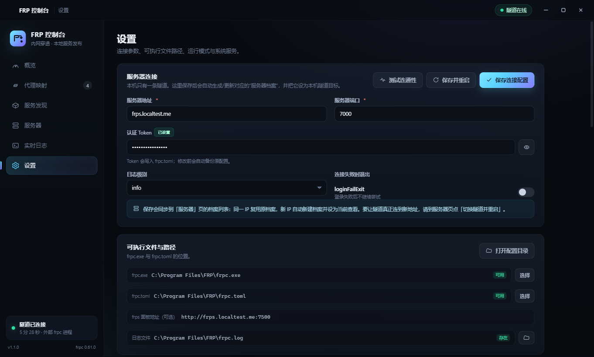

# FRP 控制台

[](LICENSE)
[](#系统要求)
[](package.json)
[](https://github.com/THEysh/FRP-Console/releases)

**把 frpc 从「改 TOML + systemctl」变成点几下鼠标。** 一个 Windows 桌面控制台，管代理、管隧道、还能反向通过 SSH 去管服务端的 frps。


## 它解决什么问题

手搓 [frp](https://github.com/fatedier/frp) 的日常是这样的：改 `frpc.toml` → 重启 frpc → 上服务器看 `journalctl` → 用 `nc` 试端口通不通 → 忘了 Token 是哪一份 → 端口撞了再改一轮。

这个控制台把这些收进一个窗口：

- **不用手写配置**：代理增删改直接写 `frpc.toml` 并热重载，其他代理不断线；写前自动备份，保留最近 30 份。
- **状态是查出来的，不是猜的**：每个代理要过「本地服务 → 隧道 → 公网」三层检查才显示"在线"，失败在哪层就报哪层。
- **服务端也能管**：填 IP + SSH 密码就能读 frps 状态、改配置、重启；服务器上连 frps 都没装的话，一键上传并装成服务。
- **多台服务器不再是复制粘贴**：把每台服务器存成「档案」，切换时先探端口通不通，再改写 `frpc.toml` 并重启。

## 功能

| 模块 | 说明 |
| --- | --- |
| **概览** | 隧道状态、服务器信息、在线/异常代理计数、最近日志，一眼看清隧道到底通没通 |
| **代理映射** | TCP / UDP / HTTP / HTTPS / STCP / XTCP 代理的增删改；自动建议未占用的公网端口；压缩与加密开关；单条测试公网可达 |
| **服务发现** | 扫本机 TCP 监听端口并显示进程，勾一个端口就变成公网代理 |
| **服务器（frps）** | SSH 连接后识别 systemd / 裸进程 / Docker / 端口四种运行方式，展示版本与 Token 状态，支持启停、配置向导、全链路检测、结构化日志 |
| **实时日志** | 跟随 `frpc.log`，按级别过滤、暂停、导出 |
| **设置** | 服务器地址 / 端口 / Token、frpc 路径、运行模式、管理 API、托盘行为 |

<table>
<tr>
<td width="50%"></td>
<td width="50%"></td>
</tr>
<tr>
<td></td>
<td></td>
</tr>
</table>

## 下载安装

到 [Releases](https://github.com/THEysh/FRP-Console/releases) 下载最新安装包：

| 文件 | 说明 |
| --- | --- |
| `FRP-Console-Setup-<版本>-x64.exe` | NSIS 一键安装，装到 `%LOCALAPPDATA%\Programs\frp-console`，自动建桌面与开始菜单快捷方式 |
| `FRP-Console-<版本>.exe` | 单文件便携版（如已提供），数据写在 exe 同级的 `frp-console-data\` |

安装包只装控制台，**不含 frpc**——请自行从 [frp Releases](https://github.com/fatedier/frp/releases) 下载 `frpc.exe`，放在控制台能找到的位置（建议与控制台同目录），或在「设置 → 可执行文件与路径」里手动选择。

### 系统要求

- Windows 10 / 11（x64）
- 会被管理的隧道需要本机有 `frpc.exe`；服务端管理需要目标机器开启 SSH
- 不做跨平台：服务控制走 `sc` / UAC，端口扫描走 `netstat` + PowerShell，都是 Windows 专有实现

## 从源码运行

```bash
git clone https://github.com/THEysh/FRP-Console.git
cd FRP-Console
npm install
npm start
```

国内网络建议先设镜像：

```powershell
$env:ELECTRON_MIRROR = "https://npmmirror.com/mirrors/electron/"
$env:ELECTRON_BUILDER_BINARIES_MIRROR = "https://npmmirror.com/mirrors/electron-builder-binaries/"
npm install --cache .\.npm-cache
```

## 快速上手

1. **认到 frpc**：首次启动会自动在程序目录和常见路径找 `frpc.exe` / `frpc.toml`，找不到就去「设置 → 可执行文件与路径」选一下。
2. **填服务器**：在「设置 → 服务器连接」填 frps 地址、端口（默认 7000）、Token，点「测试连通性」确认能连上，再点「保存连接配置」。
3. **起隧道**：回到概览点「启动隧道」。
4. **发代理**：「代理映射 → 新增代理」，或用「服务发现」扫一个本机端口直接发布。

> 想开机自启就走 Windows 服务模式（见 [运行模式](#运行模式)）；只是临时用，让控制台托管进程更省事——关掉控制台 frpc 也会一起停。

## 三层连通性检查

代理"在线"不是看进程有没有起来，而是三层都过：

```
① 本地服务   127.0.0.1:8080 能连上吗          → 不通 = 本地服务不通
② 隧道       frpc 已连 frps，且该代理已注册     → 不通 = 隧道未建立
③ 公网       从本机连 serverAddr:remotePort     → 不通 = 公网不可达
```

任一层失败即短路，后面的层不再探测；悬停状态徽章能看到每层结果。检查每 14 秒刷新一次，保存配置 / 启动隧道 / 热重载后立即重查。

这样设计的好处是**报错直接指向原因**：本地服务没起来却去查安全组，是最常见的浪费时间。如果 frpc 根本没连上 frps，控制台会直接说清是哪个地址、什么原因（端口未监听 / 网络不可达 / Token 不对），并附上 frpc 的原始报错。

## 多服务器与服务器档案

一个本机 `frpc.toml` 同一时间只能连一台 frps，但你可以保存任意多个**服务器档案**。

- 档案字段：名称、IP/域名、SSH 端口与用户名、frps 端口、Token、远程配置路径、面板地址。
- 密码**按档案独立保存**（Windows DPAPI 加密），档案之间不共享、不回退——不会出现"拿 A 的密码去连 B"。
- 「服务器」页顶部的下拉框切换的是**查看目标**，不动隧道；只有点「切换隧道并重启」才会改写 `frpc.toml` 并重启 frpc。

| 动作 | 作用 |
| --- | --- |
| 仅查看 | 什么都不改，只看这台服务器的状态与配置 |
| 切换隧道并重启 | 把 `frpc.toml` 指向该档案，重启 frpc（二次确认，所有代理短暂重连） |

切换前会先探一次目标服务器的 frps 端口：连不上就不动配置，弹窗说明原因（拒绝 / 超时 / 解析失败），是否继续由你决定。切换过程有进度浮层，按「写入 frpc.toml → 重启 frpc → 等待新隧道上线」三步推进，不靠估算。

记住密码后，选中档案就会自动连接并读取状态，不用每次点「连接并读取状态」。

## frps 服务端控制台

「服务器」页通过 SSH 连上 frps 所在主机，把服务端从"看板"升级成可操作的闭环：**连接 → 状态识别 → 配置向导 → 保存并重启 → 全链路检测 → 看日志**。

- **状态识别**：同时检查 systemd 服务、`frps` 进程、Docker 容器与监听端口，避免"实际在跑却显示已停止"；版本优先从 PATH、进程可执行文件或镜像识别。
- **快速配置向导**：模板有 基础穿透 / 带鉴权 / 带鉴权 + 面板 / HTTPS 域名 / 自定义，右侧实时生成 `frps.toml` 预览。写入前本机校验 TOML，服务器上若存在 `frps` 还会先跑 `frps verify`，通过后备份为 `.bak-时间戳` 再覆盖。
- **一键初始化**：服务器上还没有 frps 也能从零开始——按架构（amd64 / arm64）上传内置的 frps 0.61.0、写配置、注册 `frps.service`（无 systemd 时回退后台进程）、清掉旧的裸进程避免 7000 冲突。可选「同时把本机 frpc 的地址与 Token 改为本次配置」。
- **结构化日志**：把 `journalctl -u frps`、`docker logs` 或 `frps.log` 解析成时间 / 级别 / 内容三列，汇总启动时间、客户端连接数与错误数。

> 需要目标机器已开 SSH，并使用 root 或具备 `systemctl` / `docker` 权限的账户。非 root 但配了免密 `sudo` 时，控制命令会自动改用 `sudo -n`。Docker 启动的 frps 会改用 `docker start/stop/restart` 操作。

## 运行模式

| 模式 | 说明 |
| --- | --- |
| **Windows 服务** | 通过 `sc` / UAC 启停已安装的 frpc 服务，适合开机自启 |
| **应用托管进程** | 控制台直接拉起 `frpc.exe -c frpc.toml`，退出控制台会一并结束 |
| **自动** | 优先使用已安装的 Windows 服务，没有再托管进程 |

## 托盘与退出

**关窗口 ≠ 退出**：

| 操作 | 效果 |
| --- | --- |
| 点标题栏 X | 收进托盘，隧道继续跑（可在设置里改成"关闭即退出"） |
| 托盘图标单击 | 显示 / 隐藏主界面（双击强制显示） |
| 托盘右键 | 状态、启停隧道、热重载、打开配置、**退出 FRP 控制台** |

退出时会先停掉自己拉起的 frpc 再结束进程，不留孤儿；清理最多等 8 秒，之后强制退出。托盘图标三态：绿点=在线，灰点=未连接，红点=连不上服务器。

**只允许一个实例**：同数据目录靠 Electron 单实例锁，跨数据目录（安装版 + 便携版同时开）靠固定端口 47823 握手。第二个实例会把已有窗口叫到前台后自行退出。

**如果托盘建不出来**（图标缺失，或被安全软件拦截），关闭窗口会直接退出程序，而不是把窗口藏起来——避免"窗口消失且叫不回来"只能去任务管理器杀进程。控制台每 3 秒用 `tray.getBounds()` 自检：系统分配的位置连续三次全 0 就判定为"假托盘"，此时设置页会提示，点 X 改为直接退出。

> 看不到托盘图标时，先点任务栏的「^ 显示隐藏的图标」——Windows 默认把新图标折叠进溢出面板，折叠状态下 `getBounds()` 也可能是 0。仍不行就把程序移出被安全软件重点管控的目录再试。

## 管理 API

控制台通过 frpc 自带的 Admin API（默认 `127.0.0.1:7400`，`admin/admin`）读代理状态并触发热重载。这个监听只在 `webServer.addr = "127.0.0.1"` 时开放；「设置 → 管理 API」可以一键补全。改了端口或账号请在设置里同步。

## 常见问题

- **双击 exe 没反应 / 一闪就退出**：多见于以管理员身份运行的受限桌面——Chromium 沙箱初始化失败，进程在进入主进程代码前就以退出码 `3` 结束，界面来不及提示。用 `npm run dev:nosandbox`，或给快捷方式「目标」末尾补 ` --no-sandbox`。
- **点 X 后程序还在**：默认「关闭到托盘」，隧道不会断。要真正退出用**托盘右键 → 退出**。
- **换了服务器地址但仍连旧服务器**：frpc 的 reload 不会重建服务器连接，必须重启隧道（「保存并重启」或概览页「重启」）。
- **公网端口不通**：先在代理列表点「测试公网端口」；仍不通就检查服务端安全组 / 防火墙是否放行该端口，以及代理是否为 `running`。
- **服务启停弹 UAC**：Windows 服务需要管理员权限；取消授权不影响已有隧道。
- **看到两个控制台窗口**：不会。单实例锁 + 固定端口 47823 双保险，后启动的副本会叫出已有窗口后退出。
- **启动即退出 / 白屏**：程序会依次尝试 exe 同级 `frp-console-data`、`%LOCALAPPDATA%\frp-console`、程序目录下的数据目录；都不可写时会失败，请换到有写权限的位置。

## 开发

```
src/main/          主进程
  index.js         IPC、窗口、托盘、状态机
  frpc.js          frpc 进程托管、管理 API、热重载
  settings.js      设置、服务器档案、按档案加密的密码库（DPAPI）
  config.js        frpc.toml 解析与写入
  service.js       Windows 服务检测与启停
  ssh.js           SSH 会话、frps 状态识别
  frpsconfig.js    frps 配置解析、向导字段与 TOML 生成
  netport.js       本机 TCP 监听端口扫描
  log.js           日志跟随
  preload.js       contextBridge 暴露 window.FRP
src/renderer/      无框架单页界面（index.html / styles.css / app.js）
assets/            应用与托盘图标（托盘图标由脚本生成）
resources/frps/    内置 frps 二进制（linux-amd64 / linux-arm64），一键初始化用
tools/             CDP 自检脚本与构建辅助
build/installer.nsh  NSIS 安装脚本
```

渲染层不引任何框架，靠 `window.FRP`（preload 暴露的 IPC 封装）与主进程通信；界面状态由主进程 `state:update` 事件推送，不做轮询。

### 打包

```bash
npm run dist           # NSIS 安装包 → dist/FRP-Console-Setup-<版本>-x64.exe
npm run dist:portable  # 单文件便携版 → dist/FRP-Console-<版本>.exe
npm run dist:dir       # 免安装目录 dist/win-unpacked，调试用
npm run tray-icons     # 重新生成托盘三态图标
```

**打包卡在 `packaging platform=win32` 不动**：electron-builder 解包 Electron 前要在 `%TEMP%` 拿一把下载锁，上次构建被强行中断会留下它。删掉再重跑：

```powershell
Remove-Item "$env:TEMP\eb-dl-*.lock.lock" -Recurse -Force
npm run dist
```

### 自检脚本

`tools/` 下是基于 CDP 的自动化脚本。用独立的 userData 和实例端口跑，不会碰到你正在用的实例：

```bash
FRP_INSTANCE_PORT=47827 PORTABLE_EXECUTABLE_DIR=/tmp/frpsmoke \
  npx electron . --no-sandbox --remote-debugging-port=9333

node tools/ui-test.cjs                     # 逐页自检 + 截图（横向溢出、元素越界、console.error）
node tools/ui-flow.cjs settings            # 交互流程：settings / logs / proxies / server / tunnel / misc / winctl
node tools/cdp-eval.cjs "document.title"   # 在渲染层执行任意表达式
node tools/cdp-shot.cjs .proxy-row out.png # 按选择器截单个元素
```

`FRP_INSTANCE_PORT` 让测试实例用独立单实例锁，`PORTABLE_EXECUTABLE_DIR` 让它把设置写到别处；两者缺一，测试实例会被正在运行的正式实例挡掉，或改到你的真实配置。

## 安全说明

- SSH 密码与本机 Token 使用 Windows DPAPI 加密后存在用户数据目录，**不会明文落盘**；解密绑定当前 Windows 账户，拷到别的机器上无效。
- 控制台不向外发包，所有连接都是你显式发起的（本机 frpc、frpc Admin API、你填的 SSH 主机）。
- frps 初始化会写入 `/etc/frp/frps.toml`、注册系统服务并重启 frps；**若服务器上原有的 frps 正在服务其他隧道，这会短暂中断并替换其配置**，执行前请确认影响范围。

## 许可证

[MIT](LICENSE)

frp 本身由 [fatedier/frp](https://github.com/fatedier/frp) 开发，遵循 Apache-2.0；`resources/frps/` 下是 frp 0.61.0 的官方二进制，仅用于「一键初始化」上传到你的服务器。
