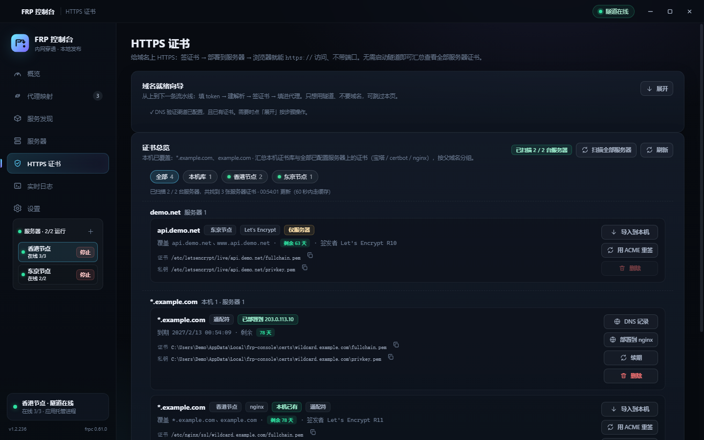
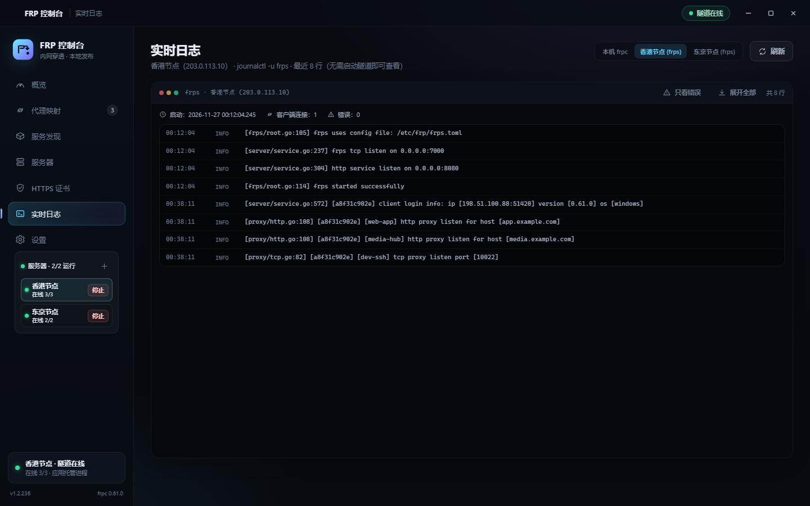

# FRP 控制台

[](LICENSE)
[](#系统要求)
[](package.json)
[](https://github.com/THEysh/FRP-Console/releases)

**把 frp 从「手改 TOML + 反复 SSH 排错」变成点几下鼠标。** 一款面向 Windows 的桌面控制台，支持同时连接多台 frps 服务器，统一管理本机代理、隧道运行态、服务端部署、防火墙、HTTPS 证书与多机实时日志。


---

## 核心亮点

- **多台服务器并行在线**：每台服务器拥有独立的 `frpc.toml`、独立 `frpc` 进程与管理端口，可同时在线互不干扰；侧栏或服务器页切换仅切换当前视图，不会停止正在运行的隧道。
- **零手写配置与热重载**：图形化增删改代理自动写入配置并热重载（其他代理不断线），支持编辑时跨服务器迁移代理，写入前自动备份最近 10 份配置。
- **三层真实连通检测**：代理状态不是看进程是否存活，而是依次验证 `本地服务 → 隧道注册 → 公网可达`，失败在哪一层就精确指出哪一层。
- **一体化服务端运维**：通过 SSH 直接识别 `systemd` / 裸进程 / Docker 三种 `frps` 运行方式，支持一键从零部署、在线编辑配置、三信号端口与防火墙诊断、以及内置交互式 SSH 终端。
- **全服务器 HTTPS 证书与直读多机日志**：无需启动隧道即可在「实时日志」直连切换本机 `frpc` 与任意一台服务器的 `frps` 日志；在「HTTPS 证书」页自动汇总扫描全部已配置服务器的证书（60 秒缓存），并内置 Cloudflare API Token 4 步新手指引与一键签发部署。

---

## 界面一览

<table>
<tr>
<td width="50%" align="center"><br><sub>代理映射 · 跨服务器全量列表与三层连通状态</sub></td>
<td width="50%" align="center"><br><sub>服务器 · 多机切换、frps 管控与四步就绪检查</sub></td>
</tr>
<tr>
<td width="50%" align="center"><br><sub>HTTPS 证书 · 汇总扫描全部服务器证书与一键导入</sub></td>
<td width="50%" align="center"><br><sub>实时日志 · 免启隧道直连切换本机 frpc 与多机 frps</sub></td>
</tr>
<tr>
<td colspan="2" align="center"><br><sub>设置 · 开关拨动即自动生效，技术参数折叠收纳</sub></td>
</tr>
</table>

---

## 下载与安装

前往 [Releases](https://github.com/THEysh/FRP-Console/releases) 下载最新版本：

| 安装包 | 说明 |
| --- | --- |
| `FRP-Console-Setup-<版本>-x64.exe` | **NSIS 安装版（推荐）**：安装至 `%LOCALAPPDATA%\Programs\frp-console`，自动创建快捷方式，支持应用内差分自动更新 |
| `FRP-Console-<版本>.exe` | **单文件便携版**：双击即用，数据保存在 exe 同级 `frp-console-data\` 目录（升级时手动替换 exe） |

- **开箱即用**：安装包已内置 `frpc.exe`（frp `0.61.0`），首次启动自动初始化数据目录，无需单独下载 `frpc`。
- **服务端 `frps`**：首次在「服务器」页执行「一键初始化」时按目标机架构（`amd64` / `arm64`）自动获取并缓存复用。
- **应用内更新**：安装版可在「设置 → 关于 → 检查更新」一键下载并重启安装；更新前会自动记录运行中的服务器连接，重启后自动恢复拉起。

### 系统要求

- Windows 10 / 11（64 位）
- 公网服务器需开启 SSH（用于服务端状态读取、一键部署、日志与证书扫描）；如仅作为纯客户端连接已有 `frps`，也可不连 SSH

---

## 快速上手（4 步打通第一条隧道）

> **概念速记**：`frps` 跑在有公网 IP 的服务器上充当中转站，`frpc` 跑在你本机主动连向 `frps`，把本地端口暴露出去。完整链路：`外部访问 → 服务器 (frps) → 本机 (frpc) → 本地服务`。

1. **安装并打开控制台**
   下载安装版或便携版直接运行。程序会自动创建配置骨架，不需要手动准备 `frpc.exe`。
2. **添加并初始化服务器**
   进入左侧 **「服务器」** 页，点击 **「＋ 再连一台」**，填写服务器 IP、SSH 端口（默认 22）、用户名和密码（Token 会自动生成，若服务器已有 `frps` 则自动复用其配置）：
   - 服务器尚未安装 `frps`：点击 **「一键初始化并启动」**，自动完成下载上传、写入配置、注册系统服务、开启自启与防火墙放行，并同步本机配置。
   - 点击 **「检查服务器」**：确认 `SSH 通道 → frps 运行 → bindPort 监听 → Token 一致` 四项全绿。
3. **添加代理映射**
   进入 **「代理映射」** 页点击 **「新增代理」**（或在 **「服务发现」** 扫描本机监听端口一键发布）：
   - 选择目标服务器、协议类型（通用选 `TCP`，绑定域名选 `HTTP` / `HTTPS`）、本地端口。
   - 公网端口可点 **「随机」** 自动避开冲突与浏览器禁用端口，或点 **「检测」** 实时排查占用、白名单与防火墙状态。
4. **启动并验证**
   在侧栏或 **「概览」** 页启动对应服务器隧道，待状态变为 **「在线 · 三层连通」** 后，用手机流量或其他设备访问公网地址即可。

<details>
<summary><b>进阶：给服务绑定自己的域名 + HTTPS（支持通配符证书）</b></summary>

支持两种方式，按需二选一：

- **路线 A：服务器 nginx 反代（推荐，访问 `https://域名` 不带端口）**
  1. 在 **「服务器」** 页找到「HTTPS 域名反代（nginx）」卡片，点击「安装 nginx 并配置」或「一键配置反代」（会自动补齐 `vhostHTTPPort`）。
  2. 进入 **「HTTPS 证书」** 页展开「域名就绪向导」，按内置 **4 步指引** 获取并保存 Cloudflare API Token → 一键建 DNS 解析（建议灰云仅 DNS）→ 签发 Let's Encrypt 正式证书（自动部署到服务器 nginx，90 天有效且到期前自动续期）。
  3. 在 **「代理映射」** 新建 `HTTP` 代理并填写自定义域名即可。
- **路线 B：frp 原生 `https2http`（无需 nginx，访问带 vhost 端口）**
  1. 在 **「HTTPS 证书」** 页签发证书。
  2. 在 **「代理映射」** 新建 `HTTPS` 代理，插件选 `https2http`，通过「证书快捷填入」自动填充证书路径与域名。

</details>

---

## 核心功能说明

### 多服务器并行管理
- **独立运行态**：最多支持 16 条服务器连接，每条连接独立配置文件、独立 `frpc` 进程与独立管理端口；多连接时自动采用「应用托管进程」模式。
- **切换不停隧道**：在左侧边栏或服务器页切换连接，仅切换查看与编辑目标，正在运行的隧道完全不受影响。
- **跨服务器代理管理**：代理映射页默认汇总展示全部服务器的代理，支持按服务器标签筛选，编辑代理时可直接更换目标服务器并自动迁移配置。
- **全局启停与托盘**：概览页顶部与系统托盘右键菜单均支持查看各服务器状态、单台启停以及「全部启动 / 全部停止」；开启「启动时自动启动隧道」会自动拉起所有已启用服务器。

### 三层连通检查与端口诊断
- **概览 / 代理映射（端到端三层检查）**：每 14 秒自动探测 `① 本地服务 → ② 隧道注册 → ③ 公网可达`，任一层异常直接定位原因（例如本地未启动、根路径 404、公网被拦）。
- **服务器页（端口与连通三信号矩阵）**：交叉比对服务器 `监听状态 (ss)`、`系统防火墙规则 (ufw/firewalld/iptables)` 与 `本机公网实测`，一眼区分「未监听」「服务器防火墙未放行（可一键放行）」和「云安全组拦截（提供规则一键复制）」。

### HTTPS 证书与多机日志
- **全服务器证书汇总**：进入「HTTPS 证书」页自动静默扫描全部已配置服务器上的证书（支持 nginx / 宝塔 / Let's Encrypt），结果按主机缓存 60 秒；顶部可按「全部 / 本机库 / 各台服务器」筛选，支持一键导入本机、重签、删除或解除站点引用。
- **多机实时日志**：在「实时日志」页顶部直接切换 `本机 frpc` 与任意已配置服务器的 `frps` 日志，按需建立短期 SSH 会话读取，不依赖隧道启动、也无需先去服务器页连接；若某台服务器尚未保存密码，支持在页内就地输入并加密保存。

### 托盘、开机自启与设置
- **自动保存与精简界面**：「设置 → 行为与开机」所有开关拨动即自动生效；运行模式、刷新间隔、日志级别与管理 API 口令收纳在默认折叠的「高级设置」中。
- **托盘与静默开机**：支持「关闭窗口时最小化到托盘」「开机自动启动」与「以最小化状态启动」，托盘图标被收纳进 Windows 溢出区时也能正常静默驻留不误弹窗。
- **断线自动重连**：托管进程异常退出、管理接口假死或系统睡眠唤醒断连时，按退避策略（1s → 30s → 60s → 每 5 分钟）自动拉起并恢复隧道。

---

## 常见问题

- **公网端口连不上，但本地服务正常**
  先在代理行点击「测试公网端口」，再去「服务器 → 端口与连通」查看三信号结论：若是服务器防火墙未放行，点击行尾「放行」即可；若显示「已监听 + 防火墙已放行 + 实测不通」，请到云厂商控制台（阿里云 / 腾讯云等）的**安全组**放行对应端口。
- **点右上角 X 关闭窗口后程序还在运行**
  默认开启「关闭窗口时最小化到托盘」，保持隧道不中断。如需彻底退出，请在右下角托盘图标右键选择「退出 FRP 控制台」。
- **双击程序闪退 / 无法启动**
  若处于受限管理员环境导致 Chromium 沙箱初始化失败，可在快捷方式目标末尾追加 `--no-sandbox`，或源码模式下运行 `npm run dev:nosandbox`。
- **一键初始化卡在下载 `frps`**
  可手动下载官方 `frp_0.61.0_linux_<arch>.tar.gz` 并将 `frps` 放至 `%LOCALAPPDATA%\frp-console\frps-cache\frp_0.61.0_linux_amd64\frps`，或配置环境变量 `FRP_DOWNLOAD_MIRROR` 走镜像加速。
- **如何查看本地配置与日志目录**
  进入 **「设置 → 关于」**，点击右上角 **「打开数据目录」** 即可在资源管理器中定位全部配置、备份与日志文件。

---

## 安全与隐私说明

- **凭据本机加密**：所有 SSH 密码与 Cloudflare API Token 均通过 Windows DPAPI 绑定当前用户加密存储，绝不明文写入配置文件或日志。
- **默认随机凭据**：新连接的 `frps` Token（24 位）与本机管理 API 口令（20 位）均由 `crypto.randomBytes` 随机生成，且 SSH 首次连接会记录主机密钥指纹并在后续连接中持续比对（可在「设置 → 已知服务器指纹」管理）。
- **无静默联网**：除用户主动点击「检查更新」访问 GitHub Releases、或「一键初始化」获取 `frps` 外，程序不会主动向外发送任何遥测或请求。

---

## 从源码运行与开发

```bash
git clone https://github.com/THEysh/FRP-Console.git
cd FRP-Console
npm install
npm start
```

### 常用命令

```bash
npm test                 # 语法检查 + ESLint + 单元测试 + 机密扫描
npm run test:e2e         # Electron 端到端回归测试
npm run dist             # 构建 Windows NSIS 安装包
npm run dist:portable    # 构建 Windows 单文件便携版
```

### 目录概览

```text
src/main/                主进程（IPC、多连接运行时、frpc 托管、SSH/frps 运维、ACME/DNS、自动更新）
src/renderer/            无框架渲染层（index.html / styles.css / app.js）
assets/                  应用图标与托盘三态图标
vendor/frp-src/          官方 frp 压缩包（构建时校验 sha256 解压内置 frpc.exe）
tests/                   单元测试（tests/unit）与端到端场景（tests/e2e）
build/installer.nsh      NSIS 自定义安装与升级保护脚本
```

---

## 许可证

本项目基于 [MIT](LICENSE) 协议开源。内置及托管的 [frp](https://github.com/fatedier/frp) 遵循 Apache-2.0 协议。
