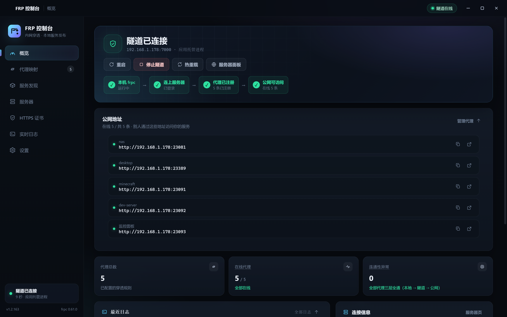

# FRP 控制台

[](LICENSE)
[](#系统要求)
[](package.json)
[](https://github.com/THEysh/FRP-Console/releases)

**把 frpc 从「改 TOML + systemctl」变成点几下鼠标。** 一个 Windows 桌面控制台，管代理、管隧道、还能反向通过 SSH 去管服务端的 frps。



## 它解决什么问题

手搓 [frp](https://github.com/fatedier/frp) 的日常是这样的：改 `frpc.toml` → 重启 frpc → 上服务器看 `journalctl` → 用 `nc` 试端口通不通 → 忘了 Token 是哪一份 → 端口撞了再改一轮。

这个控制台把这些收进一个窗口：

- **不用手写配置**：代理增删改直接写 `frpc.toml` 并热重载，其他代理不断线；写前自动备份，保留最近 30 份。
- **状态是查出来的，不是猜的**：每个代理要过「本地服务 → 隧道 → 公网」三层检查才显示"在线"，失败在哪层就报哪层。
- **服务端也能管**：填 IP + SSH 密码就能读 frps 状态、改配置、重启；服务器上连 frps 都没装的话，一键上传并装成服务。
- **多台服务器不再是复制粘贴**：把每台服务器存成「档案」，切换时先探端口通不通，再改写 `frpc.toml` 并重启。

## 功能

| 模块 | 说明 |
| --- | --- |
| **概览** | 隧道状态、服务器信息、在线/异常代理计数、最近日志，一眼看清隧道到底通没通 |
| **代理映射** | TCP / UDP / HTTP / HTTPS / STCP / XTCP 代理的增删改；自动建议未占用的公网端口；压缩与加密开关；单条测试公网可达 |
| **服务发现** | 扫本机 TCP 监听端口并显示进程，勾一个端口就变成公网代理 |
| **服务器（frps）** | SSH 连接后识别 systemd / 裸进程 / Docker / 端口四种运行方式，展示版本与 Token 状态，支持启停、配置向导、**服务器就绪检查**、结构化日志 |
| **实时日志** | 跟随 `frpc.log`，按级别过滤、暂停、导出 |
| **设置** | frpc 路径、日志级别、运行模式、开机自启、管理 API、托盘行为、版本更新（**不含任何服务器连接配置**） |
| **自动更新** | 「设置 → 关于」里检查新版本、下载、重启安装；安装版走 NSIS 差分更新，便携版只给下载入口 |

<table>
<tr>
<td width="50%"></td>
<td width="50%"></td>
</tr>
<tr>
<td></td>
<td></td>
</tr>
</table>

## 下载安装

到 [Releases](https://github.com/THEysh/FRP-Console/releases) 下载最新安装包：

| 文件 | 说明 |
| --- | --- |
| `FRP-Console-Setup-<版本>-x64.exe` | NSIS 一键安装，装到 `%LOCALAPPDATA%\Programs\frp-console`，自动建桌面与开始菜单快捷方式 |
| `FRP-Console-<版本>.exe` | 单文件便携版，数据写在 exe 同级的 `frp-console-data\` |

安装包**内置 `frpc.exe`**（frp 0.61.0，随包升级，装完就能用，不用自己去下载和放目录）。服务端的 `frps` 仍是首次「一键初始化」时按服务器架构自动下载（约 18 MB，只下一次），详见 [frps 服务端控制台](#frps-服务端控制台)。

内置的 `frpc.exe` 位于 `<安装目录>\resources\frpc\frpc.exe`，**不要手动改它，也不要往里写配置**——安装目录在升级时会被整个替换。「设置 → 可执行文件与路径」里那张路径卡就是它，`frpc.toml` 则固定放在数据目录（`%LOCALAPPDATA%\frp-console\frpc.toml`）。想用自己的 frpc 版本，就在那里手动选一个 exe，选中后以你的为准。

### 版本更新

安装版支持应用内更新：**设置 → 关于 → 检查更新**，发现新版本后点「下载更新」（走 NSIS 差分，只下变化的片段），下完点「重启并安装」，控制台关闭、安装、自动重开。

- **不会偷偷联网**：不检查则不请求，只在点按钮时才去 GitHub 取 Release 信息，见 [安全说明](#安全说明)。
- **升级是一次「卸载旧版 + 装新版」**（electron-builder 的 NSIS 流程），不是覆盖文件。`settings.json`、服务器档案、DPAPI 密码都在数据目录，不受影响。
- 放在安装目录里的 `frpc.exe` / `frpc.toml` / `frp-console-backups/` 会在升级前被搬到 `%LOCALAPPDATA%\frp-console\upgrade-rescue`，装完再搬回去——即便如此，**仍建议把 frpc 放在数据目录而不是安装目录**。
- 托管进程模式下升级会短暂断开隧道（安装器结束控制台时会带走 frpc 子进程）。控制台会在安装前留一张便条，新版本启动后自动把隧道接回来；系统服务模式完全不受影响。
- **便携版不支持自替换**：关于里只提供「打开发布页」，手动下载新版本替换 exe 即可（数据在 exe 同级的 `frp-console-data\`）。

### 系统要求
- Windows 10 / 11（x64）
- 会被管理的隧道需要本机有 `frpc.exe`；服务端管理需要目标机器开启 SSH
- 不做跨平台：服务控制走 `sc` / UAC，端口扫描走 `netstat` + PowerShell，都是 Windows 专有实现

## 从源码运行

```bash
git clone https://github.com/THEysh/FRP-Console.git
cd FRP-Console
npm install
npm start
```

国内网络建议先设镜像：

```powershell
$env:ELECTRON_MIRROR = "https://npmmirror.com/mirrors/electron/"
$env:ELECTRON_BUILDER_BINARIES_MIRROR = "https://npmmirror.com/mirrors/electron-builder-binaries/"
npm install --cache .\.npm-cache
```

## 快速上手

装完到打通一条隧道，正常只要四步：

1. **装完直接开**：`frpc.exe` 已经在安装包里，`frpc.toml` 由程序在数据目录自动建好（只有骨架：地址与 Token 留空，**不带任何预置代理**——预置一条连不上的代理只会让新装的人在概览看到红色"本地服务不通"）。不需要你去下载 frpc、也不需要找目录。
2. **在「服务器」页建档案**：「新建」只问服务器 IP、SSH 端口/用户名和密码。保存后如果填了密码，会直接连上去；没填就停在连接表单让你补一次。**Token 不用填**，保存档案时后端就生成好一把随机值了。
3. **在「服务器」页把 frps 弄好**：连上后会识别 systemd / 裸进程 / Docker。服务器上还没有 frps 就点「一键初始化并启动」——上传、写配置、注册服务、开机自启一次做完，并且默认勾选「同时把本机 frpc 的地址与 Token 改为本次配置」。做完点「检查服务器」，四步全绿就代表这台服务器**已经准备好接收客户端**。
4. **在「代理映射」加隧道**：新增一条代理（或用「服务发现」扫一个本机端口直接发布）。加完回到**概览**或**代理映射**看链路：三层全绿才是真的能用。

> 想开机自启就走 Windows 服务模式（见 [运行模式](#运行模式)）；只是临时用，让控制台托管进程更省事——关掉控制台 frpc 也会一起停。

## 三层连通性检查

> 这一节说的是**概览 / 代理映射页**的检测，判的是"用户能不能访问到你的服务"。
> 「服务器」页那个按钮是另一回事，只看服务器自己准备好没有，见 [服务器就绪检查](#服务器就绪检查)。

代理"在线"不是看进程有没有起来，而是三层都过：

```
① 本地服务   127.0.0.1:8080 能连上吗          → 不通 = 本地服务不通
② 隧道       frpc 已连 frps，且该代理已注册     → 不通 = 隧道未建立
③ 公网       从本机连 serverAddr:remotePort     → 不通 = 公网不可达
```

任一层失败即短路，后面的层不再探测；悬停状态徽章能看到每层结果。检查每 14 秒刷新一次，保存配置 / 启动隧道 / 热重载后立即重查。

几条实现上的取舍：

- **所有代理都会检查**，不再有“只查前 16 条”的上限；并发 6 条、单轮预算 7 秒，超出的留到下一轮继续。
- **没测出结果 ≠ 在线**：刚启动、还没轮到的代理显示“待检测”，不会被算进“全部在线”。
- `udp` / `stcp` / `xtcp` / `sudp` / `tcpmux` 没有可直连的公网 TCP 端口，第 ③ 层标记为跳过，只要求①②通过。
- `http` / `https` 代理按 frps 的 `vhostHTTPPort` / `vhostHTTPSPort`（设置里可填）连 IP 并带上 `Host` 头去探测，端口不是 80/443 也不会误报“公网不可达”。

这样设计的好处是**报错直接指向原因**：本地服务没起来却去查安全组，是最常见的浪费时间。如果 frpc 根本没连上 frps，控制台会直接说清是哪个地址、什么原因（端口未监听 / 网络不可达 / Token 不对），并附上 frpc 的原始报错。


## 服务器就绪检查

「服务器」页的检查只回答一个问题：**这台服务器准备好接收客户端了吗**。四步依次判断，任一步失败立即短路：

```
① SSH 通道     还能在服务器上执行命令吗
② frps 运行    systemd / 进程 / Docker 任一种在跑，并顺带回读开机自启状态
③ bindPort     服务器本机 ss / netstat 里能看到 frps 的 bindPort
④ Token 一致   服务端 auth.token 与本机档案里的 Token 是否完全相同
```

四步全绿 = 可以去加代理了；全绿**不代表**隧道能用——那要回概览看三层。

以前这里跑的是三层检测，和概览页重复，而且"本地服务"这一层在还没建代理时必然是红的，看起来像"服务器配置失败"。现在分工清楚了：服务器页管服务端就绪，概览/代理映射管端到端连通。

## 多服务器与服务器档案

一个本机 `frpc.toml` 同一时间只能连一台 frps，但你可以保存任意多个**服务器档案**。

- 档案字段：名称、IP/域名、SSH 端口与用户名、frps 端口、Token、远程配置路径、面板地址。日常只需要填前四个。
- **Token 自动生成**：新建档案时后端生成一把随机 Token，它同时是「服务端配置向导」的默认值——写进 `frps.toml` 的 `auth.token` 和写进本机 `frpc.toml` 的是同一个字符串。想接管一台已经配好 frps 的服务器（Token 早已定死），再在「高级选项」里把它填回去即可。
- 密码**按档案独立保存**（Windows DPAPI 加密），档案之间不共享、不回退——不会出现"拿 A 的密码去连 B"。
- 「服务器」页顶部的下拉框切换的是**查看目标**，不动隧道；只有点「切换隧道并重启」才会改写 `frpc.toml` 并重启 frpc。
- **新建档案会断开上一台的 SSH 会话**：页面立刻变成这台新服务器的连接表单，不会继续显示上一台的状态，也不会在顶部弹"本机隧道指向其他服务器"这种吓人的提示。

| 动作 | 作用 |
| --- | --- |
| 仅查看 | 什么都不改，只看这台服务器的状态与配置 |
| 切换隧道并重启 | 把 `frpc.toml` 指向该档案，重启 frpc（二次确认，所有代理短暂重连） |

切换前会先探一次目标服务器的 frps 端口：连不上就不动配置，弹窗说明原因（拒绝 / 超时 / 解析失败），是否继续由你决定。切换过程有进度浮层，按「写入 frpc.toml → 重启 frpc → 等待新隧道上线」三步推进，不靠估算。

记住密码后，选中档案就会自动连接并读取状态，不用每次点「连接并读取状态」。

## frps 服务端控制台

「服务器」页通过 SSH 连上 frps 所在主机，把服务端从"看板"升级成可操作的闭环：**连接 → 状态识别 → 配置向导 → 保存并重启 → 服务器就绪检查 → 看日志**。

- **状态识别**：同时检查 systemd 服务、`frps` 进程、Docker 容器与监听端口，避免"实际在跑却显示已停止"；版本优先从 PATH、进程可执行文件或镜像识别。
- **快速配置向导**：模板有 基础穿透 / 带鉴权 / 带鉴权 + 面板 / HTTPS 域名 / 自定义，右侧实时生成 `frps.toml` 预览。写入前本机校验 TOML，服务器上若存在 `frps` 还会先跑 `frps verify`，通过后备份为 `.bak-时间戳` 再覆盖。
- **一键初始化**：服务器上还没有 frps 也能从零开始——按架构（amd64 / arm64）**下载** frps 0.61.0（约 18 MB，只下一次，缓存复用）、上传、写配置、注册 `frps.service`（无 systemd 时回退后台进程）、清掉旧的裸进程避免 7000 冲突。可选「同时把本机 frpc 的地址与 Token 改为本次配置」。
  > 二进制不进安装包：两份 frps 会让安装包从 81 MB 涨到 95 MB。下载失败时见 [常见问题](#常见问题) 的手动放置办法。
- **结构化日志**：把 `journalctl -u frps`、`docker logs` 或 `frps.log` 解析成时间 / 级别 / 内容三列，汇总启动时间、客户端连接数与错误数。

> 需要目标机器已开 SSH，并使用 root 或具备 `systemctl` / `docker` 权限的账户。非 root 但配了免密 `sudo` 时，控制命令会自动改用 `sudo -n`。Docker 启动的 frps 会改用 `docker start/stop/restart` 操作。

## 运行模式

| 模式 | 说明 |
| --- | --- |
| **Windows 服务** | 通过 `sc` / UAC 启停已安装的 frpc 服务，适合开机自启 |
| **应用托管进程** | 控制台直接拉起 `frpc.exe -c frpc.toml`，退出控制台会一并结束 |
| **自动** | 优先使用已安装的 Windows 服务，没有再托管进程 |

## 开机自启与重启验收

「现在能通」和「重启后还能通」是两件事，分开验才不会误判：

| 位置 | 靠什么活着 | 验收命令 / 看哪里 |
| --- | --- | --- |
| 本机 frpc | Windows 服务的启动类型 | `Get-Service frpc \| Select-Object Status,StartType` → `Running / Automatic` |
| 服务器 frps | systemd 的 `is-enabled`，或容器的 RestartPolicy | `systemctl is-enabled frps; systemctl is-active frps` |
| 控制台窗口 | 当前用户的登录项（`HKCU\...\Run`） | 设置页开关；任务管理器「启动」里是否为「已启用」 |

几个必须知道的边界：

- **控制台是「登录后启动」，不是「开机启动」**。`Run` 项要等用户登录 + explorer 起来才执行（常见 10–60 秒）。无人值守重启时控制台不会出现——但**隧道不受影响**，服务模式下 frpc 由系统服务拉起，跟控制台无关。
- **任务管理器里禁用过启动项时**，Windows 不删 `Run` 键，只把 `StartupApproved\Run` 里的状态改成「已禁用」。控制台会读这个状态：设置页显示黄色提示，并把开关同步为关闭，不会偷偷再加回去。想恢复就在任务管理器里设为「已启用」。
- **只有服务模式（或 auto 命中服务）才谈得上「重启后隧道自己回来」**。`应用托管进程` 模式下 frpc 是控制台的子进程，控制台一退隧道就断；选这个模式时设置页会明确提示。
- **服务器端开机自启是控制台初始化后回读的**：`systemctl enable` 之后会再查一次 `systemctl is-enabled`，没到 `enabled` 就在「服务器」页状态卡标黄并给出修复命令，不会像以前那样把失败吞掉报「成功」。没有 systemd 的机器用 `nohup` 临时启动，页面会直说「重启后不会自动运行」。
- 托管的 Docker 版 frps 会读 `docker inspect` 的 `RestartPolicy`：`no` 的容器重启后不会自己起来，同样会在状态卡提示。

生成的内置 `frpc.toml` 模板里，`loginFailExit = false`：开机时网络可能还没就绪，让 frpc 自己退避重连，比"连不上就退出、等 nssm 反复拉起"更干净。

## 托盘与退出

**关窗口 ≠ 退出**：

| 操作 | 效果 |
| --- | --- |
| 点标题栏 X | 收进托盘，隧道继续跑（可在设置里改成"关闭即退出"） |
| 托盘图标单击 | 显示 / 隐藏主界面（双击强制显示） |
| 托盘右键 | 状态、启停隧道、热重载、打开配置、**退出 FRP 控制台** |

退出时会先停掉自己拉起的 frpc 再结束进程，不留孤儿；清理最多等 8 秒，之后强制退出。托盘图标三态：绿点=在线，灰点=未连接，红点=连不上服务器。

**只允许一个实例**：同数据目录靠 Electron 单实例锁，跨数据目录（安装版 + 便携版同时开）靠固定端口 47823 握手。第二个实例会把已有窗口叫到前台后自行退出。

**如果托盘建不出来**（图标缺失，或被安全软件拦截），关闭窗口会直接退出程序，而不是把窗口藏起来——避免"窗口消失且叫不回来"只能去任务管理器杀进程。控制台每 3 秒用 `tray.getBounds()` 自检：系统分配的位置连续三次全 0 就判定为"假托盘"，此时设置页会提示，点 X 改为直接退出。

> 看不到托盘图标时，先点任务栏的「^ 显示隐藏的图标」——Windows 默认把新图标折叠进溢出面板，折叠状态下 `getBounds()` 也可能是 0。仍不行就把程序移出被安全软件重点管控的目录再试。

## 管理 API

控制台通过 frpc 自带的 Admin API（默认 `127.0.0.1:7400`）读代理状态并触发热重载。这个监听只在 `webServer.addr = "127.0.0.1"` 时开放；「设置 → 管理 API」可以一键补全。

- **新装的口令是随机的**（20 位）并在首次启动时写进 `frpc.toml` 的 `webServer`，不再是 `admin/admin`；老配置沿用你原来的值，升级不会把它改掉。
- 改端口/账号后，控制台会把 `webServer` 一并写回 `frpc.toml` 并重启隧道，不会出现“控制台问 7401、frpc 还在 7400 上听着”的错位。
- 如果这个端口上跑的是**另一份配置的 frpc**，控制台会显示「端口冲突」并拒绝停止它，避免误杀别人的隧道。
- 服务器侧 `vhostHTTPPort` / `vhostHTTPSPort` 也请填在「设置 → 管理 API」里：不是 80/443 时，三层检查的公网探测要连对端口，否则会误报“公网不可达”。


## 常见问题

- **双击 exe 没反应 / 一闪就退出**：多见于以管理员身份运行的受限桌面——Chromium 沙箱初始化失败，进程在进入主进程代码前就以退出码 `3` 结束，界面来不及提示。用 `npm run dev:nosandbox`，或给快捷方式「目标」末尾补 ` --no-sandbox`。
- **点 X 后程序还在**：默认「关闭到托盘」，隧道不会断。要真正退出用**托盘右键 → 退出**。
- **换了服务器地址但仍连旧服务器**：frpc 的 reload 不会重建服务器连接，必须重启隧道（服务器页「切换隧道并重启」，或概览页「重启」）。
- **公网端口不通**：先在代理列表点「测试公网端口」；仍不通就检查服务端安全组 / 防火墙是否放行该端口，以及代理是否为 `running`。
- **服务启停弹 UAC**：Windows 服务需要管理员权限；取消授权不影响已有隧道。
- **一键初始化卡在「下载 frps」**：程序要从 GitHub 取 `frp_0.61.0_linux_<arch>.tar.gz`。连不上时手动下载解压，把 `frps` 放到 `%LOCALAPPDATA%\frp-console\frps-cache\frp_0.61.0_linux_amd64\frps`（或程序目录 `resources\frps\linux-amd64\frps`），再点一次初始化即可走本地文件；也可以设环境变量 `FRP_DOWNLOAD_MIRROR=https://ghproxy.net/` 之类的前缀走代理。
- **开了「开机自动启动」但重启后没自动运行**：这条设置写在当前用户的启动项里（`HKCU\...\Run`，不需要管理员权限）。被安全软件或组策略拦下时保存会直接报错、开关不会假装打开；这种情况可以在 `shell:startup`（Win+R 输入后回车打开的那个文件夹）里放一个控制台的快捷方式代替。另外建议同时打开「以最小化状态启动」，免得每次开机都弹窗。
- **看到两个控制台窗口**：不会。单实例锁 + 固定端口 47823 双保险，后启动的副本会叫出已有窗口后退出。
- **启动即退出 / 白屏**：程序会依次尝试 exe 同级 `frp-console-data`、`%LOCALAPPDATA%\frp-console`、程序目录下的数据目录；都不可写时会失败，请换到有写权限的位置。
- **检查更新报「更新源缺少 latest.yml」**：说明那个 Release 只挂了 exe。发版时 `latest.yml` 和 `*.blockmap` 必须一起上传（[release.yml](.github/workflows/release.yml) 会自动收集并校验，手工发版容易漏）。
- **升级后安装目录里的 frpc.exe / frpc.toml 不见了**：升级是「卸载旧版 + 装新版」，安装目录整体重建。现在 `frpc.exe` 由安装包自带（`resources\frpc\frpc.exe`），`frpc.toml` 一律写在数据目录，所以正常情况下不会丢；只有你自己把配置文件放到过安装目录，才需要依赖安装器的 `upgrade-rescue` 兜底搬运。
- **找不到 frpc.exe / 提示路径缺失**：安装版不会出现——它在 `<安装目录>\resources\frpc\frpc.exe`。便携版和解压运行（zip 解压、`win-unpacked`）时同样在 `resources\frpc\` 下；如果被杀软删掉了，重新装一次，或在「设置 → 可执行文件与路径」里指向你自己下载的 frpc。
- **检查更新连不上**：它走 `github.com` 的 Release，网络受限时会失败（报错会写明是网络问题）。可以手动到 Releases 下载安装包覆盖安装，效果一样。

## 开发

```
src/main/          主进程
  index.js         IPC、窗口、托盘、状态机
  frpc.js          frpc 进程托管、管理 API、热重载
  settings.js      设置、服务器档案、按档案加密的密码库（DPAPI）
  config.js        frpc.toml 解析与写入
  service.js       Windows 服务检测与启停
  ssh.js           SSH 会话、frps 状态识别
  frpsconfig.js    frps 配置解析、向导字段与 TOML 生成
  netport.js       本机 TCP 监听端口扫描
  log.js           日志跟随
  update.js        自动更新（electron-updater，仅安装版）
  preload.js       contextBridge 暴露 window.FRP
src/renderer/      无框架单页界面（index.html / styles.css / app.js）
assets/            应用与托盘图标（托盘图标由脚本生成）
resources/frps/    内置 frps 二进制（linux-amd64 / linux-arm64），一键初始化用
vendor/frpc/       打包前由 tools/fetch-frpc.cjs 下载的 frpc.exe（不入库）
tools/             CDP 自检脚本与构建辅助
build/installer.nsh  NSIS 安装脚本
```

`npm run dist*` 会先跑 `tools/fetch-frpc.cjs` 把 frpc 0.61.0 取到 `vendor/frpc/frpc.exe`（已存在则跳过），再交给 electron-builder 通过 `extraResources` 打进 `resources/frpc/`。想换版本改 `tools/fetch-frpc.cjs` 顶部的 `FRP_VERSION`，并同步 `src/main/frpsBinary.js` 里的常量。

渲染层不引任何框架，靠 `window.FRP`（preload 暴露的 IPC 封装）与主进程通信；界面状态由主进程 `state:update` 事件推送，不做轮询。

### 打包

```bash
npm run dist           # NSIS 安装包 → dist/FRP-Console-Setup-<版本>-x64.exe
npm run dist:portable  # 单文件便携版 → dist/FRP-Console-<版本>.exe
npm run dist:dir       # 免安装目录 dist/win-unpacked，调试用
npm run tray-icons     # 重新生成托盘三态图标
```

**打包卡在 `packaging platform=win32` 不动**：electron-builder 解包 Electron 前要在 `%TEMP%` 拿一把下载锁，上次构建被强行中断会留下它。删掉再重跑：

```powershell
Remove-Item "$env:TEMP\eb-dl-*.lock.lock" -Recurse -Force
npm run dist
```

**发版必须一起上传的三件套**：`FRP-Console-Setup-<版本>-x64.exe`、`latest.yml`、`*.blockmap`。前两个决定客户端能不能发现新版本（electron-updater 读 `latest.yml` 比对版本、校验 sha512），第三个让差分下载只取变化的片段。`package.json` 的 `build.publish` 指向 `THEysh/FRP-Console`，打出来的包自带 `resources/app-update.yml`；`latest.yml` 里的版本来自 `package.json.version`，所以**版本号与 tag 必须同步改**，否则客户端认为没有更新。

### 自检脚本

`tools/` 下是基于 CDP 的自动化脚本。用独立的 userData 和实例端口跑，不会碰到你正在用的实例：

```bash
FRP_INSTANCE_PORT=47827 PORTABLE_EXECUTABLE_DIR=/tmp/frpsmoke \
  npx electron . --no-sandbox --remote-debugging-port=9333

node tools/ui-test.cjs                     # 逐页自检 + 截图（横向溢出、元素越界、console.error）
node tools/ui-flow.cjs settings            # 交互流程：settings / logs / proxies / server / tunnel / misc / winctl
node tools/cdp-eval.cjs "document.title"   # 在渲染层执行任意表达式
node tools/cdp-shot.cjs .proxy-row out.png # 按选择器截单个元素
```

`FRP_INSTANCE_PORT` 让测试实例用独立单实例锁，`PORTABLE_EXECUTABLE_DIR` 让它把设置写到别处；两者缺一，测试实例会被正在运行的正式实例挡掉，或改到你的真实配置。

## 安全说明

- SSH 密码与本机 Token 使用 Windows DPAPI 加密后存在用户数据目录，**不会明文落盘**；解密绑定当前 Windows 账户，拷到别的机器上无效。
- **Token 由程序随机生成**（24 位小写字母数字，`crypto.randomBytes`），在创建服务器档案时就确定，并同时用于 frps 的 `auth.token` 与本机 `frpc.toml`。用户不需要自己想、也不需要手工核对两边是否一致——这也是最容易出错的一步。
- 安装包里**不含任何服务器地址、Token 或作者的个人配置**：装完全新的环境里服务器档案是空的，一切都由你自己填。
- 控制台平时不向外发包：所有连接都是你显式发起的（本机 frpc、frpc Admin API、你填的 SSH 主机）。主动联网只有两处，都由你触发：① 点「检查更新」时向 GitHub 取 Release 信息与更新包（`latest.yml` + 安装包，sha512 校验后才安装）；② 「从零初始化」时从 `github.com/fatedier/frp` 下载 frps 二进制（只在服务器已装 frps 时不发生，且可用本地文件代替，见 [resources/frps](resources/frps/README.md)）。
- 更新包来自本仓库的 GitHub Release，靠 `latest.yml` 里的 sha512 校验完整性；安装包**未做代码签名**，首次下载运行时可能被 SmartScreen 提示，介意的话请手动下载核对。
- frps 初始化会写入 `/etc/frp/frps.toml`、注册系统服务并重启 frps；**若服务器上原有的 frps 正在服务其他隧道，这会短暂中断并替换其配置**，执行前请确认影响范围。

## 更新日志

### 1.2.8

这一轮把「自定义域名 + HTTPS」推进到**可签发证书**这一大步（第一阶段：先支持 Cloudflare）：

- **新增「HTTPS 证书」页**：用 Let's Encrypt 的 DNS-01 验证给自定义域名自动签发证书（无需开放 80/443 端口，通配符域名一次覆盖所有子域名）。签发 / 续期 / 删除 / 到期提醒都在这一页完成。
- **从 0 开始的引导**：页面顶部是一份 6 步指引，一个域名托管在 Cloudflare 的用户照着走就能完成「建 token → 签发证书 → 域名解析到 frps → 填进代理」。
- **证书一键填进代理**：新建 / 编辑 http、https 代理时，插件选 `https2http` / `https2https` 后，可直接从「已签发证书」下拉里选一张，自动填好 `crtPath` / `keyPath` 和自定义域名。
- **Cloudflare API token 安全保存**：token 用 Windows DPAPI 加密存在本机 `userData`，绝不出现在配置或日志里；签发时只在域名解析里临时加 `_acme-challenge` TXT 记录、验证后删除。
- **域名完全可选**：不配置证书 / DNS 不影响隧道正常使用，「HTTPS 证书」只是一个可选入口。
- 修正几处把开发者自己的域名写进示例文案的问题（占位符与提示改为 `example.com`），任何用户看到的都是通用示例。

> 说明：真实 Let's Encrypt 签发默认走 STAGING 环境（假证书），确认流程无误后再关闭 STAGING 签真实证书。当前这一版只适配了 Cloudflare，其它 DNS 服务商（阿里云 / 腾讯云 DNSPod / Route53 等）会在后续版本补上。

### 1.2.7

这一轮继续补 https / 自定义域名这条路的第一段：

- **https 代理永久报“公网不可达”**：健康检查按域名访问，而本机往往解析不到内网/测试域名。现在改成“连服务器 IP + SNI 填域名 + 不校验证书”，只判断流量有没有被 frps 按域名路由过去，证书是否可信不影响“隧道通不通”。顺带修了探测没带 `Host` 头导致 frps 做 TLS 终止时返回 421 的问题。
- **新增「HTTPS 证书 / TLS 终止」**：http/https 代理现在可选 `https2http`（frps 解 TLS，后端是明文 HTTP）或 `https2https`（frps 解 TLS，后端仍是 HTTPS），填证书 `crtPath`、私钥 `keyPath`（可选 Host 重写）。证书交给 frpc，本地服务可以完全不碰证书。这类代理现在也会进三层连通性检查（以前被当成“无本地后端”跳过）。
- **「服务发现」地址混排**：把 0.0.0.0 / 127.0.0.1 / Docker 网桥 / 内网地址混在一张表里。现在每条监听地址都带分类徽标（回环 / 全网 / Docker / 内网 / 公网），并可一键筛选，一眼看出这个端口到底只给自己、局域网还是全网开放。

### 1.2.6

这一轮在**真实服务器**（Debian 12 + systemd 的 `frps.service`，公网 IP）上把「连服务器 → 四步就绪检查 → 读写 frps.toml → 切换隧道并重启 → 端到端走通」整条链路跑了一遍：

- **隧道停止时点「重启隧道」或「切换隧道并重启」什么都不做，却提示“已重启”**：`restart()` 在隧道没跑时直接 `return ok`，导致“切换隧道并重启”只改了配置、没把隧道拉起来，界面还显示重启成功。现在改成“停（如果还在跑）→ 再启动”，停止态也会真正启动。
- 顺带在真机上确认了 1.2.5 的三处修复：服务名正确识别为 `frps`（不是同机的 `frpc`）、`journalctl -u frps` 正常取回日志、四步就绪检查全绿。
- 端到端验证：本机 frpc 经公网连上真实 frps 后，`http://<服务器>:23281` 能拿到本机 18080 服务的响应（`hello-lab`）；http/tcpmux 这类服务器没开对应功能的代理，也会如实报“隧道未建立”，而不是假绿。

### 1.2.5

这一轮补上「服务器页」的整条链路（用一个本地假 sshd 模拟了一台 Debian 12 + systemd 的服务器，把登录、四步就绪检查、读写 frps.toml、看日志全跑了一遍）：

- **同一台机器上同时装了 `frpc.service` 和 `frps.service` 时，可能把 frpc 的服务当成 frps**：旧逻辑 `grep -i frp | head -n 2` 取第一行，而 systemd 按名字排序 `frpc` 在 `frps` 前面。现在会列出所有 frp 相关 unit、排除 `frpc`，对 `frp` 这种含糊名字再用 `systemctl cat` 看 `ExecStart` 是不是 frps 确认；认不出来宁可不认（当成“进程在跑但不受服务管理”），也绝不改写猜来的 unit。
- 服务器页读 `journalctl -u <服务名>` 时服务名没有转义，含空格或特殊字符的 unit 名会被 shell 拆开；现在统一走 `shellQuote`。
- 管理端口被别的 frpc 占用（端口冲突）期间，健康检查会继续把每条代理刷成“隧道未建立”，把真正的原因淹掉；现在冲突期间暂停探测、保留上一次结果。
- 服务器页 Token 一致的提示文案补了空格（以前是“本机 frpc.toml的”）。

### 1.2.4

本轮按“真环境跑一遍”的方式做了一次体检（本地 frps + 真 frpc + 真本地服务，24 条代理、含 http/stcp/tcpmux），修掉的全是**会让人判断错**的问题：

- **大于 16 条代理时，第 17 条起不再被检查**，而概览照样说“全部在线/三层全通”。现在全部代理都检查（并发 6、单轮预算 7 秒），没测完的显示“待检测”，不再冒充在线。
- **配置里有 stcp / xtcp 代理会让整套健康检查停摆**：这些类型没有 `remotePort`，旧代码拿它去连端口，`NaN` 端口直接抛异常，整轮检查被吞掉，界面就冻结在上一次结果或全绿。现在按类型跳过第 ③ 层，且单条检查出错只影响它自己。
- **改「管理 API 端口/口令」不生效**：写进 `frpc.toml` 的永远是 `7400/admin/admin`，导致隧道在跑、界面却永远“等待管理 API 就绪”。现在设置里改了就同步写回 `frpc.toml` 并重启隧道。
- **http 代理在 vhost 端口非 80 时永久报“公网不可达”**：公网地址没带端口，探测还忽略了 `Host` 头。现在按 vhost 端口探测、带 `Host` 头，设置里也能填 frps 的 vhost 端口。
- **管理端口被另一个 frpc 占用时会被误认成“我的隧道”**，点“停止隧道”会直接杀掉别人的 frpc。现在用 `/api/config` 核对归属，不一致时显示“端口冲突”并拒绝停止。
- **`configPath` 选成文件夹也能保存**，随后读配置报 `EISDIR`、代理列表凭空清空；**`frpcPath` 指向坏文件时保存设置直接抛异常**，界面毫无反应。现在前者拦住并说明原因，后者给出“文件可能已损坏 / 被杀毒软件隔离”的中文提示，不再弹原生错误框。
- **frpc 日志 86% 是控制台自己轮询 `/api/status` 刷出来的**，600 行只够 9 分钟。现在这些行不再入库。
- 备份文件名精确到毫秒（同秒不再互相覆盖）；同一分钟内没有实际改动时不再写盘、不再产生备份。
- `tcpmux` 代理写配置时带上必填的 `multiplexer`、不再塞 `remotePort`（以前 frpc 会整份配置拒绝）；`localIP`、域名、`serverAddr` 加了基本校验。
- 「服务发现」的进程名覆盖率不足时给出提示（以前 105 个端口只认出 12 个也一声不吭）。
- 隧道没在跑时点“热重载”，提示改成“不需要热重载（配置已保存，下次启动即生效）”。
- 新装环境的 frpc 管理口令改为随机 20 位。

## 许可证

[MIT](LICENSE)

frp 本身由 [fatedier/frp](https://github.com/fatedier/frp) 开发，遵循 Apache-2.0。安装包**不再内置** frps 二进制：需要时从上游官方 Releases 下载 frp 0.61.0 的 `frps`（仅解压上传到你的服务器，不再分发），以减小安装包体积并避免与二进制的版本绑定。
