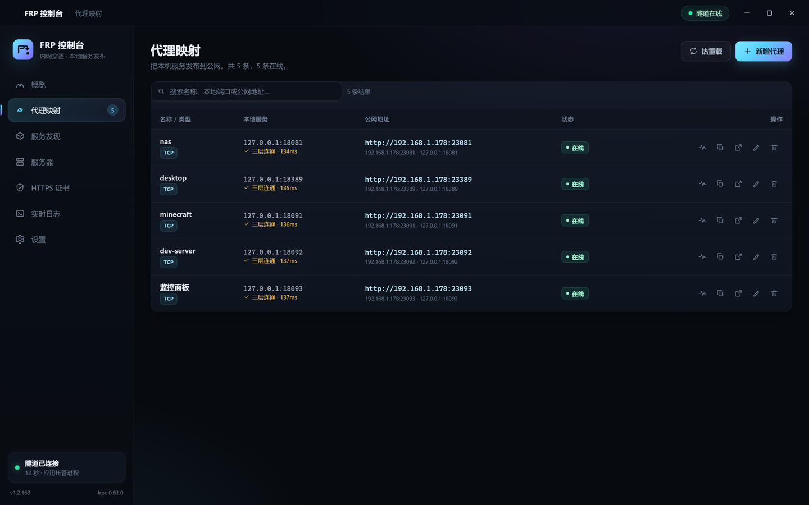

# FRP 控制台

[](LICENSE)
[](#系统要求)
[](package.json)
[](https://github.com/THEysh/FRP-Console/releases)

**把 frpc 从「改 TOML + systemctl」变成点几下鼠标。** 一个 Windows 桌面控制台，管代理、管隧道、还能反向通过 SSH 去管服务端的 frps。


## 它解决什么问题

手搓 [frp](https://github.com/fatedier/frp) 的日常是这样的：改 `frpc.toml` → 重启 frpc → 上服务器看 `journalctl` → 用 `nc` 试端口通不通 → 忘了 Token 是哪一份 → 端口撞了再改一轮。

这个控制台把这些收进一个窗口：

- **不用手写配置**：代理增删改直接写 `frpc.toml` 并热重载，其他代理不断线；写前自动备份，保留最近 10 份。
- **状态是查出来的，不是猜的**：每个代理要过「本地服务 → 隧道 → 公网」三层检查才显示"在线"，失败在哪层就报哪层。
- **服务端也能管**：填 IP + SSH 密码就能读 frps 状态、改配置、重启、管理服务器防火墙；服务器上连 frps 都没装的话，一键上传并装成服务。
- **多台服务器不再是复制粘贴**：把每台服务器存成「档案」，切换时先探端口通不通，再改写 `frpc.toml` 并重启。
- **域名 + HTTPS 一键打通**：有域名就能自动签发 Let's Encrypt 证书、自动解析 DNS、一键部署到服务器 nginx，`https://你的域名` 直接访问本机服务。

## 功能

| 模块 | 说明 |
| --- | --- |
| **概览** | 隧道状态、服务器信息、在线/异常代理计数、最近日志，一眼看清隧道到底通没通 |
| **代理映射** | TCP / UDP / HTTP / HTTPS / STCP / XTCP 代理的增删改；公网端口支持**自动建议 / 随机 / 检测**（检测会连服务器查端口占用、`allowPorts` 白名单和防火墙放行，能一键放行）；可选**访问路径**（如 `/panel/`），复制地址时直接带上；压缩与加密开关；单条测试公网可达 |
| **服务发现** | 扫本机 TCP 监听端口并显示进程与地址分类（回环 / 全网 / Docker / 内网），勾一个端口就变成公网代理 |
| **服务器（frps）** | SSH 连接后识别 systemd / 裸进程 / Docker 三种运行方式，展示版本与 Token 状态，支持启停、**frps.toml / frpc.toml 在线编辑**、**服务器就绪检查**、结构化日志、**服务器防火墙管理**、**端口与连通矩阵**、**SSH 交互式终端**、一键初始化 / 卸载 |
| **HTTPS 证书** | 用 Let's Encrypt 给自定义域名自动签发证书（DNS-01，支持通配符），一键填进 `https2http` / `https2https` 代理，到期前自动续期并在续期后**自动重新部署**；支持 **nginx 反代（方案 Y）** 一键部署、DNS 自动解析、**nginx 配置体检**（`nginx -t` + 悬空证书引用，可一键修复/注释） |
| **实时日志** | 本机 `frpc.log` 与服务器 `journalctl -u frps` 两种来源，按级别过滤、暂停、导出 |
| **设置** | frpc 路径、日志级别、运行模式、开机自启、管理 API、托盘行为、版本更新（**不含任何服务器连接配置**） |
| **自动更新** | 「设置 → 关于」里检查新版本、下载、重启安装；安装版走 NSIS 差分更新，便携版只给下载入口 |

<table>
<tr>
<td width="50%"></td>
<td width="50%"></td>
</tr>
<tr>
<td></td>
<td></td>
</tr>
</table>

## 下载安装

到 [Releases](https://github.com/THEysh/FRP-Console/releases) 下载最新安装包：

| 文件 | 说明 |
| --- | --- |
| `FRP-Console-Setup-<版本>-x64.exe` | NSIS 一键安装，装到 `%LOCALAPPDATA%\Programs\frp-console`，自动建桌面与开始菜单快捷方式 |
| `FRP-Console-<版本>.exe` | 单文件便携版，数据写在 exe 同级的 `frp-console-data\` |

安装包**内置 `frpc.exe`**（frp 0.61.0，随包升级，装完就能用，不用自己去下载和放目录）。服务端的 `frps` 仍是首次「一键初始化」时按服务器架构自动下载（约 18 MB，只下一次），详见 [frps 服务端控制台](#frps-服务端控制台)。

内置的 `frpc.exe` 位于 `<安装目录>\resources\frpc\frpc.exe`，**不要手动改它，也不要往里写配置**——安装目录在升级时会被整个替换。「设置 → 可执行文件与路径」里那张路径卡就是它，`frpc.toml` 则固定放在数据目录（`%LOCALAPPDATA%\frp-console\frpc.toml`）。想用自己的 frpc 版本，就在那里手动选一个 exe，选中后以你的为准。

### 版本更新

安装版支持应用内更新：**设置 → 关于 → 检查更新**，发现新版本后点「下载更新」（走 NSIS 差分，只下变化的片段），下完点「重启并安装」，控制台关闭、安装、自动重开。

- **不会偷偷联网**：不检查则不请求，只在点按钮时才去 GitHub 取 Release 信息，见 [安全说明](#安全说明)。
- **升级是一次「卸载旧版 + 装新版」**（electron-builder 的 NSIS 流程），不是覆盖文件。`settings.json`、服务器档案、DPAPI 密码都在数据目录，不受影响。
- 如果安装目录里有文件被别的程序锁住（反作弊、杀软、资源管理器的预览句柄都会锁 Electron 的 DLL），安装器会**跳过旧版卸载、直接原地覆盖安装**，不会再出现「卸载旧版失败」并把你原来的安装剥空。卸载时删不掉的文件会挂起到下次重启删除。
- 放在安装目录里的 `frpc.exe` / `frpc.toml` / `frp-console-backups/` 会在升级前被搬到 `%LOCALAPPDATA%\frp-console\upgrade-rescue`，装完再搬回去——即便如此，**仍建议把 frpc 放在数据目录而不是安装目录**。
- 托管进程模式下升级会短暂断开隧道（安装器结束控制台时会带走 frpc 子进程）。控制台会在安装前留一张便条，新版本启动后自动把隧道接回来；系统服务模式完全不受影响。
- **便携版不支持自替换**：关于里只提供「打开发布页」，手动下载新版本替换 exe 即可（数据在 exe 同级的 `frp-console-data\`）。

### 系统要求
- Windows 10 / 11（x64）
- `frpc.exe` 安装包自带（`resources\frpc\frpc.exe`），不用自己准备；想换版本可以在「设置」里指定
- 服务端管理需要目标机器开启 SSH；不连服务器，只用本机隧道也可以
- 不做跨平台：服务控制走 `sc` / UAC，端口扫描走 `netstat` + PowerShell，都是 Windows 专有实现

## 快速上手

装完到打通一条隧道，正常只要四步：

1. **装完直接开**：`frpc.exe` 已经在安装包里，`frpc.toml` 由程序在数据目录自动建好（只有骨架：地址与 Token 留空，**不带任何预置代理**——预置一条连不上的代理只会让新装的人在概览看到红色"本地服务不通"）。不需要你去下载 frpc、也不需要找目录。
2. **在「服务器」页建档案**：「新建」只问服务器 IP、SSH 端口/用户名和密码。保存后如果填了密码，会直接连上去；没填就停在连接表单让你补一次。**Token 不用填**，保存档案时后端就生成好一把随机值了。
3. **在「服务器」页把 frps 弄好**：连上后会识别 systemd / 裸进程 / Docker。服务器上还没有 frps 就点「一键初始化并启动」——上传、写配置、注册服务、开机自启一次做完，并且默认勾选「同时把本机 frpc 的地址与 Token 改为本次配置」。做完点「检查服务器」，四步全绿就代表这台服务器**已经准备好接收客户端**。
4. **在「代理映射」加隧道**：新增一条代理（或用「服务发现」扫一个本机端口直接发布）。公网端口可以点「随机」自动挑一个安全的，或点「检测」连服务器查这个端口有没有被占用、是否在服务器的 `allowPorts` 白名单内。加完回到**概览**或**代理映射**看链路：三层全绿才是真的能用。

> 想让隧道「不依赖控制台、开机就通」，把 frpc 装成 Windows 服务（nssm 之类），「自动」模式会识别并使用它（见 [运行模式](#运行模式)）；只是临时用，让控制台托管进程更省事——关掉控制台 frpc 也会一起停。

## 新手教程：从零到「别人能访问你的服务」

这一节假设你**第一次接触 frp**，目标是把你电脑上跑着的一个服务（网页、游戏服务端、远程桌面……）暴露到公网，让别人从外面访问。每一步都解释「为什么」，照着走即可。

### 0. 先搞懂三个词

frp 是「内网穿透」工具。你的电脑通常没有公网 IP，外面的人直接连不到你。frp 靠一台**有公网 IP 的服务器**当中转站，把你的服务转发出去。

| 词 | 是什么 | 类比 |
| --- | --- | --- |
| **frps**（服务端） | 跑在公网服务器上的转发程序 | 中转站的「前台」 |
| **frpc**（客户端） | 跑在你电脑上的程序，主动去连 frps | 把你的服务「送」到中转站 |
| **隧道 / 代理** | 一条「公网端口 → 本机服务」的映射规则 | 中转站开一个窗口，把来访的人带到你这里 |

完整链路：**外面的人 → 服务器(frps)的某个端口 → 你电脑(frpc) → 你的本地服务**。FRP 控制台就是管理 frpc 和 frps 的图形界面，不用手写 TOML 配置。

### 1. 需要准备什么

- 一台**有公网 IP 的服务器**（VPS 即可，阿里云 / 腾讯云 / AWS / 搬瓦工都行），推荐 Linux（Debian / Ubuntu），并且**开了 SSH**（root 密码或密钥）。这是 frps 的家。
- 一个**本机正在跑的服务**，比如 `127.0.0.1:8080` 的网站、`127.0.0.1:25565` 的游戏服务端、`127.0.0.1:3389` 的远程桌面。先确认它在**本机浏览器/客户端里能打开**。
- 这台 Windows 电脑装好 FRP 控制台（下一步）。

### 2. 安装

到 [Releases](https://github.com/THEysh/FRP-Console/releases) 下载：

- 想装成正经软件 → `FRP-Console-Setup-<版本>-x64.exe`，一路下一步。
- 想放 U 盘随拿随走 → `FRP-Console-<版本>.exe` 便携版，双击即用。

装完直接打开。`frpc.exe` 已内置，`frpc.toml` 会自动生成，**不需要你手动下载或放置任何东西**。首次打开概览显示「尚未配置服务器」是正常的，继续往下。

### 3. 把服务器变成 frps（服务端）

打开左侧 **「服务器」** 页：

1. 点 **「新建档案」**，填四样：服务器 IP、SSH 端口（默认 22）、SSH 用户名（一般 root）、SSH 密码。**Token 不用填**——程序自动生成随机值。保存后会自动连上去。
2. 连上后程序会识别 frps 的运行方式（systemd / 裸进程 / Docker）。服务器上**还没有 frps** 就点 **「一键初始化并启动」**：自动下载、上传、写配置、注册系统服务、开机自启、**自动放开防火墙端口**，一次做完。默认还勾选「同时把本机 frpc 的地址与 Token 改为本次配置」，客户端一起对接好。
3. 点 **「检查服务器」**：四步全绿（SSH 通道 → frps 运行 → bindPort 监听 → Token 一致）就代表**服务器准备好接收客户端**。

> 服务器上已有 frps 但不知道 Token？在档案「高级选项」里把它的 Token 填回去，程序就能对上，不用重装。

### 4. 加第一条隧道（把服务暴露出去）

打开左侧 **「代理映射」** 页，点 **「新增代理」**。以「把本机 `127.0.0.1:8080` 的网站暴露出去」为例：

- **名称**：随便起，如 `my-web`。
- **类型**：选 `tcp`（最通用；后面想配域名 + HTTPS 再选 `http` / `https`）。
- **本地地址 / 本地端口**：`127.0.0.1` / `8080`（你服务真正监听的端口）。
- **远程端口**：点「随机」自动挑一个没被占用、也不是浏览器禁用端口的；或点「检测」连服务器查某个端口是否可用（占用 / 被服务器 `allowPorts` 白名单拒绝 / 可用，一目了然）。记下这个端口——它就是公网访问端口。

保存后回 **「概览」** 页点 **「启动隧道」**，等几秒，代理状态变成 **「三层全通」** 就成了。

### 5. 验证真的通了

在**另一台设备**（手机用流量、或另一台电脑）访问：

```
http://<你的服务器公网IP>:<远程端口>
```

比如 `http://203.0.113.10:10001`（把 IP 换成你的服务器），能打开你的网站就说明穿透成功。

> **服务器本机测通了、外面连不上**：多半是云服务商（阿里云/腾讯云等）的**安全组**没放行那个端口——这是最容易被漏掉的一步。去云控制台给该端口加一条入站规则。程序能自动放开服务器系统里的 `ufw` / `firewalld` 防火墙，但云平台的安全组在程序管不到的地方。

### 6. 进阶：用自己的域名 + HTTPS（可选）

有域名（比如托管在 Cloudflare）且想用 `https://你的域名` 访问，而不是裸 IP + 端口。有两条路，选一条：

**路线 A（推荐）：nginx 反代** —— 证书放服务器、`https://域名` 不带端口、TLS 交给 nginx：

1. 打开 **「服务器」** 页连上 frps 服务器，找到「HTTPS 域名反代（nginx）」卡片：服务器没装 nginx 就点「安装 nginx 并配置」，已装就点「一键配置反代」。
2. 打开 **「HTTPS 证书」** 页，按顶部「域名就绪向导」走：先粘贴 Cloudflare API Token → 填域名（如 `app.yourname.com`）→ 签发 Let's Encrypt 正式证书（90 天有效，到期前自动续期）→ 证书签发后程序会自动部署到服务器 nginx。
3. 回 **「代理映射」** 新建一条 `http` 代理，填自定义域名 `app.yourname.com`（**不用选 TLS 插件**，TLS 由 nginx 统一终止）。
4. 在 Cloudflare 加一条 DNS 记录 `app` → 服务器 IP，**云朵点灰（DNS only，不经过 CDN）**；或在证书页向导里点「一键建解析」自动加。

**路线 B：frp 原生 https2http** —— 证书放 frpc 侧、`https://域名:端口`（带 vhost HTTPS 端口）、服务器不必装 nginx：

1. 打开 **「HTTPS 证书」** 页，同样按向导签一张 Let's Encrypt 正式证书。
2. 回 **「代理映射」** 新建 / 编辑一条 `https` 代理：插件选 `https2http`，从证书下拉选刚签的证书，填自定义域名。
3. DNS 解析同路线 A 第 4 步。

两条路都能用 `https://` 访问到本机服务。差别：路线 A 更通用（不带端口），但要求服务器能装 nginx；路线 B 不需要 nginx，但访问要带端口。

### 名词速查表

| 名词 | 一句话解释 |
| --- | --- |
| frpc / frps | 客户端（你电脑）/ 服务端（公网服务器） |
| Token | 客户端和服务端之间的「暗号」，对不上连不上 |
| bindPort | frps 接收 frpc 连接的端口（默认 7000） |
| 远程端口 / remotePort | 公网上给外部访问用的端口 |
| vhostHTTPPort / vhostHTTPSPort | http/https 代理走「域名」分发时用的端口（默认 80/443） |
| allowPorts | frps 对「客户端能申请哪些 remotePort」的白名单；不在名单里的端口会被拒绝注册 |
| STCP / XTCP | 点对点类型，不需要公网端口，双方都要装客户端 |
| 防火墙 / 安全组 | 服务器系统（ufw / firewalld / iptables）与云平台两层「放行哪些端口」的关卡；没放行就连接超时 |
| nginx 反代 | 服务器上的反向代理，统一在 443 收 HTTPS、转发给 frps，实现「不带端口访问」 |
| DNS 解析 | 把域名指到服务器 IP 的记录；用域名访问前必须先解析对 |
| 三层检查 | 本地服务 → 隧道 → 公网，三层都通才算「在线」 |

## 三层连通性检查

> 这一节说的是**概览 / 代理映射页**的检测，判的是"用户能不能访问到你的服务"。
> 「服务器」页那个按钮是另一回事，只看服务器自己准备好没有，见 [服务器就绪检查](#服务器就绪检查)。

代理"在线"不是看进程有没有起来，而是三层都过：

```
① 本地服务   127.0.0.1:8080 能连上吗          → 不通 = 本地服务不通
② 隧道       frpc 已连 frps，且该代理已注册     → 不通 = 隧道未建立
③ 公网       从本机连 serverAddr:remotePort     → 不通 = 公网不可达
```

任一层失败即短路，后面的层不再探测；悬停状态徽章能看到每层结果。检查每 14 秒刷新一次，保存配置 / 启动隧道 / 热重载后立即重查。

几条实现上的取舍：

- **所有代理都会检查**，不再有“只查前 16 条”的上限；并发 6 条、单轮预算 7 秒，超出的留到下一轮继续。
- **没测出结果 ≠ 在线**：刚启动、还没轮到的代理显示“待检测”，不会被算进“全部在线”。
- `udp` / `stcp` / `xtcp` / `sudp` / `tcpmux` 没有可直连的公网 TCP 端口，第 ③ 层标记为跳过，只要求①②通过。
- `http` / `https` 代理按 frps 的 `vhostHTTPPort` / `vhostHTTPSPort` 连 IP 并带上 `Host` 头去探测（端口按**隧道当前绑定的服务器档案**解析，连上服务器页时优先用 SSH 读到的实时值），端口不是 80/443 也不会误报“公网不可达”。

这样设计的好处是**报错直接指向原因**：本地服务没起来却去查安全组，是最常见的浪费时间。如果 frpc 根本没连上 frps，控制台会直接说清是哪个地址、什么原因（端口未监听 / 网络不可达 / Token 不对），并附上 frpc 的原始报错。


## 服务器就绪检查

「服务器」页的检查只回答一个问题：**这台服务器准备好接收客户端了吗**。四步依次判断，任一步失败立即短路：

```
① SSH 通道     还能在服务器上执行命令吗
② frps 运行    systemd / 进程 / Docker 任一种在跑，并顺带回读开机自启状态
③ bindPort     服务器本机 ss / netstat 里能看到 frps 的 bindPort
④ Token 一致   服务端 auth.token 与本机档案里的 Token 是否完全相同
```

四步全绿 = 可以去加代理了；全绿**不代表**隧道能用——那要回概览看三层。

以前这里跑的是三层检测，和概览页重复，而且"本地服务"这一层在还没建代理时必然是红的，看起来像"服务器配置失败"。现在分工清楚了：服务器页管服务端就绪，概览/代理映射管端到端连通。

## 多服务器与服务器档案

一个本机 `frpc.toml` 同一时间只能连一台 frps，但你可以保存任意多个**服务器档案**。

- 档案字段：名称、IP/域名、SSH 端口与用户名、frps 端口、Token、远程配置路径、面板地址。日常只需要填前四个。
- **Token 自动生成**：新建档案时后端生成一把随机 Token，它同时是「一键初始化 frps」时的默认值——写进 `frps.toml` 的 `auth.token` 和写进本机 `frpc.toml` 的是同一个字符串。想接管一台已经配好 frps 的服务器（Token 早已定死），再在「高级选项」里把它填回去即可。
- 密码**按档案独立保存**（Windows DPAPI 加密），档案之间不共享、不回退——不会出现"拿 A 的密码去连 B"。
- **同一台机器（IP + SSH 端口）只保留一条档案**：再连一次会更新那条，不会越连越多；历史上产生的重复档案，启动时会自动合并（先把 `settings.json` 与密码库备份到 `userData\backups\`），下拉框里也能手动「整理重复」。
- 「服务器」页顶部的下拉框切换的是**查看目标**，不动隧道；只有点「切换隧道并重启」才会改写 `frpc.toml` 并重启 frpc。
- **新建档案会断开上一台的 SSH 会话**：页面立刻变成这台新服务器的连接表单，不会继续显示上一台的状态，也不会在顶部弹"本机隧道指向其他服务器"这种吓人的提示。

| 动作 | 作用 |
| --- | --- |
| 仅查看 | 什么都不改，只看这台服务器的状态与配置 |
| 切换隧道并重启 | 把 `frpc.toml` 指向该档案，重启 frpc（二次确认，所有代理短暂重连） |

切换前会先探一次目标服务器的 frps 端口：连不上就不动配置，弹窗说明原因（拒绝 / 超时 / 解析失败），是否继续由你决定。切换过程有进度浮层，按「写入 frpc.toml → 重启 frpc → 等待新隧道上线」三步推进，不靠估算。

记住密码后，选中档案就会自动连接并读取状态，不用每次点「连接并读取状态」。

## 代理映射（隧道）

一张表管所有「公网 → 本机」的映射，改完立即写 `frpc.toml` 并热重载，其他代理不断线。

| 类型 | 什么时候用 | 公网访问形式 |
| --- | --- | --- |
| `tcp` | 远程桌面、SSH、游戏服务端、数据库……任何裸 TCP | `服务器IP:远程端口` |
| `udp` | 游戏 / DNS / 语音等 UDP 服务 | `服务器IP:远程端口/UDP` |
| `http` | 想用域名访问网页，走 frps 的 vhost | `域名:vhostHTTPPort`（配好 nginx 反代后就是 `https://域名`） |
| `https` | 同上，但 TLS 由 frps 终止（`https2http` 插件） | `域名:vhostHTTPSPort` |
| `stcp` / `sudp` / `xtcp` | 点对点，不暴露公网端口，访问方也要装 frpc | 只能被「访问者」连 |
| `tcpmux` | 一条端口多路复用（依赖服务器开 `tcpmuxHTTPConnectPort`） | 由域名 / Host 区分 |

- **公网端口**：点「随机」直接给一个安全端口（自动避开已占用、服务器 `allowPorts` 白名单、以及浏览器自己的禁用端口——`10080` 这类端口 Chrome/Edge 会直接拦下来报 `ERR_UNSAFE_PORT`）；点「检测」会连服务器三查：端口是否被占用、是否在 `allowPorts` 里、防火墙有没有放行，没放行能一键放。
- **访问路径**（可选）：很多服务（面板、Jellyfin、Grafana）根路径是 404，必须带 `/panel/`、`/web/` 才能打开。frp 只按 Host / 端口路由、**不会改写路径**，所以这个字段只做两件事：复制/打开链接时带上它、三层检查用它判断「路径对不对」（根路径 404 会单独报「路径 404」，不计入"公网不可达"）。配了 nginx 反代时，程序还会在 `location = /` 上加一条 302，把裸域名跳到这个路径。
- **证书快捷填入**：类型选 `https` + 插件 `https2http` 时，填完自定义域名后下面会出现「证书快捷填入」下拉，只列**覆盖这个域名**的已签发证书，选中即填好 `crtPath` / `keyPath`。
- **外部改配置会同步**：`frpc.toml` 被外部编辑器改过、或改坏了（frp 不认的字段），控制台会检测到并说明是哪一种——合法改动自动重载，坏配置**不重载**并提示具体报错，正在跑的隧道不受影响。

## 服务发现

「服务发现」页扫本机正在监听的 TCP 端口，列出进程名与地址分类（回环 / 全网 / Docker / 内网 / 公网），筛选后点「添加代理」直接把那个端口变成公网隧道——省得自己去翻到底是什么在占用某个端口。

> 分类只是提示：`0.0.0.0` 表示对外全开，`127.0.0.1` 只能本机访问（外部要靠 frp 转发），`172.17.x` 通常是 Docker 网桥。

## frps 服务端控制台

「服务器」页通过 SSH 连上 frps 所在主机，把服务端从"看板"升级成可操作的闭环：**连接 → 状态识别 → 改配置 / 保存并重启 → 服务器就绪检查 → 看日志**。

- **状态识别**：同时检查 systemd 服务、`frps` 进程、Docker 容器与监听端口，避免"实际在跑却显示已停止"；版本优先从 PATH、进程可执行文件或镜像识别。服务被 `mask`、unit 被删、二进制被替换/删除这类情况会直接说明是哪一种。
- **配置编辑**：一张卡片里两个页签——服务器上的 `frps.toml` 与客户端 `frpc.toml`，改完可以「仅保存」或「保存并重启 frps」。保存前本机校验 TOML，再跑服务器上的 `frps verify`；通过后备份为 `.bak-时间戳`（只留最近 10 份、权限 `600`）再覆盖。服务器上的配置被外部改过、或用 `verify` 通不过时，界面会明确提示，不会悄悄重载。
- **一键初始化**：服务器上还没有 frps 也能从零开始——按架构（amd64 / arm64）**下载** frps 0.61.0（约 18 MB，只下一次，缓存复用）、上传、写配置、注册 `frps.service`（无 systemd 时回退后台进程）、清掉旧的裸进程避免 7000 冲突。可选「同时把本机 frpc 的地址与 Token 改为本次配置」；开了鉴权但没填 Token、或面板没填口令时，会自动生成随机值并当场告诉你。
  > 二进制不进安装包：两份 frps 会让安装包从 81 MB 涨到 95 MB。下载失败时见 [常见问题](#常见问题) 的手动放置办法。
- **结构化日志**：把 `journalctl -u frps`、`docker logs` 或 `frps.log` 解析成时间 / 级别 / 内容三列，汇总启动时间、客户端连接数与错误数；「实时日志」页可以在本机 frpc 与服务器 frps 之间切换来源。
- **SSH 终端**：在服务器上开一个真正的交互式 shell（bash / vim / htop 都能用），右键菜单提供复制 / 粘贴 / 清屏；**一次粘贴多行命令前会先确认**（每行都会立即执行，粘错一次就可能是 `rm -rf`）。

> 需要目标机器已开 SSH，并使用 root 或具备 `systemctl` / `docker` 权限的账户。非 root 但配了免密 `sudo` 时，控制命令会自动改用 `sudo -n`。Docker 启动的 frps 会改用 `docker start/stop/restart` 操作。

## 端口与连通（服务器页）

服务器页这张卡片不只是列规则，而是把**三个信号交叉起来判定**，直接告诉你端口到底被哪一层拦住。

三个信号：

| 信号 | 含义 | 从哪来 |
| --- | --- | --- |
| **监听** | 服务器上有没有程序在这个端口监听 | 服务器内 `ss -lnt` / `ss -lun` |
| **规则** | 服务器系统防火墙（ufw / firewalld / iptables）有没有放行 | 读回防火墙当前实际规则 |
| **实测** | 从本机能不能连上这个端口 | 从控制台所在机器做 TCP 连接测试 |

判定表（卡片里每行给出的「结论」就是按这张表来的）：

| 监听 | 规则 | 实测 | 结论 | 该做什么 |
| --- | --- | --- | --- | --- |
| ✗ | — | — | 没有程序在这个端口监听 | 看 frps / nginx 是否在跑、配置里的端口对不对（与防火墙无关） |
| ✓ | ✓ | ✓ | 正常 | — |
| ✓ | ✓ | ✗ | **服务器已监听、防火墙也放行了，外面连不上 → 云安全组 / 中间设备拦截** | 去云控制台放行（卡片里有复制规则按钮） |
| ✓ | ✗ | ✗ | **服务器内防火墙没放行这个端口** | 行尾「放行」一键补齐 |
| ✓ | ✗ | ✓ | 规则没写但实测通（云层已放行），可忽略 | 不用动 |
| ✓ | ✗ | ✗（无本机防火墙） | 云安全组 / 网络层拦截 | 去云控制台放行 |

其他要点：

- **端口清单覆盖更全**：frps 端口（bindPort、Dashboard、vhostHTTP / vhostHTTPS、tcpmuxHTTPConnectPort，UDP 只在配置了 kcp / quic 时才列）、代理映射端口、**系统端口（SSH、nginx 的 80 / 443）**。
- **每行一个动作**：阻塞行给「放行」（只放行这一条端口）、云层阻塞给「复制规则」、没监听给「重新检测」——不会再出现「点了放行却什么都没变」。
- **放行即复检**：放行 / 删除规则后自动重跑三信号，结论行同步更新（例如「2 个端口有问题 —— 1 个在服务器防火墙」→ 放行后变成「1 个在云安全组/网络层」，这正是「本机放行了但外面还是连不上」的真实场景）。
- **云安全组提示块**：卡片内固定展示「本机防火墙放行 ≠ 公网可访问」，附阿里云 ECS / 阿里云轻量 / 腾讯云 / 华为云的控制台路径，以及两个按钮：`复制全部端口规则`（精确清单，照着填）与 `复制 1-65535 全放行`（省事但等于全端口暴露，只建议自用/测试机）。
- **服务器就绪检查的 bindPort 层加了公网实测**：以前只查「服务器本机在监听」，云安全组拦着也全绿；现在会补一次从本机的连接测试，失败时直接写明「本机在监听但从本机连不上 → 云安全组/网络层」。
- **SSH 连接失败会说明原因**：拒绝连接（端口没开 / sshd 没起）、握手前被断开（可能是防火墙代答）、超时（云安全组或本机 VPN 拦出站）、域名解析失败，分别给不同的下一步。

> **两层防火墙别搞混**：这张卡读的是服务器系统里的 ufw / firewalld / iptables。阿里云、腾讯云等云厂商还有一层**云平台防火墙 / 安全组**，在云控制台（网页）里配，程序读不到也改不了——「监听 ✓ + 规则 ✓ + 实测 ✗」就是它的典型指纹。

## 服务器防火墙（规则管理）

卡片下半部分仍然是规则管理区：

- **自动识别**：读 `ufw status` / `firewall-cmd --state` 判断服务器用的是哪种防火墙、当前是启用还是未启用。
- **一键放行**：点「放行 frps 与代理端口」把上面这些端口全部加到防火墙白名单（ufw / firewalld / iptables 三种都支持）。
- **没装防火墙也能装**：服务器系统没装防火墙时，卡片显示「安装并启用防火墙」——按发行版自动装 ufw（Debian/Ubuntu）或 firewalld（RHEL/CentOS/Fedora 系），并**先放行你的 SSH 端口**再放行 frp 端口，避免把你自己锁在门外。
- **手动放行任意端口**：输入框支持单端口、范围、逗号分隔，如 `28487`、`1000-2000`、`80,443,8000-9000`，协议可选 tcp / udp / 两者；放行后列表立即刷新为防火墙真实规则。
- **已放行 = 当前实际规则**：卡片下方「已放行规则（N 条，当前实际规则，勾选后可删除）」是从防火墙**实时读回**的，不是软件自己记的累计数——你之前在别处手动加过的规则也会列出来。
- **勾选删除任意规则**：「已放行规则」每条带复选框（含全选），勾选后按规则**原文**删除——范围规则精确命中；ufw 的 v4/v6 双规则一并处理；规则不存在时明确报错。

## 运行模式

设置页的「运行模式」只有两个选项：

| 模式 | 说明 |
| --- | --- |
| **自动**（默认） | 先看本机有没有把 frpc 装成 Windows 服务（`frpc` / `nssmfrpc` 等）。有就用它——控制台只负责读状态、需要时启停；没有就由控制台托管进程 |
| **应用托管进程** | 控制台直接拉起 `frpc.exe -c frpc.toml`，退出控制台会一并结束 |

- 控制台**不再提供「把 frpc 装成 Windows 服务」的入口**（以前那套要管理员权限、还要处理 nssm，和「装上就能用」冲突）。想要「不依赖控制台、开机就通」，用 [nssm](https://nssm.cc/) 之类把 `frpc.exe -c <数据目录>\frpc.toml` 注册成服务，控制台的「自动」会识别它并在需要时用 `sc` 启停（这一步会弹 UAC）。
- 选「应用托管进程」时，设置页会明确提示：控制台一退隧道就断，别拿它做无人值守。

## 开机自启与重启验收

「现在能通」和「重启后还能通」是两件事，分开验才不会误判：

| 位置 | 靠什么活着 | 验收命令 / 看哪里 |
| --- | --- | --- |
| 本机 frpc | Windows 服务的启动类型（**仅当已把 frpc 装成服务时**） | `Get-Service frpc \| Select-Object Status,StartType` → `Running / Automatic` |
| 服务器 frps | systemd 的 `is-enabled`，或容器的 RestartPolicy | `systemctl is-enabled frps; systemctl is-active frps` |
| 控制台窗口 | 当前用户的登录项（`HKCU\...\Run`） | 设置页开关；任务管理器「启动」里是否为「已启用」 |

几个必须知道的边界：

- **控制台是「登录后启动」，不是「开机启动」**。`Run` 项要等用户登录 + explorer 起来才执行（常见 10–60 秒）。无人值守重启时控制台不会出现——但**隧道不受影响**，服务模式下 frpc 由系统服务拉起，跟控制台无关。
- **任务管理器里禁用过启动项时**，Windows 不删 `Run` 键，只把 `StartupApproved\Run` 里的状态改成「已禁用」。控制台会读这个状态：设置页显示黄色提示，并把开关同步为关闭，不会偷偷再加回去。想恢复就在任务管理器里设为「已启用」。
- **只有服务模式（或 auto 命中服务）才谈得上「重启后隧道自己回来」**。`应用托管进程` 模式下 frpc 是控制台的子进程，控制台一退隧道就断；选这个模式时设置页会明确提示。
- **服务器端开机自启是控制台初始化后回读的**：`systemctl enable` 之后会再查一次 `systemctl is-enabled`，没到 `enabled` 就在「服务器」页状态卡标黄并给出修复命令，不会像以前那样把失败吞掉报「成功」。没有 systemd 的机器用 `nohup` 临时启动，页面会直说「重启后不会自动运行」。
- 托管的 Docker 版 frps 会读 `docker inspect` 的 `RestartPolicy`：`no` 的容器重启后不会自己起来，同样会在状态卡提示。

生成的内置 `frpc.toml` 模板里，`loginFailExit = false`：开机时网络可能还没就绪，让 frpc 自己退避重连，比"连不上就退出、等 nssm 反复拉起"更干净。

## 托盘与退出

**关窗口 ≠ 退出**：

| 操作 | 效果 |
| --- | --- |
| 点标题栏 X | 收进托盘，隧道继续跑（可在设置里改成"关闭即退出"） |
| 托盘图标单击 | 显示 / 隐藏主界面（双击强制显示） |
| 托盘右键 | 状态、启停隧道、热重载、打开配置、**退出 FRP 控制台** |

退出时会先停掉自己拉起的 frpc 再结束进程，不留孤儿；清理最多等 8 秒，之后强制退出。托盘图标三态：绿点=在线，灰点=未连接，红点=连不上服务器。

**只允许一个实例**：同数据目录靠 Electron 单实例锁，跨数据目录（安装版 + 便携版同时开）靠固定端口 47823 握手。第二个实例会把已有窗口叫到前台后自行退出。

**如果托盘建不出来**（图标缺失，或被安全软件拦截），关闭窗口会直接退出程序，而不是把窗口藏起来——避免"窗口消失且叫不回来"只能去任务管理器杀进程。控制台每 3 秒用 `tray.getBounds()` 自检：系统分配的位置连续三次全 0 就判定为"假托盘"，此时设置页会提示，点 X 改为直接退出。

> 看不到托盘图标时，先点任务栏的「^ 显示隐藏的图标」——Windows 默认把新图标折叠进溢出面板，折叠状态下 `getBounds()` 也可能是 0。仍不行就把程序移出被安全软件重点管控的目录再试。

## 管理 API

控制台通过 frpc 自带的 Admin API（默认 `127.0.0.1:7400`）读代理状态并触发热重载。这个监听只在 `webServer.addr = "127.0.0.1"` 时开放；「设置 → 管理 API」可以一键补全。

- **新装的口令是随机的**（20 位）并在首次启动时写进 `frpc.toml` 的 `webServer`，不再是 `admin/admin`；老配置沿用你原来的值，升级不会把它改掉。
- 改端口/账号后，控制台会把 `webServer` 一并写回 `frpc.toml` 并重启隧道，不会出现“控制台问 7401、frpc 还在 7400 上听着”的错位。
- 如果这个端口上跑的是**另一份配置的 frpc**，控制台会显示「端口冲突」并拒绝停止它，避免误杀别人的隧道。
- 口令还是 `admin` / 空 / 太短时，概览页会直接提示（这个接口能读到 `auth.token`），旁边一个按钮就能换成 20 位随机口令并重启 frpc；「设置 → 管理 API」里也可以自己设。
- 服务器侧 `vhostHTTPPort` / `vhostHTTPSPort` 不是默认 80/443 时，连一次服务器页（「服务器」页 → 选中档案）会自动读回真实端口，三层检查的公网探测据此连对端口，不会误报“公网不可达”；「设置」里也能手动填，会同步进当前绑定的服务器档案。


## HTTPS 与自定义域名

想把 `https://app.yourdomain.com` 挂到本机服务上，控制台在「HTTPS 证书」页 + 「服务器」页的 nginx 卡片把整条链路都做了。核心是三个问题，分别对应三个功能：

**① 证书哪来？** —— Let's Encrypt 自动签发（DNS-01 验证，无需开放 80/443，支持 `*.域名` 通配符）。

- 首次需要一个 DNS 渠道：目前支持 **Cloudflare**，在证书页粘贴一个「编辑区域 DNS」权限的 API Token（DPAPI 加密存本机，不落明文）。
- 填域名点「签发」即可，证书有效期 90 天，**到期前 30 天自动续期**（每 12 小时检查一次）。续期成功后会自动**重新部署到它原来所在的那台服务器**，不会出现「证书续了、nginx 还在用旧文件」；剩余不足 30 天而没配 DNS 渠道时，证书页顶部会红字说明「自动续期不会运行」。
- 证书存本机 `userData\certs\`，列表里能看到到期天数、覆盖域名、部署状态。

**② 域名怎么指到服务器？** —— 一键建 DNS 解析。

- 证书页「域名就绪向导」会检测你填的域名有没有解析、有没有指向当前服务器。
- 没解析时，配好 Cloudflare token 就能「一键建解析」——自动加 A 记录指向 frps 服务器；建完立即显示「已解析」，不用干等公共 DNS 传播。

**③ TLS 在哪终止？** —— 两条路（详见新手教程第 6 步）：

| 路线 | 证书位置 | 访问形式 | 服务器要求 |
| --- | --- | --- | --- |
| **A：nginx 反代（方案 Y）** | 服务器（部署到 nginx） | `https://域名` 不带端口 | 服务器能装 nginx |
| **B：frp 原生 https2http** | 客户端（frpc 读证书发给 frps） | `https://域名:端口` | 不需要 nginx |

- 路线 A：nginx 卡片一键装 nginx / 配置反代；证书签发后自动上传到服务器 `/etc/nginx/ssl/<域名>/` 并写反代配置，`nginx -t` 校验后 reload；代理保持纯 `http` 类型即可。nginx 卡片还会做**配置体检**：`nginx -t` 过不过、有没有 `ssl_certificate` 指向已删除的文件（悬空引用一旦 reload 会让整站起不来），发现问题可以「查看这段配置」或「注释掉这条引用」。
- 同一台服务器上的多个域名是**合并写入**的：给 B 域名部署证书不会把 A 域名的 80/443 段抹掉；面板口令暴露在公网（`addr = "0.0.0.0"` + 弱口令）时会在服务器页给提示，并支持一键换成随机口令。
- 路线 A 有个容易被忽略的前提：**nginx 的上游是 frps 的 `vhostHTTPPort`**。frps 没开这个端口（从零初始化默认就不带），nginx 反代照样能起来，但访问一定 502。所以「一键配置 nginx 反代」现在会先检查并自动补上 `vhostHTTPPort`（端口被占用时自动顺延）再重启 frps；代理表单里如果检测到没开，也会在徽标旁给出「开启 vhost 端口」按钮，两次点击确认后直接补上。
- 路线 B：代理表单选 `https2http` / `https2https` 插件，从证书下拉自动填 `crtPath` / `keyPath` 与域名。
- 证书列表会标注每张证书「已部署到哪台服务器」，切换服务器后按当前服务器显示，不会张冠李戴。

> 没有域名、或暂时不想上 HTTPS，完全不影响隧道使用——证书 / DNS 都是可选入口，`http://IP:端口` 随时可用。


## 常见问题

- **双击 exe 没反应 / 一闪就退出**：多见于以管理员身份运行的受限桌面——Chromium 沙箱初始化失败，进程在进入主进程代码前就以退出码 `3` 结束，界面来不及提示。用 `npm run dev:nosandbox`，或给快捷方式「目标」末尾补 ` --no-sandbox`。
- **点 X 后程序还在**：默认「关闭到托盘」，隧道不会断。要真正退出用**托盘右键 → 退出**。
- **换了服务器地址但仍连旧服务器**：frpc 的 reload 不会重建服务器连接，必须重启隧道（服务器页「切换隧道并重启」，或概览页「重启」）。
- **公网端口不通**：先在代理列表点「测试公网端口」；仍不通就检查三层——服务器系统防火墙（服务器页「服务器防火墙」卡片可一键放行）、云平台安全组（阿里云 / 腾讯云控制台，程序管不到）、代理是否为 `running`。隧道报 `EOF` / `session shutdown` 且服务器本机 `ss -tn` 看不到连接时，基本就是云防火墙没放行。
- **启停本机 frpc 服务时弹 UAC**：只有「自动」模式命中了已安装的 Windows 服务时才会去动服务，这一步需要管理员权限；取消授权不影响已经在跑的隧道。
- **一键初始化卡在「下载 frps」**：程序要从 GitHub 取 `frp_0.61.0_linux_<arch>.tar.gz`。连不上时手动下载解压，把 `frps` 放到 `%LOCALAPPDATA%\frp-console\frps-cache\frp_0.61.0_linux_amd64\frps`（或程序目录 `resources\frps\linux-amd64\frps`），再点一次初始化即可走本地文件；也可以设环境变量 `FRP_DOWNLOAD_MIRROR=https://ghproxy.net/` 之类的前缀走代理。
- **开了「开机自动启动」但重启后没自动运行**：这条设置写在当前用户的启动项里（`HKCU\...\Run`，不需要管理员权限）。被安全软件或组策略拦下时保存会直接报错、开关不会假装打开；这种情况可以在 `shell:startup`（Win+R 输入后回车打开的那个文件夹）里放一个控制台的快捷方式代替。另外建议同时打开「以最小化状态启动」，免得每次开机都弹窗。
- **看到两个控制台窗口**：不会。单实例锁 + 固定端口 47823 双保险，后启动的副本会叫出已有窗口后退出。
- **启动即退出 / 白屏**：程序会依次尝试 exe 同级 `frp-console-data`、`%LOCALAPPDATA%\frp-console`、程序目录下的数据目录；都不可写时会失败，请换到有写权限的位置。
- **检查更新报「更新源缺少 latest.yml」**：说明那个 Release 只挂了 exe。发版时 `latest.yml` 和 `*.blockmap` 必须一起上传（[release.yml](.github/workflows/release.yml) 会自动收集并校验，手工发版容易漏）。
- **升级后安装目录里的 frpc.exe / frpc.toml 不见了**：升级是「卸载旧版 + 装新版」，安装目录整体重建。现在 `frpc.exe` 由安装包自带（`resources\frpc\frpc.exe`），`frpc.toml` 一律写在数据目录，所以正常情况下不会丢；只有你自己把配置文件放到过安装目录，才需要依赖安装器的 `upgrade-rescue` 兜底搬运。
- **找不到 frpc.exe / 提示路径缺失**：安装版不会出现——它在 `<安装目录>\resources\frpc\frpc.exe`。便携版和解压运行（zip 解压、`win-unpacked`）时同样在 `resources\frpc\` 下；如果被杀软删掉了，重新装一次，或在「设置 → 可执行文件与路径」里指向你自己下载的 frpc。
- **检查更新连不上**：它走 `github.com` 的 Release，网络受限时会失败（报错会写明是网络问题）。可以手动到 Releases 下载安装包覆盖安装，效果一样。

## 从源码运行

```bash
git clone https://github.com/THEysh/FRP-Console.git
cd FRP-Console
npm install
npm start
```

国内网络建议先设镜像：

```powershell
$env:ELECTRON_MIRROR = "https://npmmirror.com/mirrors/electron/"
$env:ELECTRON_BUILDER_BINARIES_MIRROR = "https://npmmirror.com/mirrors/electron-builder-binaries/"
npm install --cache .\.npm-cache
```

## 开发

```
src/main/          主进程
  index.js         IPC、窗口、托盘、状态机
  frpc.js          frpc 进程托管、管理 API、热重载
  settings.js      设置、服务器档案、按档案加密的密码库（DPAPI）
  config.js        frpc.toml 解析与写入
  service.js       Windows 服务检测与启停
  ssh.js           SSH 会话、frps 状态识别
  frpsconfig.js    frps 配置解析、生成与校验（allowPorts / 面板口令轮换）
  frpsBinary.js    frps 二进制获取（按架构下载 / 本地缓存）
  acme.js          Let's Encrypt 证书签发与续期（acme-client，DNS-01）
  dns.js           Cloudflare DNS 记录读写
  dnscheck.js      域名解析结果判定（对齐 / 过期 / 指向别处 / CDN 代理）
  knownhosts.js    SSH 主机密钥指纹（首次信任 + 之后比对）
  netprobe.js      用 Chromium 网络栈复验公网可达（本机 TLS 被拦时兜底）
  portmatrix.js    端口与连通矩阵的判定规则
  netport.js       本机 TCP 监听端口扫描与地址分类
  log.js           日志跟随与单行长度截断
  update.js        自动更新（electron-updater，仅安装版）
  preload.js       contextBridge 暴露 window.FRP
src/renderer/      无框架单页界面（index.html / styles.css / app.js）
assets/            应用与托盘图标（托盘图标由脚本生成）
resources/frps/    frps 二进制的可选放置位置（默认不内置，见该目录 README）
vendor/frpc/       打包用的 frpc.exe（由 tools/fetch-frpc.cjs 从 vendor/frp-src 解出，不入库）
vendor/frp-src/    官方 frp 压缩包（入库，打包时离线校验 sha256 后解压，不再依赖 GitHub 下载）
tools/             CDP 自检脚本与构建辅助
build/installer.nsh  NSIS 安装脚本
```

`npm run dist*` 会先跑 `tools/fetch-frpc.cjs` 把 frpc 0.61.0 取到 `vendor/frpc/frpc.exe`（已存在则跳过），再交给 electron-builder 通过 `extraResources` 打进 `resources/frpc/`。想换版本改 `tools/fetch-frpc.cjs` 顶部的 `FRP_VERSION`，并同步 `src/main/frpsBinary.js` 里的常量。

渲染层不引任何框架，靠 `window.FRP`（preload 暴露的 IPC 封装）与主进程通信；界面状态由主进程 `state:update` 事件推送，不做轮询。

### 打包

```bash
npm run dist           # NSIS 安装包 → dist/FRP-Console-Setup-<版本>-x64.exe
npm run dist:portable  # 单文件便携版 → dist/FRP-Console-<版本>.exe
npm run dist:dir       # 免安装目录 dist/win-unpacked，调试用
npm run tray-icons     # 重新生成托盘三态图标
```

**打包卡在 `packaging platform=win32` 不动**：electron-builder 解包 Electron 前要在 `%TEMP%` 拿一把下载锁，上次构建被强行中断会留下它。删掉再重跑：

```powershell
Remove-Item "$env:TEMP\eb-dl-*.lock.lock" -Recurse -Force
npm run dist
```

**发版必须一起上传的三件套**：`FRP-Console-Setup-<版本>-x64.exe`、`latest.yml`、`*.blockmap`。前两个决定客户端能不能发现新版本（electron-updater 读 `latest.yml` 比对版本、校验 sha512），第三个让差分下载只取变化的片段。`package.json` 的 `build.publish` 指向 `THEysh/FRP-Console`，打出来的包自带 `resources/app-update.yml`；`latest.yml` 里的版本来自 `package.json.version`，所以**版本号与 tag 必须同步改**，否则客户端认为没有更新。

### 自检脚本

`tools/` 下是基于 CDP 的自动化脚本。用独立的 userData 和实例端口跑，不会碰到你正在用的实例：

```bash
FRP_INSTANCE_PORT=47827 PORTABLE_EXECUTABLE_DIR=D:/tmp/frpsmoke \
  npx electron . --no-sandbox --remote-debugging-port=9333

node tools/ui-test.cjs                     # 逐页自检 + 截图（横向溢出、元素越界、console.error）
node tools/ui-flow.cjs settings            # 交互流程：settings / logs / proxies / server / tunnel / misc / winctl
node tools/cdp-eval.cjs "document.title"   # 在渲染层执行任意表达式
node tools/cdp-shot.cjs .proxy-row out.png # 按选择器截单个元素
```

`FRP_INSTANCE_PORT` 让测试实例用独立单实例锁，`PORTABLE_EXECUTABLE_DIR` 让它把设置写到别处；两者缺一，测试实例会被正在运行的正式实例挡掉，或改到你的真实配置。

### 测试

仓库自带三层可回归的测试，不需要外网、不需要真实服务器：

```bash
npm test               # L0 语法检查 + L1 单元测试 + 机密扫描，约 4 秒，CI 每次推送都跑
npm run test:e2e       # L2 端到端：起真 Electron、真 frpc、真 frps、假 sshd，跑完 51 个场景（约 2 分钟）
npm run test:e2e -- --only=tunnel        # 只跑名字含 tunnel 的场景
npm run test:e2e -- --keep               # 保留现场（数据目录与进程），便于排查
node tests/soak.cjs 10                  # 长稳抽查：隧道 + 20 条代理跑 10 分钟，看内存/健康检查/日志缓冲趋势
node tools/test-all.cjs                # 等价于 npm test，但不需要 npm（Git Bash 里 npm 是 npm.cmd，直接调用会 exit 126）
```

| 层 | 内容 | 依赖 |
| --- | --- | --- |
| L0 `tools/check-syntax.cjs` | 对 `src/ tools/ tests/` 逐个 `node --check` | 无 |
| L1 `tests/unit/*.test.js` | 纯函数单测（配置解析与校验、端口矩阵、SSH 输出解析、DNS 判定、证书域名匹配、设置合并…） | 无 |
| L2 `tests/e2e` | **51 个场景**：冷启动、代理增删改与校验、真隧道三层全通、健康检查如实报错、服务器页与就绪检查、证书页与 DNS 面板、SSH 终端/日志/断线、布局体检、20 与 60 条代理、访问路径 404、外部改配置热重载、设置边界值、多服务器切换、并发点击、只读配置、插件证书、端口被占、域名冲突 | 本机 electron；frpc 自动从 `vendor/frpc/` 找；frps 可选（缺了对应场景跳过） |

端到端跑批把数据目录放在仓库内的 `.e2e-tmp/run-*`（已 gitignore），可以用 `E2E_DATA_ROOT` 换个位置——**不要放到 `%TEMP%`**，那会让 Electron 建单实例锁失败（`Error code: 5`）直接退不到界面。跑完要清理时删掉 `.e2e-tmp` 即可。

`tools/` 下另有一批早先的 CDP 脚本（`ui-test.cjs`、`ui-flow.cjs`、`cdp-eval.cjs`）用于临场排查，不属于回归集。

## 安全说明

- SSH 密码与本机 Token 使用 Windows DPAPI 加密后存在用户数据目录，**不会明文落盘**；解密绑定当前 Windows 账户，拷到别的机器上无效。
- **Token 由程序随机生成**（24 位小写字母数字，`crypto.randomBytes`），在创建服务器档案时就确定，并同时用于 frps 的 `auth.token` 与本机 `frpc.toml`。用户不需要自己想、也不需要手工核对两边是否一致——这也是最容易出错的一步。
- 安装包里**不含任何服务器地址、Token 或作者的个人配置**：装完全新的环境里服务器档案是空的，一切都由你自己填。
- 控制台平时不向外发包：所有连接都是你显式发起的（本机 frpc、frpc Admin API、你填的 SSH 主机）。主动联网只有两处，都由你触发：① 点「检查更新」时向 GitHub 取 Release 信息与更新包（`latest.yml` + 安装包，sha512 校验后才安装）；② 「从零初始化」时从 `github.com/fatedier/frp` 下载 frps 二进制（只在服务器已装 frps 时不发生，且可用本地文件代替，见 [resources/frps](resources/frps/README.md)）。
- 更新包来自本仓库的 GitHub Release，靠 `latest.yml` 里的 sha512 校验完整性；安装包**未做代码签名**，首次下载运行时可能被 SmartScreen 提示，介意的话请手动下载核对。
- frps 初始化会写入 `/etc/frp/frps.toml`、注册系统服务并重启 frps；**若服务器上原有的 frps 正在服务其他隧道，这会短暂中断并替换其配置**，执行前请确认影响范围。

## 许可证

[MIT](LICENSE)

frp 本身由 [fatedier/frp](https://github.com/fatedier/frp) 开发，遵循 Apache-2.0。安装包**不再内置** frps 二进制：需要时从上游官方 Releases 下载 frp 0.61.0 的 `frps`（仅解压上传到你的服务器，不再分发），以减小安装包体积并避免与二进制的版本绑定。
